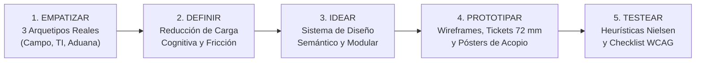

# Dictamen de Revisión UX/UI, Design Thinking y Brief de Entrega (*Handoff*) para Diseño Editorial y Multimedia
## Proyecto GIZ · Fortalecimiento y Escalamiento de INATrace (ELKE / Sinergia SVNA – Iniciativa SASI)

---

## 📋 1. Dictamen de Aprobación Técnica y de Experiencia de Usuario (*Sign-Off*)

| Atributo de Auditoría | Detalle |
|---|---|
| **Estado del Entregable** | ✅ **APTO PARA DIAGRAMACIÓN EDITORIAL Y PRODUCCIÓN MULTIMEDIA** (Contenido técnico validado empíricamente en VM limpia GCP; véase [`informe-prueba-gcp-vm-limpia-2026-11-16.md`](../informe-prueba-gcp-vm-limpia-2026-11-16.md)) |
| **Metodología de Evaluación** | **Design Thinking** (Empatizar, Definir, Idear, Prototipar, Testear) + **10 Heurísticas de Usabilidad de Jakob Nielsen** + **Estándares de Accesibilidad WCAG 2.1 AA/AAA** + **Lineamientos de Comunicación Inclusiva GIZ**. |
| **Alcance Auditado** | • 5 Manuales Técnicos Estandarizados (`docs/manuales/01` al `05`) + Portal Maestro (`README.md`)<br>• 5 Guiones y Storyboards Audiovisuales (`docs/audiovisual/01` al `05`) |
| **Calificación UX/Pedagógica** | **Alta** en estructura modular, arquetipos de usuario, prevención de errores y carga cognitiva dosificada. |
| **Trazabilidad de Validación** | **Verificado en servidor limpio (GCP `main`) y auditorías EGM Stage 9.** Todos los bloqueantes detectados en despliegue limpio (orden OS/Docker vs. build, `envsubst` de frontend, cliente PKCE, `INATRACE_KEYCLOAK_ADMIN_CLIENT_SECRET`, rol `manage-users`, plantilla visual Keycloak `inatrace` con flujo `inatrace-browser-flow`, redirección canónica `redirect_uri` en Nginx, puerto Nginx/*rate-limit*, salud Keycloak `:9000`, secuencias `IDENTITY`, semilla `'QUINTALES'`, traducciones ES/EN y sanitización B2C) quedaron resueltos y alineados entre manuales, guiones y artefactos verificados. |

---

## 🧠 2. Aplicación de *Design Thinking* al Material Técnico y Audiovisual

Para que el diseñador gráfico y el productor audiovisual transformen estos documentos en piezas memorables y altamente usables, toda decisión visual debe responder a las **5 etapas del *Design Thinking***:



### Etapa 1: Empatizar — Los 3 Arquetipos de Usuario (*User Personas*) y su Contexto Físico

El diseñador **NO** diseña únicamente para lectura en oficina silenciosa; diseña para tres contextos humanos radicalmente distintos:

| Arquetipo (*Persona*) | Contexto Físico y Ambiental | Dolor Principal (*Pain Point*) | Solución de Diseño Editorial y Visual Requerida |
|---|---|---|---|
| **👩🏽‍🌾 Persona 1: Carmen**<br>*Administradora de Acopio y Operadora de Báscula*<br>(Manabí, Esmeraldas, Comayagua, San Francisco de Macorís) | Galpón de acopio con ruido de camiones, calor/humedad costal, reflejo solar intenso en el monitor y fila de agricultores esperando su ticket térmico. | No dispone de tiempo para leer párrafos largos. Teme equivocarse en el peso, bloquear el cupo del socio o desconocer el significado de una alerta amarilla/roja. | • **Infografías de Pared (Póster A3 laminado)** junto a la báscula.<br>• **Alto contraste (WCAG AA/AAA en texto)** y tipografía $\ge 12\text{pt}$.<br>• **Semáforo visual de cupos** (Verde / Ámbar 80% / Rojo 100%).<br>• Ilustración a escala 1:1 del **Ticket Térmico de 72 mm** señalando cada campo. |
| **🧑🏾‍💻 Persona 2: Mateo / Sofía**<br>*Especialista de Sistemas / DevOps Cooperativo o Regional* | Trabaja con dos ventanas abiertas (el manual en PDF/Web a la izquierda y la consola Linux SSH a la derecha). | Confundir variables de ejemplo con comandos literales; olvidar qué puerto o permiso corresponde a cada contenedor; perder horas buscando un error `401` o `CrashLoop`. | • **Bloques de código en fuente monoespaciada (`JetBrains Mono`) sin ligaduras** con resaltado cromático para `<variables_editables>`.<br>• **Cajas de verificación («¿Cómo sé que funcionó?»)** después de cada comando crítico.<br>• **Árbol de decisión visual** en una sola página para resolver incidentes en $< 60\text{ s}$. |
| **👩🏻‍💼 Persona 3: Elena**<br>*Gerente de Exportación / Oficial de Cumplimiento EUDR* | Reuniones ejecutivas con compradores europeos, certificadoras (Fairtrade/Orgánico) e inspectores de Agrocalidad o aduanas. | Necesita demostrar trazabilidad desde el polígono GPS de la finca hasta el lote exportado sin leer código Java ni sentencias SQL. | • **Diagramas de flujo limpios e isométricos** del Grafo DAG ($\text{Parcela} \rightarrow \text{Acopio} \rightarrow \text{Beneficio} \rightarrow \text{TRACES-NT}$).<br>• Comparativa visual clara: **Predio $\le 4\text{ ha}$ (Centroide)** vs. **Predio $> 4\text{ ha}$ (Polígono cerrado)**. |

---

### Etapa 2: Definir — Principios de Psicología Cognitiva y Leyes de UX Aplicadas

El equipo de diseño gráfico y edición de video debe aplicar estrictamente estas **5 Leyes de UX**:

1. **Ley de Carga Cognitiva y *Chunking* (Ley de Miller $7 \pm 2$):**
   - Ningún procedimiento operativo debe presentarse como un bloque denso de texto. Los pasos deben agruparse en bloques visuales de **máximo 5 a 7 pasos numerados**, con iconos de acción claros.
2. **Revelación Progresiva (*Progressive Disclosure*):**
   - Separar visualmente el **"Camino Rápido Operativo"** (columna central al 70% de ancho) de las **"Notas de Arquitectura / Profundización Técnica"** (barra lateral o cajas secundarias al 30% de ancho).
3. **Ley de Proximidad y Región Común (*Gestalt*):**
   - Todo bloque de código o captura de pantalla debe mantenerse unido visualmente a su **Resultado Esperado (*Output*)** mediante un contenedor con borde sutil, evitando que un salto de página en el PDF corte el comando de su verificación.
4. **Heurística de Prevención de Errores (*Poka-Yoke* Visual):**
   - Las prohibiciones críticas de negocio (ej. *"NUNCA ingresar kilogramos en `productionEstimate`; siempre son Quintales `qq`"* o *"NUNCA publicar puertos de base de datos en `0.0.0.0`"*) deben llevar un **sello gráfico de prohibición (`🚫 PROHIBIDO`)** antes de la acción.
5. **Reconocimiento antes que Recuerdo:**
   - Utilizar una **barra superior de metadatos (Píldoras de Contexto)** al inicio de cada manual indicando: `⏱️ Tiempo estimado`, `👤 Rol destinatario`, `🛠️ Nivel técnico`, `📦 Prerrequisitos` y `🎬 Video vinculado`.

---

## 🎨 3. Sistema de Diseño Visual (*Design System Tokens* para el Diseñador)

### 3.1 Paleta Cromática Institucional, Agrícola y Semántica

Se define una paleta verificada bajo **WCAG 2.1 Nivel AA (mínimo $4.5:1$ en texto normal) / AAA en texto oscuro y titulares** (apta para impresión CMYK y pantallas RGB bajo luz intensa):

| Token / Uso | Nombre del Color | HEX | RGB | CMYK (Impresión) | Contraste y Aplicación en Manuales y Videos |
|---|---|---|---|---|---|
| **Brand Primary** | Azul Profundo INATrace | `#0F3D5E` | `15, 61, 94` | `84, 35, 0, 63` | `11.3:1` (AAA) sobre blanco. Portadas, titulares H1/H2, cabeceras y *lower thirds*. |
| **Coop Accent** | Rojo Institucional GIZ | `#C30000` | `195, 0, 0` | `0, 100, 100, 24` | `6.3:1` (AA / AAA en titulares). Filetes superiores, sellos de cumplimiento. *(Confirmar código Pantone/HEX exacto contra el manual vigente de Corporate Design de GIZ antes de imprenta).* |
| **Chain: Cacao/Café** | Tierra Cacao / Grano | `#5C3A21` | `92, 58, 33` | `0, 37, 64, 64` | Iconografía y etiquetas de Cacao en Baba, Cacao Seco y Café. |
| **Chain: EUDR/Bosque** | Verde Dosel EUDR | `#1B5E20` | `27, 94, 32` | `71, 0, 66, 63` | `7.9:1` (AAA). Polígonos satelitales WGS84, libre de deforestación y sellos TRACES-NT. |
| **Chain: Camarón** | Turquesa Pacífico | `#006978` | `0, 105, 120` | `100, 13, 0, 53` | Iconografía y flujos de la cadena acuícola / Camarón (OKF). |
| **Status: OK / Healthy** | Verde Operativo | `#2E7D32` | `46, 125, 50` | `63, 0, 60, 51` | `5.2:1` (AA) sobre blanco / `#E8F5E9`. Estados `Up (healthy)`, cupo normal ($<80\%$). |
| **Status: Warning Text** | Ámbar Oscuro Texto | `#9A3412` | `154, 52, 18` | `0, 66, 88, 40` | `7.2:1` (AAA) sobre blanco y `6.8:1` sobre `#FFF8E1`. **Usar este tono para texto de alertas `[!WARNING]` y cupo $\ge 80\%$** (`#E65100` se reserva únicamente para iconos o bordes gráficos gruesos $\ge 3\text{ px}$). |
| **Status: Danger 100%** | Rojo Bloqueo Crítico | `#B71C1C` | `183, 28, 28` | `0, 85, 85, 28` | `6.4:1` sobre blanco / `#FFEBEE`. Cupo excedido ($100\%$), `[!CAUTION]` y errores `401/403`. |
| **Code Background** | Gris Pizarra Terminal | `#1E293B` | `30, 41, 59` | `49, 31, 0, 77` | Bloques de terminal Linux con texto blanco `#F8FAFC` y variables en `#38BDF8`. |

> [!NOTE]
> **Paleta del Tema Oficial Keycloak (`inatrace`, login OIDC):** Para las láminas y capturas de acceso SSO se mantienen los colores del tema [`verificado/keycloak-theme/inatrace/`](./verificado/keycloak-theme/inatrace/login/resources/css/styles.css): **Verde Oliva Título** `#929A39` (`.login-title`), **Dorado Oliva Botón / Acento** `#A49F3E` (`.btn-register`, `.login-right-side-text`) y **Azul Profundo Fondo** `#0B376B` (`body background-color` sobre `landing-background.jpg`).

### 3.2 Sistema Tipográfico y Jerarquía Editorial

```text
┌──────────────────────────────────────────────────────────────────────────────┐
│                        JERARQUÍA TIPOGRÁFICA SUGERIDA                        │
├────────────────────┬─────────────────────────┬───────────────┬───────────────┤
│ Nivel Textual      │ Familia Tipográfica     │ Peso / Estilo │ Tamaño (PDF)  │
├────────────────────┼─────────────────────────┼───────────────┼───────────────┤
│ H1 · Título Módulo │ Montserrat / Inter      │ ExtraBold 800 │ 24 pt / 30 pt │
│ H2 · Sección Mayor │ Montserrat / Inter      │ Bold 700      │ 18 pt / 22 pt │
│ H3 · Subsección    │ Inter / Plus Jakarta    │ SemiBold 600  │ 14 pt / 18 pt │
│ Cuerpo Principal   │ Source Sans 3 / Inter   │ Regular 400   │ 10.5 pt / 15pt│
│ Código / Terminal  │ JetBrains Mono / Fira   │ Medium 500    │ 9.5 pt / 13pt │
│ Notas / Pies       │ Source Sans 3           │ Italic 400    │ 8.5 pt / 11pt │
└────────────────────┴─────────────────────────┴───────────────┴───────────────┘
```

> [!IMPORTANT]
> **Regla Tipográfica para Bloques de Código (`JetBrains Mono`):**
> El diseñador debe **desactivar las ligaduras tipográficas** (`font-variant-ligatures: none`)
> en los bloques de comandos Linux y SQL para evitar que el doble guion `--locale` se
> convierta visualmente en una raya larga `—locale`, lo cual provoca errores de sintaxis si
> el técnico copia y pega desde el PDF.

---

## 📐 4. Retícula Editorial (*Grid Layout*) y Anatomía de Página

Cada manual debe diagramarse en formato **A4 Vertical ($210 \times 297\text{ mm}$)** con una retícula de **12 columnas**:

```text
+-----------------------------------------------------------------------+
| [Banda Institucional GIZ / SASI / INATrace]              [Módulo 0X]  |
+-----------------------------------------------------------------------+
|  ⏱️ Tiempo: 25 min  |  👤 Rol: DevOps / Admin  |  🛡️ Nivel: Producción | <-- Barra UX
+-----------------------------------------------------------------------+
|                     |                                                 |
|  COLUMNA LATERAL    |   COLUMNA PRINCIPAL DE CONTENIDO (8 Columnas)   |
|  (4 Columnas)       |                                                 |
|                     |   1. Explicación concisa del paso.              |
|  💡 Glosario rápido |   2. Diagrama / Ilustración isométrica.         |
|  ⚠️ Alertas clave   |   3. Bloque de código o interfaz anotada.       |
|  📌 Regla de oro    |                                                 |
|  🔗 QR al video     |   +-----------------------------------------+   |
|     explicativo     |   | ✅ VERIFICACIÓN: ¿Qué debo ver ahora?   |   |
|     del módulo      |   +-----------------------------------------+   |
|                     |                                                 |
+-----------------------------------------------------------------------+
| Página X de Y        Licencia MPL-2.0 · Proyecto GIZ ELKE             |
+-----------------------------------------------------------------------+
```

> [!TIP]
> **Puente Híbrido Papel $\leftrightarrow$ Video (Códigos QR Editoriales):**
> En la columna lateral de cada manual impreso o PDF, el diseñador debe incluir un
> **pequeño código QR con el icono `🎬 Ver en Video (Minuto XX:XX)`** que enlace
> directamente a la Cápsula Audiovisual correspondiente.

---

## 🖼️ 5. Catálogo de Ilustraciones e Infografías que el Diseñador Debe Producir

Para que los manuales sean verdaderamente **didácticos e ilustrados**, el diseñador gráfico debe convertir los diagramas Mermaid y wireframes incluidos en los documentos en **13 láminas vectoriales estandarizadas**:

| ID Lámina | Manual Destino | Concepto Visual a Ilustrar por el Diseñador | Estilo Gráfico Requerido |
|---|---|---|---|
| **IL-01** | Portada General / README | **Mapa de Ruta por Rol Operativo:** Caminos diferenciados por color para DevOps, Admin de Cooperativa, Operador de Báscula, Auditor EUDR, Diseño y Soporte. | Infografía tipo mapa de metro con avatares diversos e inclusivos. |
| **IL-02** | Módulo 01 (Instalación) | **Arquitectura de Contenedores y Escudo de Red:** Servidor Host con Nginx al frente (`443`) y red interna aislada (`inatrace-net`) con Postgres, Keycloak (`9000` salud / `8080` tráfico), Backend y Frontend. | Diagrama isométrico 3D limpio con candados verdes en puertos seguros `127.0.0.1`. |
| **IL-03** | Módulo 02 (Configuración) | **Las 4 Cadenas de Valor en INATrace:** Cacao en Baba, Cacao Seco, Café Especial y nota de alcance separado para Camarón (`ms-shrimp` / OKF bajo ADR-016). | Ilustración plana vectorial con texturas orgánicas y paleta por cadena. |
| **IL-04** | Módulo 02 (Configuración) | **Tabla Visual de Equivalencias Físicas:** Balanza ilustrando que $1\text{ Quintal (qq)} = 100\text{ Libras}$, $1\text{ kg} = 2.20462\text{ lb}$ y $1\text{ Saco} = 69\text{ kg}$. | Infografía didáctica de alta recordación tipo ficha técnica. |
| **IL-05** | Módulo 02 (Configuración) | **Anatomía del Código Territorial DPA (6 dígitos):** Desglose visual `[09] Provincia` + `[01] Cantón` + `[50] Parroquia` resaltando el cero inicial obligatorio. | Diagrama de casillas tipográficas con sello `🚫 Prohibido convertir a número`. |
| **IL-06** | Módulo 03 (Operación) | **Semáforo del Control de Cupos en Báscula:** Tres estados visuales de la barra de progreso: Verde ($0\text{–}79\%$), Ámbar Preventivo ($80\text{–}99\%$) y Rojo Bloqueado ($100\%$). | Mockup de interfaz UI anotado con llamadas de acción para el pesador. |
| **IL-07** | Módulo 03 (Operación) | **Anatomía del Ticket Térmico POS de 72 mm:** Ilustración a escala real del rollo impreso señalando membrete, pesos, cupo restante, QR de ~3.2 cm (en rollo de 72 mm de ancho) y exclusión del campo prohibido. | Ilustración realista de ticket térmico con lupas explicativas. |
| **IL-08** | Módulo 03 (Operación) | **Flujo de Balance de Masas y Mermas Multiplicativas del Cacao:** Embudo secuencial desde recepción en baba (`1,000 lb = 100%`) pasando por escurrido (`-15%`), volteo (`-10%`), secado (`~-48%`) y limpieza (`-5%`) hasta rendimiento neto `33%–38%`, sacos de `69 kg` y remanente `< 69 kg`. | Infografía de proceso paso a paso con ejemplo numérico verificado. |
| **IL-09** | Módulo 03 (Operación) | **Regla Geométrica EUDR (4 Hectáreas):** Comparativa lado a lado sobre fotografía satelital: Finca $\le 4\text{ ha}$ (1 punto centroide) vs. Finca $> 4\text{ ha}$ (polígono cerrado de vértices). | Cartografía pedagógica estilo guía de campo europea. |
| **IL-10** | Módulo 04 (Seguridad) | **Doble Capa de Privacidad (B2C Comprobante vs. B2B EUDR):** Smartphone escaneando un QR mostrando vista pública B2C (nombre completo visible; cédula, teléfono, correo, precios comerciales y coordenadas GPS **omitidos** del payload tras el parche de privacidad) vs. vista aduanera B2B autenticada con polígono WGS84 y clave SRI. | Comparativa visual dividida (Consumidor vs. Inspector de Aduana). |
| **IL-11** | Módulo 04 (Seguridad) | **El Puente de Autenticación ERP M2M:** Cómo viaja el token JWT desde Keycloak hacia la tabla `"User"` (`email`) y `companyuser` (`COMPANY_ADMIN`) para evitar el error `401 Unauthorized`. | Diagrama de llaves y compuertas lógicas. |
| **IL-12** | Módulo 05 (Mantenimiento) | **Árbol de Decisión de Diagnóstico Rápido (60 Segundos):** Flujograma de síntomas («¿No carga la web?», «¿Rechaza el pesaje?», «¿El QR devuelve 500?») hacia la solución exacta. | Póster de soporte rápido con rutas coloreadas Sí/No. |
| **IL-13** | Módulos 01 y 04 (Identidad OIDC) | **Pantalla Institucional de Login OIDC y Redirección Canónica:** Flujo desde acceso por IP o dominio secundario (`301` hacia `$server_name`), carga de `inatrace-browser-flow` con plantilla `loginTheme: inatrace` (`#929A39` / `#A49F3E` / `#0B376B`) y retorno `/es/` sin error `redirect_uri`. | Diagrama de secuencia limpio con captura de referencia de inicio de sesión. |

---

## 🎬 6. Lineamientos de UX y Dirección de Arte para los Videos (`docs/audiovisual/`)

Para garantizar que las **5 Cápsulas Audiovisuales** mantengan la atención del espectador y maximicen la retención pedagógica:

1. **Regla de Cambio de Estímulo Visual cada 15–20 segundos:**
   - Nunca dejar una captura estática de terminal o formulario por más de 20 segundos sin aplicar un **zoom suave (*Ken Burns* / *Magnifier* al 180%)**, un **resaltador luminoso (*Spotlight*)** sobre la línea de código activa o una tarjeta gráfica lateral (*Callout*).
2. **Diseño de Pantalla en *Screencasts* de Consola (Cápsula 03):**
   - Utilizar fondo oscuro de alto contraste (`#1E293B`), tamaño de fuente en terminal mínimo de **18 px a 22 px** durante la grabación para que sea legible incluso si el técnico reproduce el video desde un teléfono móvil en una cooperativa rural.
3. **Subtitulado Universal Quemado y Opcional (SRT/VTT):**
   - Caja de subtítulos en la franja inferior central (respetando el *Title Safe Area* del 10%), tipografía sin serifa blanca sobre pastilla negra al 75% de opacidad.
4. **Representación Humana e Inclusiva (Cláusula GIZ):**
   - En las cortinillas de introducción, transiciones e iconos de actores, representar equitativamente a **mujeres lideresas cooperativistas, técnicas de control de calidad, jóvenes agricultores y productores montuvios/afrodescendientes**, evitando estereotipos y reflejando la realidad viva del agro latinoamericano.

---

## 📦 7. Piezas Adicionales de Alto Impacto Recomendadas al Diseñador

Además de los 5 manuales en formato libro A4 y los 5 videos Full HD, el análisis de **Design Thinking** recomienda entregar dos piezas operativas de consulta instantánea (cuyos contenidos ya han sido integrados en los manuales):

1. **Lámina Plastificada A3 para Centro de Acopio ("Guía Rápida de Báscula en 1 Minuto"):**
   - Diseñada para colgarse en la pared junto a la báscula electrónica y la impresora térmica de 72 mm (Módulo 03 §7).
2. **Ficha de Bolsillo DevOps ("Tarjeta de Emergencia y Comandos Críticos"):**
   - Hoja A4 doble cara descargable con los comandos de respaldo, restauración y solución de los **12 incidentes de producción** (Módulo 05 §5).
