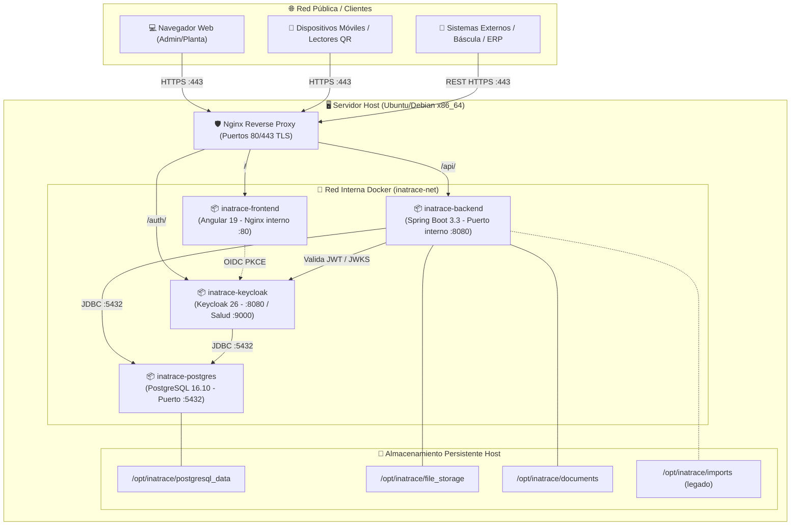
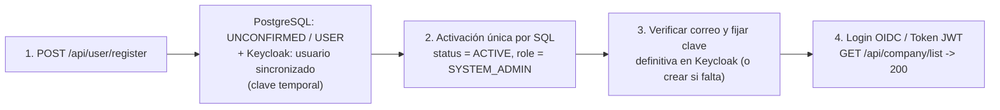

# Manual Técnico de Instalación y Despliegue de Infraestructura
## Módulo 01 · Suite Estandarizada de Manuales INATrace (Alcance Regional y Global)
### Proyecto GIZ · Fortalecimiento y Escalamiento de INATrace (ELKE / Sinergia SVNA – Iniciativa SASI)

---

```text
┌──────────────────────────────────────────────────────────────────────────────┐
│ 🧭 FICHA DE EXPERIENCIA DE USUARIO (UX CARD · NAVEGACIÓN RÁPIDA)             │
├──────────────────────┬───────────────────────────────────────────────────────┤
│ ⏱️ Tiempo Ejecución  │ 45 – 60 minutos (instalación completa desde código)   │
│ 👤 Arquetipo (Rol)   │ Persona 2: Especialista TI / DevOps / SysAdmin        │
│ 🛠️ Nivel Técnico     │ Intermedio – Avanzado (Linux, SSH, Docker, Nginx)     │
│ 📦 Prerrequisitos    │ Servidor Ubuntu 22.04/24.04 o Debian 12 x86_64 (mín. 8 GB RAM) │
│                      │ + Dominio DNS (público para Let's Encrypt, o DNS interno en LAN) │
│ 🎬 Video Vinculado   │ Cápsulas 02 (Costos/Sizing) y 03 (Despliegue Docker)  │
└──────────────────────┴───────────────────────────────────────────────────────┘
```

> [!TIP]
> **🎨 [BRIEF PARA EL DISEÑADOR EDITORIAL — LÁMINA IL-02]:**
> Diagramar el esquema inferior como una **ilustración isométrica vectorial de 2 niveles**: en el nivel externo mostrar el *Escudo Perimetral (Nginx + Firewall UFW, puertos 80/443)* con un candado verde TLS; en el nivel interno mostrar la *Caja Fuerte Docker (`inatrace-net`)* donde residen los 4 contenedores conectados a los cilindros de almacenamiento persistente `/opt/inatrace`. Usar color Azul Profundo (`#0F3D5E`) para la red privada y Verde Operativo (`#2E7D32`) para las rutas autorizadas.

---

## 1. Introducción, Arquitectura y Alcance por Cadena (ADR-016)

El propósito de este manual es estandarizar el aprovisionamiento, compilación, despliegue e inicialización de la infraestructura tecnológica de **INATrace** para una organización nueva. La solución se compone de cuatro contenedores principales orquestados en red aislada detrás de un proxy inverso Nginx:

- **Motor de Base de Datos:** PostgreSQL 16 (`postgres:16.10`, distribución Debian GNU/Linux con soporte glibc y collation `en_US.utf8`).
- **Servidor de Identidad y Accesos (IAM):** Keycloak 26 (`quay.io/keycloak/keycloak:26.0.0`, distribución Quarkus con soporte OIDC/OAuth2 + PKCE).
- **Capa de Lógica de Negocio (Backend):** Spring Boot 3.3 con Java 17 LTS (`eclipse-temurin:17-jre`) y motor de migraciones Flyway.
- **Capa de Presentación Web (Frontend):** Angular 19 estructurado bajo monorepo Nx 22, compilado en modo producción y servido por Nginx interno (`nginx:stable-alpine`).
- **Puerta de Enlace Inversa (Reverse Proxy) y Seguridad de Red:** Nginx en el sistema anfitrión con terminación TLS automatizada (Let's Encrypt / Certbot) y limitación de tasa (*rate-limiting*).

> [!IMPORTANT]
> **Alcance de este manual: cadenas agrícolas (cacao y café).** La topología de cuatro
> contenedores cubre el núcleo monolítico. La **cadena acuícola (camarón)** no corre sobre
> este núcleo: bajo **ADR-016 (Desacoplamiento Estricto por Cadena)** requiere dos
> artefactos adicionales que **no se despliegan aquí**:
>
> | Componente | Qué es | Estado en el repositorio público |
> |---|---|---|
> | `ms-shrimp` | Microservicio Spring Boot independiente, con su propio `Dockerfile`, `pom.xml` y `docker-compose.yml` | Repositorio aparte; **no incluido** en `Atijaguar-ec/backend` |
> | `shrimpMfe` | Microfrontend de la cadena acuícola | **Ausente** de `fe/apps/` en `Atijaguar-ec/fe` (sólo `inatrace-fe`) |
>
> En despliegues de cacao y café, ADR-016 exige que `shrimpMfe` permanezca deshabilitado
> **en tres capas: no compilado, no servido por Nginx y no alcanzable en Angular**, que es
> la configuración por defecto de este manual. Si su organización opera camarón, planifique
> la integración acuícola como un proyecto separado con su propia especificación OKF.



---

## 2. Requisitos de Infraestructura y Dimensionamiento (Ejecución vs. Compilación)

INATrace opera tanto en servidores virtuales en la nube (VPS / Cloud) como en **servidores locales (*on-premise*)** instalados en centros de acopio o plantas de beneficio.

> [!IMPORTANT]
> **El servidor tolera no tener salida a Internet; el puesto de báscula no tolera perder el
> servidor.** Instalarlo *on-premise* elimina la dependencia de una conexión externa en zonas
> rurales, pero la aplicación **no funciona fuera de línea**: cada pesaje ejecuta llamadas
> sincrónicas (`GET /api/chain/stock-order/quota-balance` y `PUT /api/chain/stock-order`)
> y exige un token vigente de Keycloak. Si el puesto de báscula pierde el enlace de red
> hacia el servidor, **no se puede registrar ni imprimir**. Asegure la red local y aplique
> el protocolo de contingencia del **Módulo 03 §2.4** ante cortes. *(Nota: si el servidor
> local no tiene DNS público ni puerto 80 abierto desde Internet, utilice la opción de TLS
> interno/autofirmado documentada en §7.2 en lugar de Let's Encrypt HTTP-01).*

### 2.1 Arquitectura de Procesador y Matriz de Dimensionamiento en Ejecución

> [!WARNING]
> **Arquitectura obligatoria `x86_64` (`amd64`).** Las dependencias e imágenes publicadas
> del ecosistema INATrace están orientadas a **`linux/amd64`**. En servidores ARM64 (como
> instancias de gama económica basadas en Ampere/Graviton sin compilación nativa ajustada)
> las imágenes `amd64` requieren emulación con severa penalización de rendimiento. Aprovisione
> siempre instancias **`x86_64` (`amd64`)**.

| Perfil de Despliegue | Volumen Operativo Diario | CPU Mínima | Memoria RAM | Disco SSD/NVMe | Rango Referencial Cloud (2026) |
|---|---|---|---|---|---|
| **Piloto / Cooperativa Pequeña** | 1 a 20 entregas/día (~50 socios) | 2 vCPU (`x86_64`) | 8 GB | 60 GB | USD 15 – 45 / mes (según proveedor VPS/Cloud) |
| **Producción Estándar (Recomendado)** | 20 a 300 entregas/día (200–1,500 socios) | 4 vCPU (`x86_64`) | 16 GB | 120 GB | USD 30 – 95 / mes (según proveedor VPS/Cloud) |
| **Centro Regional Multi-Instancia** | +300 entregas/día (varias empresas filiales) | 8 vCPU (`x86_64`) | 32 GB | 250 GB NVMe | USD 70 – 190 / mes (según proveedor VPS/Cloud) |

> [!NOTE]
> **Consumo real en reposo y bajo carga:** PostgreSQL 16 y Keycloak 26 consumen cerca de
> 2.5 GB de RAM en reposo. Spring Boot requiere entre 1.5 GB y 3 GB adicionales durante
> picos de acopio, generación de reportes y trazabilidad EUDR. El umbral mínimo operativo
> en producción es de **8 GB de RAM**; para compilar el frontend en el mismo servidor se
> aplican los requisitos adicionales de la §2.2.
> *(Nota sobre proveedores: antes de contratar cualquier plan en Hetzner, AWS, DigitalOcean
> u otro proveedor, verifique en la ficha vigente la arquitectura `x86_64` y que la RAM
> real asignada coincida con su perfil, ya que los catálogos comerciales cambian periódicamente).*

### 2.2 Requisitos Separados de Compilación (Build)

> [!CAUTION]
> **Compilar el frontend consume mucha más memoria que ejecutar toda la plataforma.**
> `fe/Dockerfile` fija `NODE_OPTIONS=--max_old_space_size=4096`: la compilación de Angular 19
> con Nx reclama hasta **4 GB sólo de *heap* de Node.js**, además de los procesos del sistema
> y Docker. En servidores de 4 GB a 7.8 GB de RAM sin archivo de intercambio (*swap*), el
> kernel termina el proceso por falta de memoria (*OOM killer*).

| Fase | CPU | RAM Requerida | Disco Libre |
|---|---|---|---|
| **Compilación (puntual)** | 2–4 vCPU (`x86_64`) | **6 GB** libres recomendados (mín. 4 GB + **4 GB de *swap***) | ≥ 12 GB libres para capas Docker |
| **Ejecución (permanente)** | Según §2.1 | Según §2.1 | Según §2.1 |

---

## 3. Preparación del Sistema Operativo Host, Docker y Cortafuegos (UFW y Red Cloud)

Esta guía asume una instalación limpia sobre **Ubuntu Server 22.04 LTS / 24.04 LTS** o **Debian 12 Bookworm** en arquitectura **`x86_64` (`amd64`)**. *(En instalaciones mínimas de Debian 12 sin `sudo`, ejecute primero `apt update && apt install -y sudo` como `root` y añada su usuario al grupo `sudo`).*

### 3.1 Actualización de Paquetes Base

```bash
sudo apt update && sudo apt upgrade -y
sudo apt install -y curl wget git jq ufw htop ca-certificates gnupg lsb-release openssl python3 unattended-upgrades
```

*(En Debian 12, ejecute `sudo dpkg-reconfigure -plow unattended-upgrades` si desea habilitar la instalación automática de parches de seguridad).*

### 3.2 Instalación de Docker Engine y Docker Compose V2

Utilice el repositorio oficial de Docker para obtener Compose V2 (`docker compose`). El bloque siguiente detecta automáticamente si la distribución es `ubuntu` o `debian` desde `/etc/os-release`:

```bash
OS_ID=$(. /etc/os-release && echo "$ID")
OS_CODENAME=$(. /etc/os-release && echo "$VERSION_CODENAME")

sudo install -m 0755 -d /etc/apt/keyrings
curl -fsSL "https://download.docker.com/linux/${OS_ID}/gpg" | sudo gpg --dearmor -o /etc/apt/keyrings/docker.gpg
sudo chmod a+r /etc/apt/keyrings/docker.gpg

echo \
  "deb [arch=$(dpkg --print-architecture) signed-by=/etc/apt/keyrings/docker.gpg] https://download.docker.com/linux/${OS_ID} \
  ${OS_CODENAME} stable" | \
  sudo tee /etc/apt/sources.list.d/docker.list > /dev/null

sudo apt update
sudo apt install -y docker-ce docker-ce-cli containerd.io docker-buildx-plugin docker-compose-plugin
sudo systemctl enable --now docker

# Agregar su usuario al grupo docker
sudo usermod -aG docker "$USER"
```

> [!IMPORTANT]
> **Activación obligatoria del grupo `docker` antes de continuar:** La pertenencia al grupo
> `docker` sólo entra en efecto al abrir una sesión nueva. Cierre su conexión SSH y vuelva
> a ingresar (o ejecute `exec su -l "$USER"` en la misma terminal), y luego compruebe que
> funciona **sin `sudo`**:
> ```bash
> id -nG | grep -qw docker && docker compose version
> ```
> No ejecute `newgrp docker` dentro de un bloque pegado por consola: abre una subshell
> interactiva e interrumpe los comandos posteriores.

### 3.3 Configuración del Cortafuegos (UFW y Red Cloud) y Aislamiento de Puertos

> [!IMPORTANT]
> **Regla crítica en servidores cloud (GCP, AWS, Azure, OCI):** Abrir los puertos `80` y `443`
> únicamente en el cortafuegos del sistema operativo (`ufw`) **no es suficiente** si la red VPC
> o el grupo de seguridad del proveedor bloquea ese tráfico en el perímetro del hipervisor.
> Antes de ejecutar `certbot --standalone` (§7.2), verifique que las **Reglas de Firewall VPC /
> Security Groups** permitan tráfico entrante `TCP 80` y `TCP 443` desde `0.0.0.0/0` hacia la VM.

> [!IMPORTANT]
> **Advertencia sobre Docker y UFW:** Docker inserta reglas directamente en la cadena
> `DOCKER` de `iptables` antes que UFW. Si un contenedor declara `ports: ["5432:5432"]`,
> quedará expuesto públicamente en `0.0.0.0` aunque UFW bloquee ese puerto. Por ello,
> **todos los puertos de este manual se publican exclusivamente en `127.0.0.1`**. El único
> acceso externo permitido será Nginx en los puertos `80` y `443`.

```bash
sudo ufw default deny incoming
sudo ufw default allow outgoing

sudo ufw allow 22/tcp  comment 'SSH Seguro'
sudo ufw allow 80/tcp  comment 'HTTP ACME Let_s Encrypt'
sudo ufw allow 443/tcp comment 'HTTPS INATrace Web'

sudo ufw --force enable
sudo ufw status numbered
```

> [!NOTE]
> **Si despliega en un servidor compartido** que ya albergaba otros servicios, `ufw default deny incoming`
> no borra las reglas `ALLOW` preexistentes. Inspeccione `sudo ufw status numbered` y retire
> puertos heredados innecesarios (en especial motores de bases de datos abiertos a `Anywhere`).

---

## 4. Obtención del Código Fuente (`main`) y Construcción de Imágenes Propias (MPL-2.0)

> [!IMPORTANT]
> **Una adopción autónoma construye sus propias imágenes desde su propio *fork* sobre la rama
> estable `main`.** No apunte en producción a registros de terceros ni a etiquetas mutables
> (`latest`): no hay garantía de permanencia ni de que correspondan al código auditado por su
> organización.

### 4.1 *Fork* y Clonación de Repositorios (`main`)

Los repositorios oficiales de la implementación Ecuador son públicos bajo licencia **Mozilla Public License 2.0 (MPL-2.0)**, que permite la bifurcación (*fork*), modificación y uso productivo manteniendo publicadas bajo MPL-2.0 las modificaciones sobre archivos fuente cubiertos:

| Componente | Repositorio Oficial Ecuador | *Upstream* Global (AgStack) |
|---|---|---|
| **Backend** (Spring Boot 3.3 / Java 17) | `https://github.com/Atijaguar-ec/backend` (`main`) | *Fork* de `https://github.com/agstack/inatrace-backend` |
| **Frontend** (Angular 19 / Nx 22) | `https://github.com/Atijaguar-ec/fe` (`main`) | *Fork* de `https://github.com/agstack/inatrace-frontend` |

Realice el *fork* en GitHub hacia la cuenta de su organización y clone **su propio *fork* fijando explícitamente la rama `main`** *(si mantiene el fork privado, autentíquese antes mediante llave SSH de despliegue o Personal Access Token)*:

```bash
# Sustituya SU-ORGANIZACION por el nombre real de su cuenta u organización en GitHub
sudo mkdir -p /opt/src && sudo chown -R "$USER":"$USER" /opt/src
cd /opt/src

git clone -b main https://github.com/SU-ORGANIZACION/backend.git backend
git clone -b main https://github.com/SU-ORGANIZACION/fe.git fe

# Opcional: registrar el repositorio origen como upstream para futuras sincronizaciones
git -C /opt/src/backend remote add upstream https://github.com/Atijaguar-ec/backend.git
git -C /opt/src/fe      remote add upstream https://github.com/Atijaguar-ec/fe.git
```

> [!WARNING]
> **Fije siempre una rama (`main`) y un commit/etiqueta inmutable antes de construir.** En este
> repositorio conviven `main` y `staging` (al momento de esta edición ambas ramas convergen
> en `V1`–`V15`, pero históricamente han divergido cuando entran cambios en preproducción).
> Anote el commit exacto y cree su propia etiqueta de lanzamiento para garantizar builds
> reproducibles:
> ```bash
> git -C /opt/src/backend branch --show-current
> git -C /opt/src/backend rev-parse --short HEAD
> git -C /opt/src/backend tag v1.0.0-mi-cooperativa
> git -C /opt/src/fe      branch --show-current
> git -C /opt/src/fe      rev-parse --short HEAD
> git -C /opt/src/fe      tag v1.0.0-mi-cooperativa
>
> # Verifique cuántas migraciones SQL contiene la rama que va a compilar
> ls -1 /opt/src/backend/src/main/resources/db/migration/V*__*.sql | wc -l
> ```

### 4.2 Habilitación Preventiva de *Swap* y Construcción de Imágenes Docker

Si el equipo donde va a compilar dispone de menos de 8 GB de RAM (o para proteger cualquier servidor durante la fase de build), cree un archivo *swap* de 4 GB sólo si todavía no existe:

```bash
if [ -z "$(swapon --show)" ]; then
  sudo fallocate -l 4G /swapfile && sudo chmod 600 /swapfile
  sudo mkswap /swapfile && sudo swapon /swapfile
  echo '/swapfile none swap sw 0 0' | sudo tee -a /etc/fstab
fi
swapon --show
```

Construya ambas imágenes utilizando los `Dockerfile` del repositorio (Maven, JDK 17 y Node 22 se ejecutan dentro de los contenedores de compilación; no necesita instalar Java ni Node.js en el host):

```bash
# 1. Compilar imagen del Backend (~2–4 minutos; 98 s medidos en VM limpia de 4 vCPU)
cd /opt/src/backend
docker build -t mi-cooperativa/inatrace-backend:v1.0.0 .

# 2. Compilar imagen del Frontend (~5–7 minutos sin caché npm/Nx; 344 s medidos en 4 vCPU; requiere swap si RAM < 8 GB)
cd /opt/src/fe
docker build -t mi-cooperativa/inatrace-fe:v1.0.0 .

# Verificar que ambas imágenes quedaron registradas localmente
docker images | grep 'mi-cooperativa/'
```

> [!TIP]
> **Recomendación para producción:** Si su cooperativa cuenta con un entorno de CI/CD
> (GitHub Actions o Jenkins), compile allí y publique sus imágenes en su propio registro
> privado (`ghcr.io/SU-ORGANIZACION/...`) con etiquetas inmutables (`v1.0.0`), evitando
> consumir CPU y memoria en el servidor de producción mientras atiende pesajes en báscula.

---

## 5. Estructura de Directorios (`/opt/inatrace`) y Script `initdb`

Centralice la persistencia fuera de los contenedores para poder actualizar imágenes sin pérdida de datos:

```bash
sudo mkdir -p /opt/inatrace/{postgresql_data,file_storage,imports,documents,initdb,backups,scripts,keycloak-theme}
sudo chown -R "$USER":docker /opt/inatrace
sudo chmod -R 775 /opt/inatrace
```

### 5.1 Script de Creación Automática de Base de Datos Keycloak

La imagen oficial de PostgreSQL sólo inicializa la base de datos declarada en `POSTGRES_DB`. Sin una base separada para Keycloak, el contenedor de identidad falla en bucle al arrancar. Cree el siguiente script en `/opt/inatrace/initdb/01-create-keycloak-db.sh` (sólo se ejecuta cuando `/opt/inatrace/postgresql_data` está vacío en el primer arranque):

```bash
cat << 'EOF' > /opt/inatrace/initdb/01-create-keycloak-db.sh
#!/bin/bash
set -e

echo ">> Verificando / Creando base de datos de Keycloak: ${KC_DB_NAME:-inatrace_keycloak}"
psql -v ON_ERROR_STOP=1 --username "$POSTGRES_USER" --dbname "$POSTGRES_DB" <<-EOSQL
    SELECT 'CREATE DATABASE ${KC_DB_NAME:-inatrace_keycloak}'
    WHERE NOT EXISTS (SELECT FROM pg_database WHERE datname = '${KC_DB_NAME:-inatrace_keycloak}')\gexec
    GRANT ALL PRIVILEGES ON DATABASE ${KC_DB_NAME:-inatrace_keycloak} TO $POSTGRES_USER;
EOSQL
echo ">> Base de datos de Keycloak lista."
EOF

chmod +x /opt/inatrace/initdb/01-create-keycloak-db.sh
```

### 5.2 Instalación del Tema Visual Institucional de Keycloak (`inatrace`)

Sin un tema personalizado montado en `/opt/keycloak/themes/inatrace`, Keycloak muestra su pantalla gris predeterminada. El tema institucional oficial `inatrace` (`theme.properties`, `login.ftl`, `login-reset-password.ftl`, `login-update-password.ftl`, `styles.css`, logotipo y fondo de cacao) se distribuye en el repositorio público oficial `Atijaguar-ec/ina-docs` (`manuales/verificado/keycloak-theme/inatrace/`). Descárguelo al host y otorgue permisos de lectura global para que el usuario interno del contenedor (`UID 1000`) pueda servirlo:

```bash
# Descargar artefactos verificados desde el repositorio público oficial de documentación
git clone --depth 1 -b main https://github.com/Atijaguar-ec/ina-docs.git /opt/src/ina-docs

sudo mkdir -p /opt/inatrace/keycloak-theme/inatrace
sudo cp -R /opt/src/ina-docs/manuales/verificado/keycloak-theme/inatrace/* /opt/inatrace/keycloak-theme/inatrace/
sudo chmod -R a+rX /opt/inatrace/keycloak-theme
```

---

## 6. Configuración de Entorno (`.env`) y Orquestación (`docker-compose.yml`)

### 6.1 Generación del Archivo `.env` Seguro

> [!NOTE]
> Antes de fijar los puertos de bucle local (`8081`, `8082`, `8083`, `5433`), verifique que no
> estén ocupados por otro proceso en el host ejecutando:
> `ss -ltn | grep -E ':(5433|8081|8082|8083)' || echo "Puertos libres"`

Reemplace **`DOMAIN_NAME`** y **`KEYCLOAK_REALM`** con los valores reales de su organización al inicio del bloque antes de ejecutar (`INATRACE_FE_URL` se deriva automáticamente desde `DOMAIN_NAME`):

```bash
DOMAIN_NAME="trazabilidad.mi-cooperativa.org"
KEYCLOAK_REALM="cooperativa"

DB_PASS=$(openssl rand -hex 24)
KC_ADMIN_PASS=$(openssl rand -hex 24)
CLIENT_SECRET=$(openssl rand -hex 32)

cat << EOF > /opt/inatrace/.env
# ==============================================================================
# CONFIGURACIÓN OFICIAL DE PRODUCCIÓN INATRACE
# ==============================================================================

# Dominio público completamente calificado (FQDN)
DOMAIN_NAME=${DOMAIN_NAME}

# Base de Datos PostgreSQL 16
POSTGRES_DB=inatrace_core
POSTGRES_USER=inatrace
POSTGRES_PASSWORD=${DB_PASS}
KC_DB_NAME=inatrace_keycloak
PG_DATA_VOL=/opt/inatrace/postgresql_data

# Keycloak 26 IAM
KEYCLOAK_ADMIN=admin
KEYCLOAK_ADMIN_PASSWORD=${KC_ADMIN_PASS}
KEYCLOAK_REALM=${KEYCLOAK_REALM}
KEYCLOAK_CLIENT_ID=inatrace-backend
KEYCLOAK_CLIENT_SECRET=${CLIENT_SECRET}

# Perfil Spring Boot 3.3 y origen CORS autorizado (INATrace.fe.url en SpringSecurityConfig)
SPRING_PROFILES_ACTIVE=prod
INATRACE_FE_URL=https://${DOMAIN_NAME}

# Puertos publicados en bucle local (127.0.0.1) para Nginx y respaldo
PG_HOST_PORT=5433
FRONTEND_PORT=8081
KEYCLOAK_PORT=8082
BACKEND_PORT=8083
EOF

chmod 600 /opt/inatrace/.env
```

> [!IMPORTANT]
> **¿Por qué las variables del backend usan el prefijo `INATRACE_*`?** Spring Boot enlaza
> propiedades `INATrace.*` desde variables de entorno con ese prefijo exacto: `INATRACE_FE_URL`
> configura el origen CORS (`SpringSecurityConfig`), `INATRACE_FILESTORAGE_ROOT` persiste todos
> los archivos y planillas importadas (`StorageService`) y `INATRACE_DOCUMENTS_ROOT` guarda
> PDF/reportes generados (`DocumentGeneratorEngine`). Propiedades heredadas como
> `INATRACE_IMPORT_PATH` o `INATRACE_PRODUCT_TYPE` no tienen consumidores activos en el código
> Java vigente (`ProductType` se gestiona por base de datos), y el envío de correos SMTP viene
> desactivado por defecto (`INATrace.mail.sendingEnabled=false`) hasta configurar `SPRING_MAIL_*`
> y `INATRACE_MAIL_SENDINGENABLED=true`.

### 6.2 Archivo de Orquestación Canónico (`/opt/inatrace/docker-compose.yml`)

Cree `/opt/inatrace/docker-compose.yml` y valide su sintaxis con `docker compose config`:

```bash
cat << 'EOF' > /opt/inatrace/docker-compose.yml
# ==============================================================================
# docker-compose.yml — INATrace Producción (PostgreSQL 16 + Keycloak 26)
# ==============================================================================

networks:
  inatrace-net:
    driver: bridge

services:

  # --------------------------------------------------------------------------
  # 1. BASE DE DATOS: PostgreSQL 16.10 (Debian glibc)
  # --------------------------------------------------------------------------
  inatrace-postgres:
    image: postgres:16.10
    container_name: inatrace-postgres
    restart: always
    environment:
      POSTGRES_DB: ${POSTGRES_DB}
      POSTGRES_USER: ${POSTGRES_USER}
      POSTGRES_PASSWORD: ${POSTGRES_PASSWORD}
      POSTGRES_INITDB_ARGS: "--locale=en_US.utf8 --encoding=UTF8"
      KC_DB_NAME: ${KC_DB_NAME}
    volumes:
      - ${PG_DATA_VOL}:/var/lib/postgresql/data
      - ./initdb:/docker-entrypoint-initdb.d:ro
    # Publicado sólo en 127.0.0.1 para utilidades locales (pg_dump, psql, túnel SSH)
    ports:
      - "127.0.0.1:${PG_HOST_PORT}:5432"
    networks:
      - inatrace-net
    healthcheck:
      test: ["CMD-SHELL", "pg_isready -U ${POSTGRES_USER} -d ${POSTGRES_DB}"]
      interval: 10s
      timeout: 5s
      retries: 5
      start_period: 20s

  # --------------------------------------------------------------------------
  # 2. IDENTIDAD: Keycloak 26 (Quarkus + Hostname v2)
  # --------------------------------------------------------------------------
  inatrace-keycloak:
    image: quay.io/keycloak/keycloak:26.0.0
    container_name: inatrace-keycloak
    restart: unless-stopped
    command: start
    environment:
      KC_DB: postgres
      KC_DB_URL_HOST: inatrace-postgres
      KC_DB_URL_PORT: 5432
      KC_DB_URL_DATABASE: ${KC_DB_NAME}
      KC_DB_USERNAME: ${POSTGRES_USER}
      KC_DB_PASSWORD: ${POSTGRES_PASSWORD}
      # Obligatorio en Keycloak 17+: restituye el prefijo /auth para coincidir con el proxy
      KC_HTTP_RELATIVE_PATH: /auth
      # Hostname v2 en Keycloak 26: acepta la URL completa (KC_HOSTNAME_PATH fue retirada)
      KC_HOSTNAME: https://${DOMAIN_NAME}/auth
      KC_HOSTNAME_STRICT: "false"
      KC_HOSTNAME_BACKCHANNEL_DYNAMIC: "true"
      KC_PROXY_HEADERS: xforwarded
      KC_HTTP_ENABLED: "true"
      KC_HEALTH_ENABLED: "true"
      KC_BOOTSTRAP_ADMIN_USERNAME: ${KEYCLOAK_ADMIN}
      KC_BOOTSTRAP_ADMIN_PASSWORD: ${KEYCLOAK_ADMIN_PASSWORD}
    volumes:
      - /opt/inatrace/keycloak-theme/inatrace:/opt/keycloak/themes/inatrace:ro
    depends_on:
      inatrace-postgres:
        condition: service_healthy
    ports:
      - "127.0.0.1:${KEYCLOAK_PORT}:8080"
    networks:
      - inatrace-net
    healthcheck:
      # La salud vive en el puerto de gestión 9000 y hereda /auth (verificado en keycloak:26.0.0)
      test: ["CMD-SHELL", "exec 3<>/dev/tcp/127.0.0.1/9000 && printf 'GET /auth/health/live HTTP/1.1\\r\\nHost: localhost\\r\\nConnection: close\\r\\n\\r\\n' >&3 && grep -q '200 OK' <&3"]
      interval: 10s
      timeout: 5s
      retries: 24
      start_period: 30s

  # --------------------------------------------------------------------------
  # 3. BACKEND: Spring Boot 3.3 / Java 17 (Imagen propia del §4.2)
  # --------------------------------------------------------------------------
  inatrace-backend:
    image: mi-cooperativa/inatrace-backend:v1.0.0
    container_name: inatrace-backend
    restart: always
    environment:
      SPRING_PROFILES_ACTIVE: ${SPRING_PROFILES_ACTIVE}
      # application.properties fija 8082; se alinea explícitamente a 8080 en el contenedor
      SERVER_PORT: 8080
      INATRACE_DATABASE_NAME: ${POSTGRES_DB}
      INATRACE_DATABASE_HOSTNAME: inatrace-postgres
      INATRACE_DATABASE_PORT: 5432
      SPRING_DATASOURCE_URL: jdbc:postgresql://inatrace-postgres:5432/${POSTGRES_DB}
      SPRING_DATASOURCE_USERNAME: ${POSTGRES_USER}
      SPRING_DATASOURCE_PASSWORD: ${POSTGRES_PASSWORD}
      # CORS allowedOrigins + URLs para correos de activación/restablecimiento (APP_BASE_HREF /es/)
      INATRACE_FE_URL: https://${DOMAIN_NAME}
      INATRACE_EMAILCONFIRMATION_URL: https://${DOMAIN_NAME}/es/confirm-email/
      INATRACE_PASSWORDRESET_URL: https://${DOMAIN_NAME}/es/reset-password/
      # Almacenamiento físico real (StorageService y DocumentGeneratorEngine)
      INATRACE_FILESTORAGE_ROOT: /app/files
      INATRACE_DOCUMENTS_ROOT: /app/documents
      # Alineación de límites multipart con el frontend (36 MB) y Nginx (100 MB)
      SPRING_SERVLET_MULTIPART_MAX_FILE_SIZE: 50MB
      SPRING_SERVLET_MULTIPART_MAX_REQUEST_SIZE: 50MB
      # Sincronización administrativa hacia Keycloak
      INATRACE_KEYCLOAK_ADMIN_SERVER_URL: http://inatrace-keycloak:8080/auth
      INATRACE_KEYCLOAK_ADMIN_REALM: ${KEYCLOAK_REALM}
      INATRACE_KEYCLOAK_ADMIN_CLIENT_ID: ${KEYCLOAK_CLIENT_ID}
      INATRACE_KEYCLOAK_ADMIN_CLIENT_SECRET: ${KEYCLOAK_CLIENT_SECRET}
      SPRING_SECURITY_OAUTH2_RESOURCESERVER_JWT_ISSUER_URI: https://${DOMAIN_NAME}/auth/realms/${KEYCLOAK_REALM}
      # El issuer es la URL pública; las llaves JWKS se validan por la red interna Docker
      SPRING_SECURITY_OAUTH2_RESOURCESERVER_JWT_JWK_SET_URI: http://inatrace-keycloak:8080/auth/realms/${KEYCLOAK_REALM}/protocol/openid-connect/certs
    volumes:
      - /opt/inatrace/file_storage:/app/files
      - /opt/inatrace/documents:/app/documents
    depends_on:
      inatrace-postgres:
        condition: service_healthy
      inatrace-keycloak:
        condition: service_healthy
    ports:
      - "127.0.0.1:${BACKEND_PORT}:8080"
    networks:
      - inatrace-net
    # No se configura healthcheck HTTP aquí porque /actuator/health exige token (devuelve 401).

  # --------------------------------------------------------------------------
  # 4. FRONTEND: Angular 19 / Nx 22 (Nginx interno + envsubst en arranque)
  # --------------------------------------------------------------------------
  inatrace-frontend:
    image: mi-cooperativa/inatrace-fe:v1.0.0
    container_name: inatrace-frontend
    restart: always
    environment:
      ENVIRONMENT_NAME: prod
      APP_BASE_URL: https://${DOMAIN_NAME}
      API_BASE_URL: https://${DOMAIN_NAME}/api
      QR_CODE_BASE_PATH: q-cd
      KEYCLOAK_URL: https://${DOMAIN_NAME}/auth
      KEYCLOAK_REALM: ${KEYCLOAK_REALM}
      KEYCLOAK_CLIENT_ID: inatrace-frontend
      RELATIVE_FILE_UPLOAD_URL: /api/common/document
      RELATIVE_FILE_UPLOAD_URL_MANUAL_TYPE: /api/common/document?type=
      RELATIVE_IMAGE_UPLOAD_URL: /api/common/image
      RELATIVE_IMAGE_UPLOAD_URL_ALL_SIZES: /api/common/image
    ports:
      - "127.0.0.1:${FRONTEND_PORT}:80"
    networks:
      - inatrace-net
    healthcheck:
      test: ["CMD-SHELL", "wget -q -O /dev/null http://127.0.0.1:80/health || exit 1"]
      interval: 15s
      timeout: 5s
      retries: 5
      start_period: 10s
EOF

cd /opt/inatrace && docker compose config -q
```

> [!CAUTION]
> **Verificación previa al arranque:** Compose valida que existan todas las imágenes antes de
> iniciar cualquier servicio. Si una sola imagen falta, **todo el stack se detiene** con
> `manifest unknown`. Compruebe la presencia de las 4 imágenes antes de continuar:
> `docker images | grep -E 'mi-cooperativa|postgres|keycloak'`

---

## 7. Servidor Web Nginx, Rate-Limiting y Certificados TLS (Let's Encrypt)

Nginx termina el tráfico cifrado HTTPS en el puerto `443` del host y enruta internamente hacia los puertos locales `8081` (Frontend), `8082` (Keycloak) y `8083` (Backend).

### 7.1 Instalación de Nginx y Certbot

```bash
sudo apt install -y nginx certbot python3-certbot-nginx
```

### 7.2 Emisión del Certificado TLS (Let's Encrypt con Hooks o CA Interna *On-Premise*)

**Opción A — Servidor con dominio público DNS e Internet (Let's Encrypt + renovación compatible con Nginx):**

Al instalar `nginx`, Ubuntu/Debian inicia el servicio en el puerto `80`. Utilice `--pre-hook` y `--post-hook` para que `certbot` guarde esos *hooks* en `/etc/letsencrypt/renewal/` y pueda renovar automáticamente cada 60 días aunque Nginx quede escuchando en el puerto `80` (reemplace dominio y correo real):

```bash
cd /opt/inatrace && set -a && . ./.env && set +a
sudo systemctl stop nginx
sudo certbot certonly --standalone \
  -d "$DOMAIN_NAME" \
  --pre-hook "systemctl stop nginx" \
  --post-hook "systemctl start nginx" \
  --agree-tos --email soporte@mi-cooperativa.org --no-eff-email
```

**Opción B — Servidor local (*on-premise*) en LAN aislada sin salida a Internet ni DNS público:**

Si su cooperativa opera en red local cerrada (sin registro DNS público ni puerto `80` alcanzable desde Internet), emita un certificado propio de CA interna / autofirmado para el dominio interno definido en `.env` e instale el certificado raíz en los navegadores de báscula para que Keycloak OIDC PKCE (`S256`) opere bajo HTTPS confiable:

```bash
cd /opt/inatrace && set -a && . ./.env && set +a
sudo mkdir -p "/etc/letsencrypt/live/${DOMAIN_NAME}"
sudo openssl req -x509 -nodes -days 825 -newkey rsa:2048 \
  -keyout "/etc/letsencrypt/live/${DOMAIN_NAME}/privkey.pem" \
  -out "/etc/letsencrypt/live/${DOMAIN_NAME}/fullchain.pem" \
  -subj "/CN=${DOMAIN_NAME}" \
  -addext "subjectAltName=DNS:${DOMAIN_NAME}"
```

### 7.3 Definición de la Zona de Rate-Limiting (`/etc/nginx/conf.d/inatrace-ratelimit.conf`)

> [!IMPORTANT]
> **Obligatorio antes de probar Nginx:** La directiva `limit_req zone=inatrace_public` en el
> sitio virtual falla con error `[emerg] zero size shared memory zone "inatrace_public"` si no
> se declara previamente la zona compartida en el contexto `http {}` (que incluye `conf.d/*.conf`):

```bash
echo 'limit_req_zone $binary_remote_addr zone=inatrace_public:10m rate=20r/m;' | \
  sudo tee /etc/nginx/conf.d/inatrace-ratelimit.conf
```

### 7.4 Sitio Virtual de Nginx (`/etc/nginx/sites-available/inatrace.conf`)

Reemplace las **4 ocurrencias** de `trazabilidad.mi-cooperativa.org` (`server_name` x2, `ssl_certificate` y `ssl_certificate_key`) con su `DOMAIN_NAME` (el comando `sed` posterior al heredoc puede hacerlo automáticamente leyendo `.env`). Si cambió `FRONTEND_PORT`, `KEYCLOAK_PORT` o `BACKEND_PORT` en `.env`, ajuste también `8081`, `8082` y `8083` en las directivas `proxy_pass`:

```bash
sudo tee /etc/nginx/sites-available/inatrace.conf << 'EOF'
# Redirección global HTTP -> HTTPS sobre el dominio canónico (evita accesos por IP desnuda)
server {
    listen 80;
    listen [::]:80;
    server_name trazabilidad.mi-cooperativa.org;
    return 301 https://$server_name$request_uri;
}

# Bloque HTTPS Principal (en Nginx >= 1.25.1 puede usar 'listen 443 ssl;' + 'http2 on;')
server {
    listen 443 ssl http2;
    listen [::]:443 ssl http2;
    server_name trazabilidad.mi-cooperativa.org;

    # Evitar error OIDC "Invalid parameter: redirect_uri" si alguien abre la IP en vez del dominio
    if ($host != $server_name) {
        return 301 https://$server_name$request_uri;
    }

    # Certificados TLS (Let's Encrypt u Opción B interna)
    ssl_certificate     /etc/letsencrypt/live/trazabilidad.mi-cooperativa.org/fullchain.pem;
    ssl_certificate_key /etc/letsencrypt/live/trazabilidad.mi-cooperativa.org/privkey.pem;
    ssl_protocols       TLSv1.2 TLSv1.3;
    ssl_ciphers         HIGH:!aNULL:!MD5;
    ssl_prefer_server_ciphers on;

    # Cabeceras de Seguridad
    add_header Strict-Transport-Security "max-age=31536000; includeSubDomains" always;
    add_header X-Frame-Options "SAMEORIGIN" always;
    add_header X-Content-Type-Options "nosniff" always;
    add_header Referrer-Policy "strict-origin-when-cross-origin" always;
    client_max_body_size 100M;

    # 1. Identidad: Keycloak (/auth/) -> puerto local KEYCLOAK_PORT (8082)
    location /auth/ {
        proxy_pass http://127.0.0.1:8082/auth/;
        proxy_set_header Host $host;
        proxy_set_header X-Real-IP $remote_addr;
        proxy_set_header X-Forwarded-For $proxy_add_x_forwarded_for;
        proxy_set_header X-Forwarded-Proto https;
        proxy_buffer_size 128k;
        proxy_buffers 4 256k;
        proxy_busy_buffers_size 256k;
    }

    # 2a. API Pública (comprobantes QR): rate-limit estricto antes de /api/
    location /api/public/ {
        limit_req zone=inatrace_public burst=10 nodelay;
        limit_req_status 429;
        proxy_pass http://127.0.0.1:8083/api/public/;
        proxy_set_header Host $host;
        proxy_set_header X-Real-IP $remote_addr;
        proxy_set_header X-Forwarded-For $proxy_add_x_forwarded_for;
        proxy_set_header X-Forwarded-Proto https;
    }

    # 2b. API REST Autenticada (/api/) -> puerto local BACKEND_PORT (8083)
    location /api/ {
        proxy_pass http://127.0.0.1:8083/api/;
        proxy_set_header Host $host;
        proxy_set_header X-Real-IP $remote_addr;
        proxy_set_header X-Forwarded-For $proxy_add_x_forwarded_for;
        proxy_set_header X-Forwarded-Proto https;
        proxy_read_timeout 300s;
        proxy_connect_timeout 90s;
    }

    # 3. Aplicación Web Angular (/) -> puerto local FRONTEND_PORT (8081)
    # Nota: si posteriormente despliega Superset BI en este host, añada un bloque location /bi/ antes de /.
    location / {
        proxy_pass http://127.0.0.1:8081/;
        proxy_set_header Host $host;
        proxy_set_header X-Real-IP $remote_addr;
        proxy_set_header X-Forwarded-For $proxy_add_x_forwarded_for;
        proxy_set_header X-Forwarded-Proto https;
    }
}
EOF
```

Sustituya automáticamente el dominio desde `.env`, active el sitio virtual, retire `default`, valide la sintaxis, arranque Nginx y compruebe el simulacro de renovación TLS *(omita `certbot renew` si usó la Opción B *on-premise*)*:

```bash
cd /opt/inatrace && set -a && . ./.env && set +a
sudo sed -i "s/trazabilidad\.mi-cooperativa\.org/${DOMAIN_NAME}/g" /etc/nginx/sites-available/inatrace.conf

sudo ln -sf /etc/nginx/sites-available/inatrace.conf /etc/nginx/sites-enabled/inatrace.conf
sudo rm -f /etc/nginx/sites-enabled/default
sudo nginx -t
sudo systemctl enable --now nginx
sudo certbot renew --dry-run
```

---

## 8. Secuencia de Arranque y Verificación de Contenedores y Esquema Flyway

Compruebe primero que su sesión activa pertenece al grupo `docker` y luego inicie la plataforma completa desde `/opt/inatrace`:

```bash
id -nG | grep -qw docker || { echo "Reconecte su sesion SSH antes de continuar (§3.2)"; exit 1; }
cd /opt/inatrace && set -a && . ./.env && set +a
docker compose up -d
```

### 8.1 Comprobación del Estado de Contenedores y Mapeo de Puertos

```bash
docker compose ps
```

Salida esperada (tarda entre 30 y 60 segundos mientras Keycloak inicia y valida salud):

```text
NAME                IMAGE                                     STATUS                    PORTS
inatrace-postgres   postgres:16.10                            Up (healthy) 2 minutes    127.0.0.1:5433->5432/tcp
inatrace-keycloak   quay.io/keycloak/keycloak:26.0.0          Up (healthy) 2 minutes    127.0.0.1:8082->8080/tcp
inatrace-backend    mi-cooperativa/inatrace-backend:v1.0.0    Up 1 minute               127.0.0.1:8083->8080/tcp
inatrace-frontend   mi-cooperativa/inatrace-fe:v1.0.0         Up (healthy) 1 minute     127.0.0.1:8081->80/tcp
```

> [!IMPORTANT]
> **Verifique dos detalles clave en `docker compose ps`:**
> 1. La columna `PORTS` **debe** mostrar `127.0.0.1:<puerto_host>-><puerto_contenedor>`. Si
>    aparece sólo `8080/tcp` sin flecha, Nginx en el host no podrá alcanzar el servicio.
> 2. `inatrace-postgres`, `inatrace-keycloak` e `inatrace-frontend` deben figurar como
>    `Up (healthy)`. `inatrace-backend` muestra `Up` sin etiqueta `(healthy)` porque su
>    endpoint `/actuator/health` exige autenticación (véase §6.2).

### 8.2 Espera Activa de Backend y Logs de Migración (Flyway)

Espere de forma acotada hasta que el endpoint abierto OpenAPI del backend responda `200` (garantiza que Flyway concluyó) e inspeccione los últimos registros de migración:

```bash
for i in $(seq 1 30); do
  curl -sf "http://127.0.0.1:${BACKEND_PORT}/api/v3/api-docs" >/dev/null && break
  sleep 2
done
curl -s -o /dev/null -w "Backend listo (/api/v3/api-docs): HTTP %{http_code}\n" \
  "http://127.0.0.1:${BACKEND_PORT}/api/v3/api-docs"

docker compose logs --tail=120 inatrace-backend | grep -E "Flyway|DbValidate|DbMigrate|Started INATrace"
```

Salida esperada (ejemplo sobre la rama actual de 15 migraciones):

```text
INFO o.f.c.i.command.DbValidate : Successfully validated 15 migrations (execution time 00:00.035s)
INFO o.f.c.i.command.DbMigrate  : Current version of schema "public": << Empty Schema >>
INFO o.f.c.i.command.DbMigrate  : Migrating schema "public" to version "1 - baseline canonical"
...
INFO o.f.c.i.command.DbMigrate  : Successfully applied 15 migrations to schema "public", now at version v15
INFO c.a.i.INATraceBackendApplication : Started INATraceBackendApplication in 13.410 seconds
```

> [!NOTE]
> **El criterio de éxito es `Successfully applied N migrations` sin errores**, donde `N`
> coincide con el número de archivos `V*__*.sql` presentes en la rama que usted compiló
> (`ls -1 /opt/src/backend/src/main/resources/db/migration/V*__*.sql | wc -l`).

---

## 9. Inicialización de Plataforma (Bootstrap): Realm, Clientes OIDC, Primer Administrador y Semilla Base

> [!CAUTION]
> **Un stack recién desplegado aún NO es usable.** Al terminar el §8 tiene cuatro contenedores
> sanos y una base con el esquema creado, pero **completamente vacía**: Keycloak sólo tiene
> el realm `master`, no existen clientes OIDC, no hay usuarios en `"User"` ni catálogos de
> países, monedas o cultivos. Ninguna persona puede iniciar sesión ni pesar cacao. Ejecute
> todos los pasos de esta sección en una instalación nueva.

### 9.1 Crear el Realm y los Dos Clientes OIDC (`inatrace-backend` e `inatrace-frontend`)

Necesita crear tanto el cliente **confidencial** (comunicación servidor a servidor, con permiso `manage-users` para sincronizar usuarios creados desde la web hacia Keycloak) como el cliente **público con PKCE S256** (para que el navegador Angular autentique a los usuarios):

```bash
cd /opt/inatrace && set -a && . ./.env && set +a
KC="http://127.0.0.1:${KEYCLOAK_PORT}/auth"

# 1. Obtener token de administración del realm master
TOK=$(curl -s -d client_id=admin-cli \
  -d username="$KEYCLOAK_ADMIN" \
  --data-urlencode password="$KEYCLOAK_ADMIN_PASSWORD" \
  -d grant_type=password \
  "$KC/realms/master/protocol/openid-connect/token" \
  | python3 -c 'import sys,json; print(json.load(sys.stdin)["access_token"])')

# 2. Crear el realm de la organización activando la plantilla visual institucional "inatrace"
curl -s -o /dev/null -w "realm (${KEYCLOAK_REALM}): HTTP %{http_code}\n" \
  -X POST "$KC/admin/realms" \
  -H "Authorization: Bearer $TOK" -H 'Content-Type: application/json' \
  -d "{\"realm\":\"$KEYCLOAK_REALM\",\"enabled\":true,\"loginTheme\":\"inatrace\",\"resetPasswordAllowed\":true,\"loginWithEmailAllowed\":true,\"bruteForceProtected\":true}"

# 2b. Desactivar el paso Identity-First de "Organization" en Keycloak 26 para mostrar login.ftl unificado
curl -s -o /dev/null -X POST "$KC/admin/realms/$KEYCLOAK_REALM/authentication/flows/browser/copy" \
  -H "Authorization: Bearer $TOK" -H 'Content-Type: application/json' \
  -d '{"newName":"inatrace-browser-flow"}'
EXECS=$(curl -s "$KC/admin/realms/$KEYCLOAK_REALM/authentication/flows/inatrace-browser-flow/executions" \
  -H "Authorization: Bearer $TOK")
python3 - "$EXECS" "$KC" "$KEYCLOAK_REALM" "$TOK" << 'PY_FLOW'
import sys, json, urllib.request
for ex in json.loads(sys.argv[1]):
    if "Organization" in ex.get("displayName", "") or ex.get("providerId") == "organization":
        if ex.get("requirement") != "DISABLED":
            ex["requirement"] = "DISABLED"
            req = urllib.request.Request(
                f"{sys.argv[2]}/admin/realms/{sys.argv[3]}/authentication/flows/inatrace-browser-flow/executions",
                data=json.dumps(ex).encode(),
                headers={"Authorization": f"Bearer {sys.argv[4]}", "Content-Type": "application/json"},
                method="PUT",
            )
            urllib.request.urlopen(req).read()
PY_FLOW
curl -s -o /dev/null -w "browserFlow (inatrace-browser-flow): HTTP %{http_code}\n" \
  -X PUT "$KC/admin/realms/$KEYCLOAK_REALM" \
  -H "Authorization: Bearer $TOK" -H 'Content-Type: application/json' \
  -d "{\"realm\":\"$KEYCLOAK_REALM\",\"browserFlow\":\"inatrace-browser-flow\"}"

# 3. Crear el cliente confidencial del backend
curl -s -o /dev/null -w "cliente backend (${KEYCLOAK_CLIENT_ID}): HTTP %{http_code}\n" \
  -X POST "$KC/admin/realms/$KEYCLOAK_REALM/clients" \
  -H "Authorization: Bearer $TOK" -H 'Content-Type: application/json' \
  -d "{\"clientId\":\"$KEYCLOAK_CLIENT_ID\",\"enabled\":true,
       \"serviceAccountsEnabled\":true,\"publicClient\":false,
       \"secret\":\"$KEYCLOAK_CLIENT_SECRET\"}"

# 4. Asignar rol manage-users (realm-management) a la cuenta de servicio del backend
BE_CLIENT_UUID=$(curl -s "$KC/admin/realms/$KEYCLOAK_REALM/clients?clientId=$KEYCLOAK_CLIENT_ID" \
  -H "Authorization: Bearer $TOK" | python3 -c 'import sys,json; print(json.load(sys.stdin)[0]["id"])')
SA_USER_ID=$(curl -s "$KC/admin/realms/$KEYCLOAK_REALM/clients/$BE_CLIENT_UUID/service-account-user" \
  -H "Authorization: Bearer $TOK" | python3 -c 'import sys,json; print(json.load(sys.stdin)["id"])')
RM_CLIENT_UUID=$(curl -s "$KC/admin/realms/$KEYCLOAK_REALM/clients?clientId=realm-management" \
  -H "Authorization: Bearer $TOK" | python3 -c 'import sys,json; print(json.load(sys.stdin)[0]["id"])')
MANAGE_USERS_ROLE=$(curl -s "$KC/admin/realms/$KEYCLOAK_REALM/clients/$RM_CLIENT_UUID/roles/manage-users" \
  -H "Authorization: Bearer $TOK")

curl -s -o /dev/null -w "rol manage-users (service-account): HTTP %{http_code}\n" \
  -X POST "$KC/admin/realms/$KEYCLOAK_REALM/users/$SA_USER_ID/role-mappings/clients/$RM_CLIENT_UUID" \
  -H "Authorization: Bearer $TOK" -H 'Content-Type: application/json' \
  -d "[$MANAGE_USERS_ROLE]"

# 5. Crear el cliente público PKCE del frontend web (Angular)
curl -s -o /dev/null -w "cliente frontend (inatrace-frontend): HTTP %{http_code}\n" \
  -X POST "$KC/admin/realms/$KEYCLOAK_REALM/clients" \
  -H "Authorization: Bearer $TOK" -H 'Content-Type: application/json' \
  -d "{\"clientId\":\"inatrace-frontend\",\"enabled\":true,
       \"publicClient\":true,\"standardFlowEnabled\":true,
       \"directAccessGrantsEnabled\":false,
       \"redirectUris\":[\"https://${DOMAIN_NAME}/*\"],
       \"webOrigins\":[\"https://${DOMAIN_NAME}\"],
       \"attributes\":{\"pkce.code.challenge.method\":\"S256\"}}"
```

Los recursos creados (`realm`, `cliente backend` y `cliente frontend`) deben devolver **`HTTP 201`**, y la asignación del rol `manage-users` debe devolver **`HTTP 204`**. Compruebe que el realm publica sus llaves JWKS por HTTPS:

```bash
curl -s -o /dev/null -w "JWKS público: HTTP %{http_code}\n" \
  "https://$DOMAIN_NAME/auth/realms/$KEYCLOAK_REALM/protocol/openid-connect/certs"
# -> JWKS público: HTTP 200
```

### 9.2 Crear el Primer Administrador (`SYSTEM_ADMIN`)

El alta del primer usuario rompe un bucle inicial porque `/api/user/register` crea cuentas en estado `UNCONFIRMED` con rol `USER`, y todavía no existe un administrador que las apruebe. Además, con `INATRACE_KEYCLOAK_ADMIN_CLIENT_SECRET` y el rol `manage-users` configurados en §6.2 y §9.1, el propio backend (`UserService.createUser()`) crea automáticamente el usuario en Keycloak con `emailVerified: false` y contraseña temporal:



> [!CAUTION]
> **El endpoint `POST /api/user/login` es código vestigial y NO concede acceso.** Aunque
> responde `200`, la cadena de seguridad del backend utiliza exclusivamente tokens Bearer
> OIDC de Keycloak (`oauth2ResourceServer`). Además, `KeycloakJwtAuthenticationConverter`
> exige que el `email` (o `preferred_username`) del token exista en la tabla `"User"` de
> PostgreSQL. Por ello, el administrador debe quedar sincronizado con **el mismo correo en ambos
> sistemas**.

**Paso 1 — Cargar entorno y registrar al administrador mediante la API de INATrace (exige contraseña de 8 a 50 caracteres):**

*(Nota: se usa comilla simple en `ADMIN_PASS` para evitar expansión de `$` y construcción JSON segura mediante `python3`. El campo `"language":"ES"` inicia la interfaz en español; si se omite, `ApiCreateUserRequest` usa `EN`).*

```bash
cd /opt/inatrace && set -a && . ./.env && set +a
KC="http://127.0.0.1:${KEYCLOAK_PORT}/auth"

ADMIN_EMAIL="admin@mi-cooperativa.org"
ADMIN_PASS='DefinaUnaContrasenaFuerte_8a50_chars'

REG_JSON=$(python3 -c 'import json,sys; print(json.dumps({"email":sys.argv[1],"password":sys.argv[2],"name":"Administrador","surname":"Principal","language":"ES"}))' "$ADMIN_EMAIL" "$ADMIN_PASS")
curl -sf -X POST "https://$DOMAIN_NAME/api/user/register" \
  -H "Content-Type: application/json" -d "$REG_JSON" | grep -q '"status":"OK"' && echo "Registro API: OK"
```

**Paso 2 — Activar y promover a `SYSTEM_ADMIN` en PostgreSQL (intervención única inicial):**

```bash
docker exec -i inatrace-postgres psql -v ON_ERROR_STOP=1 -U "$POSTGRES_USER" -d "$POSTGRES_DB" <<SQL
UPDATE "User"
SET status = 'ACTIVE', role = 'SYSTEM_ADMIN'
WHERE email = '${ADMIN_EMAIL}';

SELECT id, email, status, role FROM "User" WHERE email = '${ADMIN_EMAIL}';
SQL
```

Confirme en la salida `UPDATE 1` y que la fila muestre `ACTIVE` y `SYSTEM_ADMIN` antes de pasar al Paso 3.

**Paso 3 — Verificar correo y fijar la contraseña definitiva en Keycloak (idempotente):**

Al ejecutar el Paso 1 con el cliente de administración activo, `inatrace-backend` ya habrá creado el usuario en Keycloak con una contraseña temporal (igual al prefijo del correo). Este paso busca la cuenta sincronizada para marcar `emailVerified: true` y establecer la contraseña definitiva (o la crea si aún no existía):

```bash
TOK=$(curl -s -d client_id=admin-cli -d username="$KEYCLOAK_ADMIN" \
  --data-urlencode password="$KEYCLOAK_ADMIN_PASSWORD" -d grant_type=password \
  "$KC/realms/master/protocol/openid-connect/token" \
  | python3 -c 'import sys,json; print(json.load(sys.stdin)["access_token"])')

ADMIN_KC_ID=$(curl -s "$KC/admin/realms/$KEYCLOAK_REALM/users?email=$(python3 -c "import urllib.parse,sys; print(urllib.parse.quote(sys.argv[1]))" "$ADMIN_EMAIL")&exact=true" \
  -H "Authorization: Bearer $TOK" \
  | python3 -c 'import sys,json; data=json.load(sys.stdin); print(data[0]["id"] if data else "")')

if [ -n "$ADMIN_KC_ID" ]; then
  echo "Usuario ya sincronizado en Keycloak (id=$ADMIN_KC_ID); actualizando verificación y contraseña..."
  UPD_JSON=$(python3 -c 'import json,sys; print(json.dumps({"username":sys.argv[1],"email":sys.argv[1],"firstName":"Administrador","lastName":"Principal","enabled":True,"emailVerified":True,"requiredActions":[]}))' "$ADMIN_EMAIL")
  PWD_JSON=$(python3 -c 'import json,sys; print(json.dumps({"type":"password","value":sys.argv[1],"temporary":False}))' "$ADMIN_PASS")

  curl -s -o /dev/null -w "verificacion correo Keycloak: HTTP %{http_code}\n" \
    -X PUT "$KC/admin/realms/$KEYCLOAK_REALM/users/$ADMIN_KC_ID" \
    -H "Authorization: Bearer $TOK" -H 'Content-Type: application/json' -d "$UPD_JSON"
  curl -s -o /dev/null -w "contrasena definitiva Keycloak: HTTP %{http_code}\n" \
    -X PUT "$KC/admin/realms/$KEYCLOAK_REALM/users/$ADMIN_KC_ID/reset-password" \
    -H "Authorization: Bearer $TOK" -H 'Content-Type: application/json' -d "$PWD_JSON"
  # Salidas esperadas: HTTP 204 y HTTP 204
else
  CRT_JSON=$(python3 -c 'import json,sys; print(json.dumps({"username":sys.argv[1],"email":sys.argv[1],"firstName":"Administrador","lastName":"Principal","enabled":True,"emailVerified":True,"credentials":[{"type":"password","value":sys.argv[2],"temporary":False}]}))' "$ADMIN_EMAIL" "$ADMIN_PASS")
  curl -s -o /dev/null -w "usuario Keycloak (creacion manual): HTTP %{http_code}\n" \
    -X POST "$KC/admin/realms/$KEYCLOAK_REALM/users" \
    -H "Authorization: Bearer $TOK" -H 'Content-Type: application/json' -d "$CRT_JSON"
  # Salida esperada: HTTP 201
fi
```

**Paso 4 — Comprobar el acceso real contra la API autenticada (y limpiar el cliente temporal):**

```bash
# Refrescar token administrativo (evita expiración por límite de 60 s en admin-cli)
TOK=$(curl -s -d client_id=admin-cli -d username="$KEYCLOAK_ADMIN" \
  --data-urlencode password="$KEYCLOAK_ADMIN_PASSWORD" -d grant_type=password \
  "$KC/realms/master/protocol/openid-connect/token" \
  | python3 -c 'import sys,json; print(json.load(sys.stdin)["access_token"])')

# Crear un cliente temporal para verificar la emisión de token desde consola
curl -s -o /dev/null -X POST "$KC/admin/realms/$KEYCLOAK_REALM/clients" \
  -H "Authorization: Bearer $TOK" -H 'Content-Type: application/json' \
  -d '{"clientId":"verificacion-cli","enabled":true,"publicClient":true,
       "directAccessGrantsEnabled":true,"standardFlowEnabled":false}'

UT=$(curl -s -d client_id=verificacion-cli -d username="$ADMIN_EMAIL" \
  --data-urlencode password="$ADMIN_PASS" -d grant_type=password -d scope=openid \
  "$KC/realms/$KEYCLOAK_REALM/protocol/openid-connect/token" \
  | python3 -c 'import sys,json; print(json.load(sys.stdin)["access_token"])')

curl -s -o /dev/null -w "API autenticada (/api/company/list): HTTP %{http_code}\n" \
  -H "Authorization: Bearer $UT" "https://$DOMAIN_NAME/api/company/list?limit=5"
# Salida esperada: HTTP 200

# Eliminar inmediatamente el cliente temporal de prueba (refrescando TOK)
TOK=$(curl -s -d client_id=admin-cli -d username="$KEYCLOAK_ADMIN" \
  --data-urlencode password="$KEYCLOAK_ADMIN_PASSWORD" -d grant_type=password \
  "$KC/realms/master/protocol/openid-connect/token" \
  | python3 -c 'import sys,json; print(json.load(sys.stdin)["access_token"])')
VERIF_UUID=$(curl -s "$KC/admin/realms/$KEYCLOAK_REALM/clients?clientId=verificacion-cli" \
  -H "Authorization: Bearer $TOK" | python3 -c 'import sys,json; print(json.load(sys.stdin)[0]["id"])')
curl -s -o /dev/null -w "limpieza cliente temporal: HTTP %{http_code}\n" \
  -X DELETE "$KC/admin/realms/$KEYCLOAK_REALM/clients/$VERIF_UUID" \
  -H "Authorization: Bearer $TOK"
# Salida esperada: HTTP 204
```

### 9.3 Semilla de Catálogos Base y Cadena de Valor Inicial

> [!CAUTION]
> **Una base recién migrada no contiene catálogos.** `V1__baseline_canonical.sql` crea las
> tablas sin filas semilla. Además, el backend lee los nombres de semiproductos directamente
> desde `semiproducttranslation` (no desde `semiproduct.name`), y el alta de centros de
> acopio en la web exige una `valuechain` activa con sus asociaciones.

Ejecute la semilla mínima viable (adapte `country`, `currencytype`, `producttype` y `semiproduct` si su despliegue es de café u otro país de la región; al final se sincronizan las secuencias `IDENTITY` de PostgreSQL para impedir errores `duplicate key` al crear nuevos catálogos desde la interfaz):

```bash
docker exec -i inatrace-postgres psql -U "$POSTGRES_USER" -d "$POSTGRES_DB" <<'SQL'
BEGIN;

-- 1. País y Moneda (no disponen de endpoint de creación en la API)
INSERT INTO country (id, code, name, latitude, longitude)
VALUES (1, 'EC', 'Ecuador', -1.831239, -78.183406)
ON CONFLICT (id) DO NOTHING;

INSERT INTO currencytype (id, code, label, enabled)
VALUES (1, 'USD', 'Dólar Estadounidense', true)
ON CONFLICT (id) DO NOTHING;

-- 2. Unidades de Medida (Libra base + Quintales = 100 lb; 'QUINTALES' coincide con StockOrderService)
INSERT INTO measureunittype (id, code, label, weight)
VALUES (1, 'PESOLIBRA', 'Libras (lb)', 1.0)
ON CONFLICT (id) DO NOTHING;

INSERT INTO measureunittype (id, code, label, weight, underlyingmeasurementunittype_id)
VALUES (2, 'QUINTALES', 'Quintal (qq)', 100.0, 1)
ON CONFLICT (id) DO NOTHING;

-- 3. Tipo de Producto (Cultivo) y sus traducciones ES / EN
INSERT INTO producttype (id, entityversion, code, name, description, creationtimestamp)
VALUES (1, 0, 'CACAO', 'Cacao', 'Cacao fino de aroma', NOW())
ON CONFLICT (id) DO NOTHING;

INSERT INTO producttypetranslation (language, name, description, entityversion, producttype_id)
SELECT v.lang, v.name, v.descr, 0, 1
FROM (VALUES
  ('ES', 'Cacao', 'Cacao fino de aroma'),
  ('EN', 'Cocoa', 'Fine aroma cocoa')
) AS v(lang, name, descr)
WHERE NOT EXISTS (
  SELECT 1 FROM producttypetranslation pt
  WHERE pt.producttype_id = 1 AND pt.language = v.lang
);

-- 4. Semiproducto comprable en báscula y traducciones obligatorias (SemiProductMapper lee de aquí)
INSERT INTO semiproduct (id, name, description, isbuyable, issku, isskuendcustomer,
                         measurementunittype_id, creationtimestamp)
VALUES (1, 'Cacao en Baba', 'Mucílago húmedo recién cosechado', true, false, false, 1, NOW())
ON CONFLICT (id) DO NOTHING;

INSERT INTO semiproducttranslation (language, name, description, entityversion, semiproduct_id)
SELECT v.lang, v.name, v.descr, 0, 1
FROM (VALUES
  ('ES', 'Cacao en Baba', 'Mucílago húmedo recién cosechado'),
  ('EN', 'Wet Cocoa Beans', 'Freshly harvested wet cocoa beans')
) AS v(lang, name, descr)
WHERE NOT EXISTS (
  SELECT 1 FROM semiproducttranslation st
  WHERE st.semiproduct_id = 1 AND st.language = v.lang
);

-- 5. Tipo de Instalación para Centros de Acopio
INSERT INTO facilitytype (id, code, label)
VALUES (1, 'COLLECTING', 'Centro de acopio')
ON CONFLICT (id) DO NOTHING;

-- 6. Cadena de Valor Habilitada (indispensable para registrar instalaciones desde la web)
INSERT INTO valuechain (id, creationtimestamp, entityversion, name, description,
                        valuechainstatus, createdby_id, producttype_id)
SELECT 1, NOW(), 0, 'Cadena de Cacao', 'Cadena estándar de trazabilidad de cacao',
       'ENABLED', (SELECT MIN(id) FROM "User" WHERE role = 'SYSTEM_ADMIN'), 1
WHERE NOT EXISTS (SELECT 1 FROM valuechain WHERE id = 1);

INSERT INTO valuechainfacilitytype (facilitytype_id, valuechain_id)
SELECT 1, 1 WHERE NOT EXISTS (
  SELECT 1 FROM valuechainfacilitytype WHERE facilitytype_id = 1 AND valuechain_id = 1
);

INSERT INTO valuechainmeasureunittype (measureunittype_id, valuechain_id)
SELECT 1, 1 WHERE NOT EXISTS (
  SELECT 1 FROM valuechainmeasureunittype WHERE measureunittype_id = 1 AND valuechain_id = 1
);

INSERT INTO valuechainsemiproduct (semiproduct_id, valuechain_id)
SELECT 1, 1 WHERE NOT EXISTS (
  SELECT 1 FROM valuechainsemiproduct WHERE semiproduct_id = 1 AND valuechain_id = 1
);

-- 7. Sincronizar secuencias IDENTITY para evitar colisiones 'duplicate key' en altas futuras
SELECT setval(pg_get_serial_sequence('country', 'id'), COALESCE((SELECT MAX(id) FROM country), 1));
SELECT setval(pg_get_serial_sequence('currencytype', 'id'), COALESCE((SELECT MAX(id) FROM currencytype), 1));
SELECT setval(pg_get_serial_sequence('measureunittype', 'id'), COALESCE((SELECT MAX(id) FROM measureunittype), 1));
SELECT setval(pg_get_serial_sequence('producttype', 'id'), COALESCE((SELECT MAX(id) FROM producttype), 1));
SELECT setval(pg_get_serial_sequence('semiproduct', 'id'), COALESCE((SELECT MAX(id) FROM semiproduct), 1));
SELECT setval(pg_get_serial_sequence('facilitytype', 'id'), COALESCE((SELECT MAX(id) FROM facilitytype), 1));
SELECT setval(pg_get_serial_sequence('valuechain', 'id'), COALESCE((SELECT MAX(id) FROM valuechain), 1));

COMMIT;
SQL
```

### 9.4 Primer Acceso por Navegador y Creación de la Organización

Abra `https://trazabilidad.mi-cooperativa.org` en su navegador web. Será redirigido automáticamente al formulario de inicio de sesión de Keycloak (usando el cliente PKCE `inatrace-frontend`), y tras autenticarse con `admin@mi-cooperativa.org` accederá al panel de INATrace para crear y activar su organización (véase el **Módulo 02 §7** para activar la organización, vincular la cadena de valor, registrar la ubicación del centro de acopio y aplicar las banderas operativas).

---

## 10. Lista de Verificación de Cierre (UX Quality Gate)

Antes de pasar al **Módulo 02**, confirme cada uno de los 10 puntos de control:

- [ ] **Firewall UFW Activo:** `sudo ufw status numbered` mantiene abiertos únicamente `22/tcp`, `80/tcp` y `443/tcp` (o las reglas estrictamente documentadas si el host es compartido).
- [ ] **Aislamiento de Puertos:** Ningún contenedor publica en `0.0.0.0`; `docker compose ps` muestra mapeos `127.0.0.1:<puerto_host>-><contenedor>`.
- [ ] **Permisos de Secretos:** `/opt/inatrace/.env` tiene permisos `600` (`-rw-------`).
- [ ] **Imágenes Propias:** `docker compose ps` utiliza sus imágenes inmutables (`mi-cooperativa/...:v1.0.0`), no etiquetas genéricas ajenas.
- [ ] **Salud de Contenedores:** `inatrace-postgres`, `inatrace-keycloak` e `inatrace-frontend` reportan `Up (healthy)`, e `inatrace-backend` reporta `Up`.
- [ ] **Esquema Flyway Aplicado:** `SELECT max(version::int), count(*) FROM schema_version;` coincide exactamente con el número de archivos `V*__*.sql` de su rama compilada.
- [ ] **Realm y Clientes OIDC Listos:** El endpoint `certs` responde `200`, y existen tanto `inatrace-backend` (confidencial, con rol `manage-users`) como `inatrace-frontend` (público PKCE S256), sin clientes de prueba activos.
- [ ] **Tema Visual `inatrace` y Redirección Canónica Activos:** El flujo `inatrace-browser-flow` y `loginTheme: "inatrace"` están aplicados al realm, `/opt/inatrace/keycloak-theme/inatrace` está montado en Keycloak, y Nginx redirige con `301` cualquier petición por IP o host distinto de `$server_name` hacia el dominio canónico (`certbot renew --dry-run` aprobado).
- [ ] **Administrador Inicial Verificado:** Existe el mismo correo en Keycloak y en PostgreSQL `"User"` (`ACTIVE` / `SYSTEM_ADMIN`), y el acceso web OIDC desde el navegador carga el panel sin errores `401` ni `redirect_uri`.
- [ ] **Catálogos Base y Traducciones Cargados:** Existen filas en `country`, `currencytype`, `measureunittype` (incluida `QUINTALES`), `producttype` (+ traducciones), `semiproduct` (+ traducciones ES/EN), `facilitytype` y `valuechain`.

**Comprobación técnica rápida desde consola:**

```bash
cd /opt/inatrace && set -a && . ./.env && set +a
echo "frontend: $(curl -s -o /dev/null -w '%{http_code}' https://$DOMAIN_NAME/)"
echo "env.js:   $(curl -s -o /dev/null -w '%{http_code}' https://$DOMAIN_NAME/assets/env.js)"
echo "api-docs: $(curl -s -o /dev/null -w '%{http_code}' https://$DOMAIN_NAME/api/v3/api-docs)"
echo "jwks:     $(curl -s -o /dev/null -w '%{http_code}' https://$DOMAIN_NAME/auth/realms/$KEYCLOAK_REALM/protocol/openid-connect/certs)"
echo "esquema:  $(docker exec inatrace-postgres psql -U $POSTGRES_USER -d $POSTGRES_DB -tAc 'SELECT max(version::int) FROM schema_version;')"
docker compose ps --format '{{.Name}} {{.Image}} {{.Status}}'
```

Los cuatro códigos HTTP deben ser `200`, `200`, `200`, `200`, y el número de versión del esquema debe coincidir con su rama. Con estas verificaciones completas, la plataforma está instalada, asegurada y lista para configurar su cooperativa en el **Módulo 02**.
