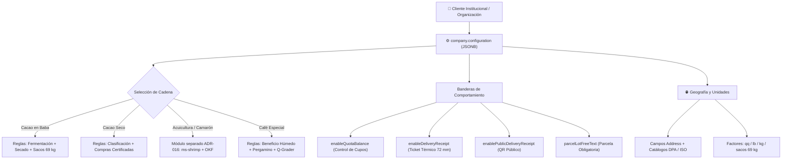
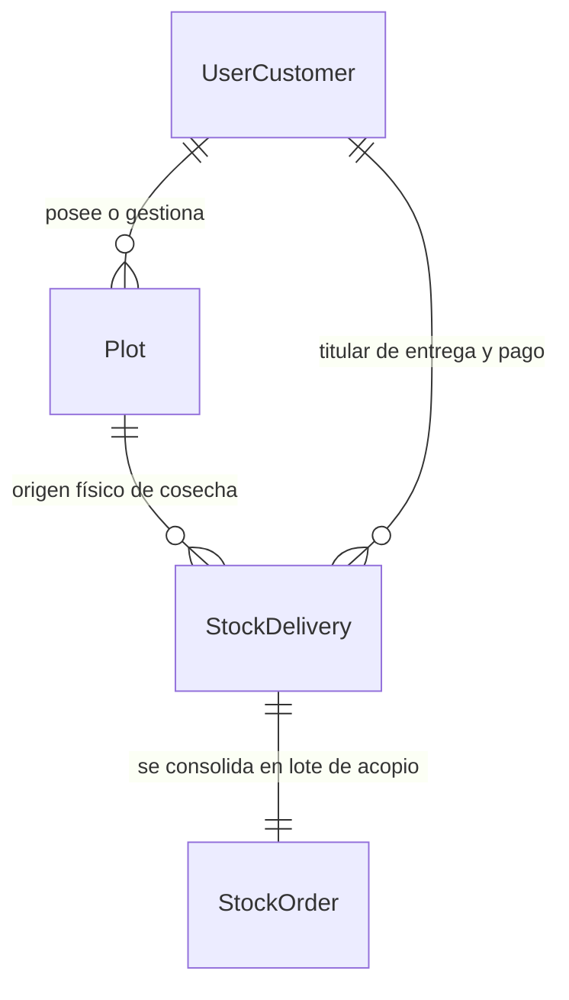

# Manual Técnico de Configuración y Parametrización Multi-Tenant y Multi-Cadena
## Módulo 02 · Suite Estandarizada de Manuales INATrace (Alcance Regional y Global)
### Proyecto GIZ · Fortalecimiento y Escalamiento de INATrace (ELKE / Sinergia SVNA – Iniciativa SASI)

---

```text
┌──────────────────────────────────────────────────────────────────────────────┐
│ 🧭 FICHA DE EXPERIENCIA DE USUARIO (UX CARD · NAVEGACIÓN RÁPIDA)             │
├──────────────────────┬───────────────────────────────────────────────────────┤
│ ⏱️ Tiempo Ejecución  │ 20 – 30 minutos por organización (Cooperativa/Empresa)│
│ 👤 Arquetipo (Rol)   │ Persona 1 y 2: Admin de Cooperativa / Consultor TI    │
│ 🛠️ Nivel Técnico     │ Básico – Intermedio (Panel Admin Web + SQL puntual)   │
│ 📦 Prerrequisitos    │ Infraestructura desplegada (Módulo 01 §9) + Admin     │
│ 🎬 Video Vinculado   │ Cápsula 04 (Parametrización Multi-Cadena y QR)        │
└──────────────────────┴───────────────────────────────────────────────────────┘
```

> [!TIP]
> **🎨 [BRIEF PARA EL DISEÑADOR EDITORIAL — LÁMINA IL-03]:**
> Convertir el diagrama inferior en una **infografía de 4 tarjetas modulares** identificadas por color semántico: Marrón Tierra (`#5C3A21`) para *Cacao en Baba*, Dorado Grano (`#D9822B`) para *Cacao Seco*, Turquesa Pacífico (`#006978`) para *Camarón (OKF)* y Verde Montaña (`#1B5E20`) para *Café Especial (SASI)*.

---

## 1. Introducción y Filosofía Arquitectónica

Uno de los mayores avances de **INATrace** en Ecuador ha sido su evolución desde una aplicación monoproducto hacia una **plataforma configurable multi-organización y multi-cadena**. Esta flexibilidad permite parametrizar reglas de negocio para organizaciones heterogéneas —desde cooperativas de cacao fino de aroma y café especial hasta plantas procesadoras (mediante módulos especializados separados para acuicultura)— sobre una misma base tecnológica abierta.

Este manual detalla cómo estructurar el aislamiento institucional, configurar las banderas de comportamiento en `company.configuration`, adaptar las cadenas de valor y unidades de medida, manejar la división territorial y activar correctamente la primera organización y su centro de acopio.



---

## 2. Modelo de Tenancy y Aislamiento Institucional (ADR-007)

En la arquitectura de INATrace rige la decisión **ADR-007 (Aislamiento Institucional Físico)** para la separación de datos:

1. **Soberanía y Confidencialidad de Datos:**
   La unidad de aislamiento es el **cliente institucional**, no la organización individual. Cada cliente (p. ej. UNOCACE, Fortaleza del Valle, Dufer) dispone de una instancia transaccional independiente, una base de datos PostgreSQL 16 dedicada y un *Realm* de Keycloak propio (`unocace`, `fortaleza`, `dufer`). Dentro de una misma base **sí** coexisten varias filas de `company`: las organizaciones o asociaciones filiales pertenecientes a ese mismo cliente. Lo que ADR-007 prohíbe explícitamente es compartir una sola base de datos mediante multi-tenancy lógico entre **clientes comercialmente competidores**.

2. **Independencia Operativa y Copias de Seguridad:**
   Permite ejecutar respaldos individuales (`pg_dump`), restauraciones puntuales y ventanas de mantenimiento sin afectar la operación de otras entidades en la misma región.

3. **Homogeneidad de Esquema:**
   Todas las instancias comparten el mismo esquema relacional gobernado por las migraciones de **Flyway** (véase el **Módulo 05 §4**), garantizando que las evoluciones de la plataforma se propaguen de manera uniforme.

---

## 3. Parametrización en Base de Datos: `company.configuration`

El comportamiento funcional del frontend Angular y de las APIs Spring Boot para cada organización se gobierna mediante la columna `configuration` (tipo `jsonb`) de la tabla `company`.

### 3.1 Estructura del JSON de Configuración Canónica

A continuación se presenta el modelo completo con las **diez (10) directivas reales** soportadas en el código fuente y las migraciones de producción:

```json
{
  "enableDeliveryReceipt": true,
  "enablePublicDeliveryReceipt": true,
  "enableQuotaBalance": true,
  "quotaAlertThresholdPercent": 80,
  "simplifySemiProductToCacao": false,
  "genericCacaoDisplay": false,
  "parcelLotFreeText": false,
  "numericVarietyOptions": false,
  "onlyNacionalVariety": false,
  "onlyOrganicProduction": false
}
```

### 3.2 Glosario Completo de Parámetros y Efectos Operativos

| Parámetro | Tipo | Valor Habitual | Efecto Verificado en la Aplicación |
|---|---|---|---|
| `enableDeliveryReceipt` | Booleano | `true` | Habilita la generación automática de un comprobante secuencial por organización (`deliveryReceipt` / `identifier`) y habilita el botón de impresión térmica POS de 72 mm en el historial. |
| `enablePublicDeliveryReceipt` | Booleano | `true` (público) / `false` (cerrado) | Autoriza la consulta pública sin inicio de sesión en `/public/delivery-receipt/:id` y `/api/public/delivery-receipt/:id`. Si es `false`, el QR redirige al módulo privado y la API pública responde `403 Forbidden`. |
| `enableQuotaBalance` | Booleano | `true` | Activa la validación preventiva de cupo anual frente a la suma de `Plot.productionEstimate` del productor al registrar entregas en báscula y vía API. |
| `quotaAlertThresholdPercent` | Numérico | `80` | Umbral porcentual de consumo de cupo (por defecto `80.0`) a partir del cual el backend marca `isNearLimit: true` y la interfaz muestra la alerta preventiva amarilla sin bloquear el pesaje. |
| `simplifySemiProductToCacao` | Booleano | `false` / `true` | Cuando es `true`, sustituye la etiqueta del semiproducto en los comprobantes por `"Cacao"` y simplifica la selección en cooperativas mono-producto. |
| `genericCacaoDisplay` | Booleano | `false` | Alias alternativo equivalente a `simplifySemiProductToCacao` (`delivery-receipt.util.ts`); mantiene el mismo comportamiento de visualización genérica `"Cacao"`. |
| `parcelLotFreeText` | Booleano | `false` | En `false` (modo estricto recomendado), exige seleccionar una parcela georreferenciada real del socio (`Plot`) al registrar compras y bloquea cadenas arbitrarias o nulas en `parcelLot`. En `true`, permite texto libre. |
| `numericVarietyOptions` | Booleano | `false` / `true` | Cuando es `true`, el selector de variedad de cacao almacena códigos numéricos (`"1"` = Orgánico, `"2"` = CCN51) en lugar de literales de texto (`ORGANICO`, `CCN51`). |
| `onlyNacionalVariety` | Booleano | `false` / `true` | Cuando es `true`, oculta el campo de variedad en entregas y procesamiento, fijando automáticamente la variedad como `'NACIONAL'`. |
| `onlyOrganicProduction` | Booleano | `false` / `true` | Cuando es `true`, marca automáticamente las entregas como producción orgánica usando la certificación del perfil de la empresa y oculta el selector manual en báscula. |

> [!IMPORTANT]
> **Condición de Doble Bandera para Trazabilidad QR Pública:**
> Para que un productor o consumidor final consulte el comprobante escaneando el código QR sin credenciales, **ambas banderas** deben estar en `true`: `"enableDeliveryReceipt": true` y `"enablePublicDeliveryReceipt": true`. Además, revise los controles de privacidad y limitación de tasa descritos en el **Módulo 04 §5.1 y §5.2** antes de habilitarla.

---

## 4. Adaptación a Cadenas de Valor Específicas

### 4.1 Cadena de Cacao en Baba (Modelo Post-Cosecha Completa)
*Caso de Referencia: Corporación Fortaleza del Valle (Ecuador)*

- **Materia Prima Recibida:** Cacao en Baba (mucílago húmedo recién cosechado).
- **Semiproducto Base:** `semiProduct.id = 1` (Cacao en Baba).
- **Unidad de Acopio:** Libras (`PESOLIBRA`).
- **Ciclo de Beneficio:**
  1. *Recepción y Llenado de Cajones de Fermentación* (4 a 6 días con volteos periódicos).
  2. *Pre-secado / Tendales* (reducción inicial de humedad superficial).
  3. *Secado Solar en Marquesinas / Secado Final* (hasta alcanzar humedad objetivo $\le 7.0\%$).
  4. *Limpieza y Ensacado* en sacos de yute de **69 kg** ($152.12\text{ lb}$), registrando el remanente estricto ($< 69\text{ kg}$).
- **Rendimiento Típico de Masa (Secuencial / Multiplicativo):** De cada $2.65\text{ a }3.0\text{ lb}$ de cacao en baba se obtiene $1.0\text{ lb}$ de cacao seco comercial ($33\%\text{–}38\%$ de rendimiento neto acumulado tras aplicar las mermas sucesivas sobre el peso remanente de cada etapa: escurrido de baba $\sim 15\%$, volteo en fermentación $\sim 10\%$, evaporación en secado $\sim 45\%$ y limpieza final $\sim 5\%$, cálculo ilustrativo explicado paso a paso en el **Módulo 03 §4.1**).

### 4.2 Cadena de Cacao Seco Clasificado y Compras Certificadas
*Caso de Referencia: Unión de Organizaciones Cacaoteras del Ecuador (UNOCACE)*

- **Materia Prima Recibida:** Grano de cacao fermentado y seco.
- **Parámetros de Calidad en Báscula:** Prueba de corte, porcentaje de fermentación, porcentaje de humedad (máximo referencial $7.5\%$), impurezas y defectos (mohoso/pizarroso).
- **Certificaciones Asociadas al Lote:** Comercio Justo (*Fairtrade*), Orgánico (USDA / UE), Rainforest Alliance, SPP (Símbolo de Pequeños Productores).
- **Control de Cupos Anuales:** Bloqueo estricto al $100\%$ de la cuota calculada por socio para impedir mezcla con cacao no certificado.

### 4.3 Cadena de Acuicultura y Camarón (Estándar OKF)

> [!IMPORTANT]
> **Esta cadena no se habilita mediante configuración.** Bajo **ADR-016 (Desacoplamiento Estricto por Cadena)**, la cadena acuícola requiere el microservicio independiente `ms-shrimp` y el microfrontend `shrimpMfe`, los cuales son artefactos separados y **no forman parte del núcleo monolítico público** (`Atijaguar-ec/backend` / `Atijaguar-ec/fe`). No existe ninguna bandera en `company.configuration` que active camarón dentro del núcleo de cacao. Véase el alcance en el **Módulo 01 §1**.

*Modelo Operativo de Referencia (`2026/RF01.md` — Empacadora Dufer, Ecuador):*
- **Materia Prima:** Camarón de cultivo (*Litopenaeus vannamei*).
- **Entidades Especializadas:** Muestreos de precosecha en piscina, análisis sensorial en laboratorio (olor, sabor, textura, porcentaje de corbata, muda), aplicación de metabisulfito de sodio, clasificación de tallas comerciales y túnel de congelación / masterizado.
- **Rendimientos Físicos Canónicos (`RF01.md`):**
  - Proceso entero con cabeza: $\text{Rendimiento} = \frac{\text{Libras procesadas}}{\text{Libras netas recibidas}} \times 100$ (referencia base $71.37\%$).
  - Proceso en cola: referencia base $67.27\%$ (la diferencia refleja la merma natural por descabezado).

### 4.4 Cadena de Café Especial (Iniciativa Regional SASI)
*Adaptación para: Honduras, República Dominicana, Colombia y Perú*

- **Materia Prima:** Café cereza húmedo, pergamino húmedo o café pergamino seco.
- **Variables de Calidad:** Análisis físico (rendimiento en trilla, defectos primarios/secundarios) y cata sensorial bajo estándar SCA (*Specialty Coffee Association* / *Q-Grader*).
- **Unidad Tradicional:** Quintales oro ($100\text{ lb}$) o sacos de $46\text{ kg}$, $60\text{ kg}$ o $69\text{ kg}$ según el país exportador.

---

## 5. Unidades de Medida y Reglas de Conversión

La consistencia del inventario y de las liquidaciones exige mantener un sistema único de equivalencias:

```text
┌─────────────────────────────────────────────────────────────────────────────┐
│                   SISTEMA DE EQUIVALENCIAS Y CONVERSIONES                   │
├───────────────────────────────┬─────────────────────────────────────────────┤
│ 1 Quintal (qq)                │ = 100 Libras (lb) exactas                   │
│ 1 Kilogramo (kg)              │ = 2.20462 Libras (lb)                       │
│ Fórmula Báscula kg -> lb      │ libras = round(kg * 2.20462, 2)             │
│ 1 Saco Internacional de Cacao │ = 69 Kilogramos = 152.12 Libras             │
└───────────────────────────────┴─────────────────────────────────────────────┘
```

> [!WARNING]
> **No confunda la columna de estimación de cupo.** La columna
> `usercustomer.farm_maxproductionquantity` existe en el esquema de base de datos como
> campo legado inactivo: no figura en `ApiFarmInformation`, no puede modificarse por API y
> **ninguna regla de negocio la lee**. El backend (`StockOrderService`) calcula el cupo
> anual exclusivamente a partir de **`Plot.productionEstimate`** (`plot.productionestimate`),
> sumando las parcelas del socio en quintales.

> [!CAUTION]
> **Prohibición de Ambigüedad en la Estimación de Producción:**
> En los registros de parcelas (`plot.productionestimate`, propiedad `productionEstimate` de
> `ApiPlot`), el valor numérico representa **Quintales (`qq`)**, donde $1\text{ qq} = 100\text{ lb}$.
> Está estrictamente prohibido registrar este dato en kilogramos o sacos. Fórmula ejecutada
> por el backend:
> $$\text{Cupo Anual (lb)} = \sum_{\text{parcelas del socio}} \text{productionEstimate (qq)} \times 100$$

---

## 6. Catálogos Territoriales y División Político-Administrativa (DPA)

Para la trazabilidad de origen y las declaraciones regulatorias de la Unión Europea (EUDR / TRACES-NT), INATrace combina campos de dirección persistidos en base de datos con catálogos oficiales de división político-administrativa.

### 6.1 Código DPA INEC (Ecuador) y Regla de *Zero-Padding*

El código DPA oficial de Ecuador consta de **6 dígitos**:
- Primeros 2 dígitos: Provincia (ej. `09` = Guayas, `13` = Manabí).
- Siguientes 2 dígitos: Cantón (ej. `01` = Guayaquil / Portoviejo).
- Últimos 2 dígitos: Parroquia rural o urbana (ej. `50`).

> [!IMPORTANT]
> **Regla de *Zero-Padding* Mandatorio:**
> Los códigos territoriales DPA deben manejarse estrictamente como cadenas de texto (`VARCHAR` / `string`), aplicando relleno con ceros a la izquierda (`padStart(6, '0')` o `LPAD(dpa, 6, '0')`). Está prohibido convertirlos a enteros (`INTEGER`), ya que provincias como Azuay (`01`) perderían el cero inicial (`1`), invalidando los esquemas enviados a TRACES-NT y Agrocalidad.

```text
┌──────────────────────────────────────────────────────────────────────────────┐
│ 🎨 [WIREFRAME IL-05 PARA DISEÑADOR] ANATOMÍA DEL CÓDIGO TERRITORIAL DPA      │
├──────────────────────────────────────────────────────────────────────────────┤
│                                                                              │
│     [ 0 9 ]              [ 0 1 ]              [ 5 0 ]                        │
│    ├───┴───┤            ├───┴───┤            ├───┴───┤                       │
│    Provincia             Cantón              Parroquia                       │
│   (Ej. Guayas)       (Ej. Guayaquil)        (Rural/Urb.)                     │
│                                                                              │
│  ✅ CORRECTO (String): "090150" (Con cero inicial preservado - padStart 6)   │
│  🚫 PROHIBIDO (Int):    90150   (Rompe validación TRACES-NT y Agrocalidad)   │
└──────────────────────────────────────────────────────────────────────────────┘
```

### 6.2 Modelo Real de Direcciones en Base de Datos y Adaptación Regional

En el esquema relacional de PostgreSQL (`V1__baseline_canonical.sql`), la ubicación geográfica de organizaciones (`company`), centros de acopio (`facilitylocation`), agricultores (`usercustomer`) y parcelas (`plot`) no utiliza una tabla maestra única de divisiones administrativas, sino columnas de dirección embebidas (`Address`) junto al enlace a `country`:

- **Campos territoriales estándar en el esquema:** `address_state` (provincia/departamento), `address_city` (cantón/municipio), `address_village` (parroquia/aldea), `address_sector`, `address_zip` y `address_country_id`.
- **Soporte nativo centroamericano (Honduras / SASI):** El esquema incluye además columnas dedicadas (`address_hondurasdepartment`, `address_hondurasmunicipality`, `address_hondurasvillage`, `address_hondurasfarm`).
- **Mapeo en reportes regulatorios y BI:** Los conectores de exportación (como Agrocalidad GUIA y TRACES-NT JSON-LD) cruzan los nombres territoriales con el catálogo oficial del país (en Ecuador `catalogos_dpa_inec_ecuador.json`; en otros países, el catálogo nacional equivalente mapeado a códigos **ISO 3166-2**, como `HN-FM` o `DO-01`).

---

## 7. Alta y Activación de la Organización, Centro de Acopio y Productores

### 7.1 Diferenciación Conceptual: Productor (`UserCustomer`) vs. Parcela (`Plot`)

- **Productor / Socio (`UserCustomer`):** Persona natural o jurídica socia o proveedora de la organización. Almacena documento de identidad, datos de contacto y cuenta para liquidaciones.
- **Parcela / Predio Agrícola (`Plot`):** Unidad física de tierra donde se produce el cultivo. Almacena coordenadas geográficas WGS84, área, variedad, estimación de cosecha (`productionEstimate`) y análisis satelital de no deforestación.



### 7.2 Secuencia Obligatoria para Dejar Lista una Organización Nueva

Tras completar la instalación y las semillas base del **Módulo 01 §9**, siga este orden exacto para habilitar la primera empresa sin errores en la web ni en los tickets QR:

**1. Crear y activar la organización (`POST /api/company/create` + `ACTIVATE_COMPANY`):**

Una organización creada vía interfaz o por `POST /api/company/create` nace en estado `REGISTERED` y no puede operar hasta pasar a `ACTIVE`. Desde la API (o mediante el panel administrativo):

```bash
# Reemplazar <SU_TOKEN_BEARER> por un token OIDC vigente de SYSTEM_ADMIN
# 1. Activar la empresa recién creada (ejemplo id = 1)
curl -s -X POST "https://$DOMAIN_NAME/api/company/execute/ACTIVATE_COMPANY" \
  -H "Authorization: Bearer <SU_TOKEN_BEARER>" \
  -H 'Content-Type: application/json' \
  -d '{"companyId": 1}'
```

Los estados posibles de `company.status` son `REGISTERED`, `ACTIVE` y `DEACTIVATED`. El usuario que ejecuta `create` queda vinculado automáticamente como `COMPANY_ADMIN`.

**2. Vincular la Cadena de Valor y configurar las banderas JSONB con mezcla segura (`||`):**

```sql
-- 1. Vincular la empresa (id = 1) con la Cadena de Cacao sembrada en el Módulo 01 §9.3
INSERT INTO companyvaluechain (company_id, valuechain_id)
SELECT 1, 1
WHERE NOT EXISTS (
  SELECT 1 FROM companyvaluechain WHERE company_id = 1 AND valuechain_id = 1
);

-- 2. Mezclar banderas en company.configuration usando || (NUNCA reemplazar con SET =)
-- Un SET configuration = '{...}' sobrescribe todo el JSONB y destruye claves previas
-- específicas de la organización (como onlyNacionalVariety u onlyOrganicProduction).
UPDATE company
SET configuration = COALESCE(configuration, '{}'::jsonb) || '{
  "enableDeliveryReceipt": true,
  "enablePublicDeliveryReceipt": true,
  "enableQuotaBalance": true,
  "quotaAlertThresholdPercent": 80,
  "simplifySemiProductToCacao": false,
  "parcelLotFreeText": false
}'::jsonb
WHERE id = 1;

-- 3. Comprobar estado, vínculo a cadena y configuración resultante
SELECT c.id, c.name, c.status, cvc.valuechain_id, c.configuration
FROM company c
LEFT JOIN companyvaluechain cvc ON cvc.company_id = c.id
WHERE c.id = 1;
```

> [!NOTE]
> **Sobre configuraciones particulares por organización en Ecuador:** El bloque SQL anterior
> muestra el perfil estándar recomendado con control de cupos y parcela obligatoria. En
> despliegues históricos específicos existen excepciones gobernadas por migraciones
> dedicadas (por ejemplo, en Fortaleza del Valle `V12` ajustó `parcelLotFreeText` y
> desactivó temporalmente el control de cupos respecto a `V11`). Respete siempre las
> decisiones documentadas del cliente institucional antes de aplicar banderas en una base
> ya existente.

**3. Crear el Centro de Acopio (`facility`) con Ubicación Geográfica Completa:**

Al dar de alta el centro de acopio desde la interfaz web (*Configuración de Empresa → Instalaciones*), asegúrese de registrar **latitud, longitud, dirección y país** en el mapa del formulario (y activar *Mostrar saldo de cupo* si aplica). Como se detalla en el **Módulo 03 §3**, una instalación sin `facilitylocation` provoca un error `500` al consultar comprobantes públicos por QR.

---

## 8. Lista de Verificación de Cierre (UX Quality Gate)

Antes de iniciar las operaciones de pesaje en el **Módulo 03**, confirme los 7 puntos siguientes:

- [ ] **Catálogos Base y Cadena Vinculada:** `country`, `currencytype`, `measureunittype`, `producttype`, `semiproduct` (+ `semiproducttranslation`) y `valuechain` tienen filas, y la empresa está vinculada en `companyvaluechain` (Módulo 01 §9.3 y §7.2).
- [ ] **Organización Activada:** `company.status = 'ACTIVE'` (una empresa recién creada por API nace en `REGISTERED`).
- [ ] **Doble Bandera QR Evaluada:** Si la organización habilita consulta pública sin login, `enableDeliveryReceipt` y `enablePublicDeliveryReceipt` están en `true` **y** se han aplicado las mitigaciones de privacidad y *rate-limit* del Módulo 04 §5.2.
- [ ] **Control de Cupos Parametrizado:** `enableQuotaBalance` está en `true` y `quotaAlertThresholdPercent` está definido en `80`.
- [ ] **Bloqueo de Texto Libre en Parcela:** `parcelLotFreeText` está en `false` para exigir la selección de una parcela real registrada.
- [ ] **Estimación de Parcelas en Quintales (`qq`):** Todas las parcelas tienen `Plot.productionEstimate` expresada en **Quintales ($1\text{ qq} = 100\text{ lb}$)** y nunca en kilogramos.
- [ ] **Centro de Acopio con Ubicación Registrada:** La tabla `facilitylocation` vinculada al centro de acopio contiene `latitude`, `longitude` y dirección completas (sin valores `NULL`).

Con estos parámetros verificados, la organización queda habilitada para iniciar el registro de productores, parcelas y transacciones de acopio en el **Módulo 03**.
