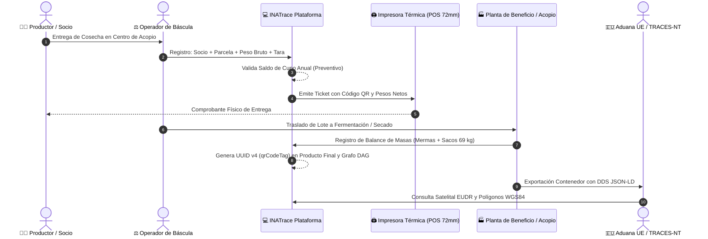
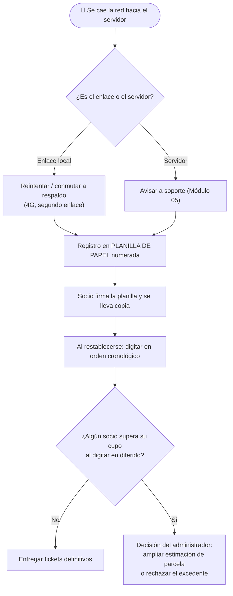
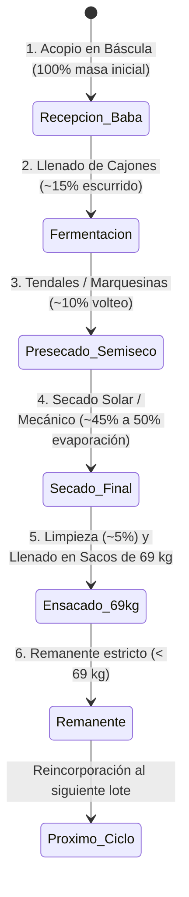

# Manual Técnico de Operación Funcional y Trazabilidad de Campo a Puerto
## Módulo 03 · Suite Estandarizada de Manuales INATrace (Alcance Regional y Global)
### Proyecto GIZ · Fortalecimiento y Escalamiento de INATrace (ELKE / Sinergia SVNA – Iniciativa SASI)

---

```text
┌──────────────────────────────────────────────────────────────────────────────┐
│ 🧭 FICHA DE EXPERIENCIA DE USUARIO (UX CARD · NAVEGACIÓN RÁPIDA)             │
├──────────────────────┬───────────────────────────────────────────────────────┤
│ ⏱️ Tiempo Operación  │ 45 segundos por pesaje en báscula / Ciclo continuo    │
│ 👤 Arquetipo (Rol)   │ Persona 1 (Operadora Báscula) y Persona 3 (EUDR/Exp.) │
│ 🛠️ Nivel Técnico     │ Operativo de Campo y Planta (Sin consola de comandos) │
│ 📦 Prerrequisitos    │ Impresora térmica POS 72 mm + Socios/Parcelas creados │
│ 🎬 Video Vinculado   │ Cápsulas 04 (Báscula y QR) y 05 (EUDR y TRACES-NT)    │
└──────────────────────┴───────────────────────────────────────────────────────┘
```

---

## 1. Introducción y Flujo Integral de Trazabilidad

Este manual formaliza la operativa diaria de acopio, post-cosecha, balance de masas, emisión de comprobantes térmicos y trazabilidad de exportación bajo **INATrace**. La plataforma garantiza que cada saco de cacao o café exportado hacia mercados regulados (como la Unión Europea o Japón) pueda rastrearse retrospectivamente hasta sus parcelas de origen mediante un grafo acíclico dirigido (DAG).



---

## 2. Recepción Física y Pesaje en Báscula

El módulo de acopio (`StockOrder`) constituye el punto de entrada primario donde se consolida la información física, agronómica y fiscal de cada transacción.

### 2.1 Captura de Parámetros Cuantitativos

El operador de báscula ingresa los siguientes campos obligatorios:
1. **Identificación del Productor:** Búsqueda por cédula, RUC o apellidos del socio en `UserCustomer`.
2. **Parcela de Procedencia:** Selección de una parcela previamente registrada (`Plot`).
   > [!IMPORTANT]
   > Con el parámetro `parcelLotFreeText: false`, está prohibido registrar cadenas arbitrarias (ej. `"1"` o `"finca"`). La entrega debe asociarse a una parcela registrada y validada.
3. **Peso Bruto:** Lectura directa del pesaje total de los sacos, bultos o gavetas.
4. **Tara:** Peso del transporte, sacas vacías o recipientes plásticos.
5. **Deducción por Humedad e Impurezas:** Descuento convenido por humedad excesiva, grano defectuoso o materia extraña.
6. **Peso Neto Liquidado:** La **interfaz web** lo calcula en pantalla:
   $$\text{Peso Neto (lb)} = \text{Peso Bruto} - \text{Tara} - \text{Deducción}$$

> [!NOTE]
> **Variedad de cacao en API vs. configuración (`cocoaVariety` vs. `onlyNacionalVariety`):**
> El enumerado `cocoaVariety` en base de datos admite los valores `'ORGANICO'` y `'CCN51'`
> (y con `numericVarietyOptions: true`, la UI almacena `"1"` y `"2"`). `'NACIONAL'` no es
> un valor del enum `cocoaVariety`, sino el literal fijo que asigna el formulario cuando la
> empresa tiene activa la bandera `onlyNacionalVariety: true` en `company.configuration`
> (Módulo 02 §3.2). Evite enviar `'NACIONAL'` al campo tipado `cocoaVariety` si integra por API.

> [!IMPORTANT]
> **Si integra por API (báscula electrónica o ERP), el cálculo del neto es responsabilidad del cliente.**
> `PUT /api/chain/stock-order` **no** deriva `totalQuantity` desde bruto y tara: exige
> recibir explícitamente tres campos de contabilidad interna, y rechaza la petición hasta
> que estén completos:
>
> ```text
> PUT /api/chain/stock-order  ->  400 "Total quantity cannot be null!"
>                             ->  400 "Fulfilled quantity cannot be null!"
>                             ->  200
> ```
>
> | Campo obligatorio | Qué enviar en una compra |
> |---|---|
> | `totalQuantity` | Peso neto liquidado |
> | `fulfilledQuantity` | Peso neto liquidado |
> | `availableQuantity` | Peso neto liquidado (inventario inicial disponible del lote) |
>
> Lo que **sí** calcula automáticamente el servidor es `cost = totalQuantity × pricePerUnit`
> y el número secuencial de comprobante por organización (`0001`, `0002`, …). No los envíe.
>
> **Cuerpo mínimo verificado de una compra (`PUT /api/chain/stock-order`):**
> ```json
> {
>   "orderType": "PURCHASE_ORDER",
>   "company": {"id": 1},
>   "facility": {"id": 1},
>   "semiProduct": {"id": 1},
>   "measurementUnitType": {"id": 1},
>   "producerUserCustomer": {"id": 1},
>   "parcelLot": "Parcela San Antonio",
>   "totalGrossQuantity": 1250.00,
>   "tare": 120.00,
>   "damagedWeightDeduction": 30.00,
>   "totalQuantity": 1100.00,
>   "fulfilledQuantity": 1100.00,
>   "availableQuantity": 1100.00,
>   "pricePerUnit": 1.25,
>   "currency": "USD",
>   "productionDate": "2026-11-04",
>   "deliveryTime": "2026-11-04"
> }
> ```

### 2.2 Control y Saldo Preventivo de Cupos Anuales (`enableQuotaBalance`)

Para prevenir la mezcla con cosechas provenientes de predios no certificados o de zonas deforestadas, INATrace audita en tiempo real el cupo productivo de las parcelas del socio durante el año calendario:

$$\text{Cupo Anual (lb)} = \sum_{\text{parcelas del socio}} \text{Plot.productionEstimate (qq)} \times 100$$
$$\text{Saldo Disponible (lb)} = \text{Cupo Anual (lb)} - \sum \text{Entregas del Año Calendario}$$

> [!NOTE]
> **Comportamiento verificado de los tres niveles de control:** Sobre una parcela con
> `productionEstimate = 24 qq` (cupo anual `2,400.00 lb`), el endpoint preventivo
> `GET /api/chain/stock-order/quota-balance` devuelve `initialQuota: 24.0`,
> `initialQuotaInUnit: 2400.0` y `alertThresholdPercent: 80.0`:
>
> | Entrega | Acumulado | `isNearLimit` | Respuesta HTTP |
> |---|---|---|---|
> | `1,100 lb` | `45.8 %` | `false` | `200` (registro regular) |
> | `+ 850 lb` | **`81.2 %`** | **`true`** | `200` (advierte en amarillo, no bloquea) |
> | `+ 500 lb` | Excedería `2,400 lb` | — | **`400 VALIDATION_ERROR`** |
>
> Mensaje devuelto al bloquear: *«La cantidad a entregar (500.00 Libras (lb)) supera el
> saldo de cupo disponible (450.00 Libras (lb)).»*

```text
┌─────────────────────────────────────────────────────────────────────────────┐
│                 NIVELES DE CONTROL DE CUPO EN EL SISTEMA                    │
├─────────────────────┬───────────────────┬───────────────────────────────────┤
│ Estado del Cupo     │ Rango Porcentual  │ Respuesta de la Interfaz / API    │
├─────────────────────┼───────────────────┼───────────────────────────────────┤
│ Normal              │ 0% a 79.9%        │ Registro regular, badge verde.    │
│ Alerta Preventiva   │ 80.0% a 99.9%     │ Badge amarillo "Cercano al límite"│
│ Bloqueo al 100%     │ >= 100.0%         │ Botón Guardar deshabilitado.      │
│                     │                   │ Backend rechaza: 400 VALIDATION   │
└─────────────────────┴───────────────────┴───────────────────────────────────┘
```

### 2.3 Registro de Conciliación Fiscal SRI (Idempotencia)

En implementaciones integradas con sistemas contables o de facturación electrónica (como el SRI en Ecuador o autoridades tributarias equivalentes), el campo `comments` registra una firma estructurada:

```text
LC:001-002-000045892|CA:1203202601099234567800120010020000458921234567819|ERP:REC-8921
```

- **LC:** Liquidación de Compra (`Establecimiento-PuntoEmisión-Secuencial`).
- **CA:** Clave de Acceso de 49 dígitos validada con algoritmo Módulo 11.
- **ERP:** Identificador único de transacción en el sistema contable externo para evitar duplicados ante reintentos de red.

### 2.4 Contingencia ante Caída de Conectividad en Báscula

La aplicación es **síncrona**: sin servidor alcanzable no hay validación de cupo, no hay número de comprobante y no se genera el ticket. Un corte de red detiene físicamente la fila de entregas, por lo que todo centro de acopio debe mantener listo un procedimiento de contingencia:



**Planilla mínima de respaldo** (manténgala impresa junto a la báscula):

| Campo | Por qué es imprescindible al digitar en diferido |
|---|---|
| Correlativo manual (`M-0001`, `M-0002`…) | Evita duplicar u omitir entregas |
| Fecha y hora reales del pesaje | `deliveryTime` y `productionDate` deben reflejar el pesaje, no la digitación tardía |
| Socio (cédula/ID y nombre) | Identificación inequívoca |
| **Parcela exacta** | Con `parcelLotFreeText = false` la entrega no puede guardarse sin ella |
| Peso bruto, tara, deducción y **neto** | La API exige el neto calculado (véase §2.1) |
| Firma del socio | Respaldo físico mientras se emite el ticket definitivo |

> [!WARNING]
> **El orden cronológico de digitación importa.** El validador de cupo compara cada entrega
> contra lo ya acumulado en la base: si digita fuera de orden, una entrega temprana legítima
> puede ser rechazada por `400 VALIDATION_ERROR` mientras una posterior ya consumió el saldo.

> [!CAUTION]
> **No altere la base de datos con `UPDATE` para «desbloquear» un cupo.** Si al digitar en
> diferido un socio excede su estimación, corresponde una decisión administrativa
> (actualizar técnicamente `Plot.productionEstimate` si la finca rindió más, o rechazar el
> excedente).

---

## 3. Impresión Térmica de Tickets de Báscula (72 mm POS)

> [!CAUTION]
> **Registre la ubicación completa del centro de acopio antes de emitir comprobantes.** Si la
> instalación (`facility`) carece de `facilitylocation` con latitud, longitud y dirección, el
> comprobante público falla: `FacilityMapper` desreferencia `getFacilityLocation()` **15 veces
> sin comprobación de nulo** (y 8 de ellas encadenan `.getAddress()`). Sin ubicación,
> `GET /api/public/delivery-receipt/:id` responde **`500 NullPointerException`** en lugar
> del comprobante. Verifique siempre en PostgreSQL:
> ```sql
> SELECT f.id, f.name, fl.latitude, fl.longitude, fl.address_address
> FROM facility f LEFT JOIN facilitylocation fl ON fl.id = f.facilitylocation_id;
> ```
> Si `latitude`, `longitude` o `address_address` son `NULL`, complételos en la interfaz antes
> de activar la consulta pública por QR.

INATrace incorpora impresión directa diseñada para impresoras térmicas de rollo continuo POS de **72 mm** (7 cm) u 80 mm sin controladores propietarios.

### 3.1 Características del Ticket Térmico

- **Renderizado Nativo Web:** Utiliza hojas de estilo CSS `@media print` desde el navegador; no requiere software intermedio ni servicios en la nube.
- **Formato Compacto Monocromático:** Ancho calibrado para rollos de **72 mm** (`7 cm`).
- **Contenido Estandarizado:**
  - Nombre de la organización / identificación fiscal / logotipo monocromático.
  - Número secuencial único del comprobante (`identifier` / `deliveryReceipt`).
  - Fecha y hora exacta de báscula.
  - Nombre del productor y parcela de origen.
  - Desglose cuantitativo: Peso Bruto, Tara, Deducción y Peso Neto (en libras y quintales).
  - Saldo remanente de cupo anual (cuando `displayQuotaBalance` está activo en el centro).
  - **Código QR impreso de ~3.2 cm** (`<qr-code [size]="120">` dentro de la hoja de 72 mm de ancho): enlaza directamente a `/public/delivery-receipt/:id` cuando el QR público está habilitado.
  - Espacio para firmas del agricultor y del operador de báscula.

> [!IMPORTANT]
> **Regla de Negocio Operativa:** El campo *"Representante de los agricultores"* se omite
> del ticket térmico impreso para mantener la legibilidad del rollo de 72 mm y agilizar las
> jornadas de pesaje.

### 3.2 Wireframe Editorial del Ticket Térmico POS (72 mm) — Lámina `IL-07`

> [!TIP]
> **🎨 [BRIEF PARA EL DISEÑADOR EDITORIAL — LÁMINA IL-07]:**
> Ilustrar este comprobante como un rollo de papel térmico blanco de **72 mm de ancho** a escala real, con borde dentado superior e inferior, tipografía monoespaciada térmica y llamadas laterales indicando el QR (~3.2 cm) y el campo excluido por regla operativa.

```text
         ┌──────────────────────────────────────┐  <-- Ancho físico del rollo: 72 mm
         │     COOPERATIVA CACAOTERA EJEMPLO    │
         │          RUC: 0991234567001          │
         │     COMPROBANTE DE ENTREGA #001042   │
         │--------------------------------------│
         │ FECHA: 2026-11-01       HORA: 14:32  │
         │ SOCIO: Zambrano Vera María Elena     │
         │ FINCA: Parcela San Antonio (130150)  │
         │ PROD:  Cacao en Baba                 │
         │--------------------------------------│
         │ PESO BRUTO:              1,250.00 lb │
         │ TARA (Gavetas):          - 120.00 lb │
         │ DEDUCCIÓN (Impurezas):   -  30.00 lb │
         │ ==================================== │
         │ PESO NETO LIQUIDADO:     1,100.00 lb │
         │ EQUIVALENTE QUINTALES:      11.00 qq │
         │--------------------------------------│
         │ CUPO ANUAL RESTANTE:     2,400.00 lb │
         │--------------------------------------│
         │          ┌────────────────┐          │
         │          │  ▄▄▄▄▄  ▄▄▄▄▄  │          │
         │          │  █   █  █   █  │          │  <-- Código QR Público (~3.2 cm)
         │          │  ▀▀▀▀▀  ▀▀▀▀▀  │          │      (/public/delivery-receipt/:id)
         │          │  ▄ ▀ ▄▀▀▄ ▀ ▄  │          │
         │          │  ▀▀▀▀▀  ▀▀▀▀▀  │          │
         │          └────────────────┘          │
         │   Escanee para verificar origen      │
         │                                      │
         │  _____________        _____________  │
         │  Firma Socio          Firma Báscula  │
         └──────────────────────────────────────┘
          🚫 PROHIBIDO INCLUIR: "Representante de los agricultores"
```

---

## 4. Transformación y Balance de Masas (Post-Cosecha)

Para cadenas que realizan transformación física de materia prima (como Cacao y Café), INATrace controla el **Balance de Masas** mediante órdenes de procesamiento (`ProcessingOrder`).



### 4.1 Fórmulas de Transformación, Mermas Secuenciales y Ensacado

En el beneficio de cacao en baba hacia cacao seco comercial las mermas actúan de forma **multiplicativa (sobre el peso remanente de cada etapa)**, resultando en un rendimiento neto típico de **$33\%\text{ a }38\%$** (de $2.65\text{ a }3.0\text{ lb}$ de baba por $1.0\text{ lb}$ de cacao seco):

1. **Ejemplo Ilustrativo sobre `1,000.00 lb` de Cacao en Baba (`453.59 kg`):**
   - Tras escurrido inicial ($-15\%$): $1,000 \times 0.85 = 850.00\text{ lb}$.
   - Tras volteos en fermentación ($-10\%$): $850 \times 0.90 = 765.00\text{ lb}$.
   - Tras evaporación solar/mecánica ($-48\%$ promedio según humedad inicial): $765 \times 0.52 = 397.80\text{ lb}$.
   - Tras limpieza/zaranda ($-5\%$): $397.80 \times 0.95 = 377.91\text{ lb}$ secos ($\approx 37.8\%$ de rendimiento neto, equivalente a **$171.42\text{ kg}$**).
2. **Ensacado Estándar (`69 kg`):**
   - Cada saco de exportación contiene exactamente **$69.00\text{ kg}$ netos** ($152.12\text{ lb}$).
   - Sobre el ejemplo de $171.42\text{ kg}$ secos: se completan **2 sacos de $69\text{ kg}$** ($138.00\text{ kg}$ exportables) y queda un **remanente estricto de $33.42\text{ kg}$** ($< 69\text{ kg}$), el cual se incorpora automáticamente como saldo inicial del siguiente ciclo de ensacado.

---

## 5. Protocolo de Anulación Segura de Entregas (Flyway V9)

Si un operador comete un error de digitación en el pesaje o en la asignación de socio/parcela, INATrace dispone de un protocolo transaccional de anulación:

### 5.1 Invariante de Inventario
Sólo es posible anular una compra si el lote no ha sido consumido total ni parcialmente en órdenes de procesamiento (fermentación o secado):
$$\text{Condición de Anulación:} \quad availableQuantity == fulfilledQuantity$$

Si el lote ya entró a proceso, el backend bloquea la anulación devolviendo `400 Bad Request`.

### 5.2 Procedimiento de Anulación vía API REST

```http
POST /api/chain/stock-order/1042/cancel
Content-Type: application/json
Authorization: Bearer <TOKEN_ADMIN>

{
  "reason": "Error en digitación de tara en báscula. Se reimprime ticket con pesaje correcto."
}
```

> [!NOTE]
> **Protocolo verificado en ejecución:** Al anular una entrega de `850 lb` sobre un
> acumulado de `1,950 lb` (`POST /api/chain/stock-order/2/cancel` → `200`), el sistema
> marca `status = 'CANCELED'`, guarda `cancellationreason` y `cancellationtimestamp`,
> restituye al instante el saldo disponible (`1,950` → `1,100 lb` entregadas; `450` → `1,300 lb`
> disponibles) y apaga la alerta de cercanía al límite.

**Efectos Inmediatos en el Sistema:**
1. El pedido pasa a estado `status = 'CANCELED'`.
2. Se registran `cancellationreason` y `cancellationtimestamp` para auditoría.
3. El cupo anual de las parcelas en `quota-balance` se **restituye automáticamente en tiempo real**.
4. El registro queda excluido de inventario disponible y reportes de balance de masas.

> [!WARNING]
> **La anulación NO retira el comprobante de la consulta pública por `id`.**
> En la versión actual del backend, `getPublicDeliveryReceipt` no filtra por `status`: una
> entrega con `status = 'CANCELED'` sigue devolviendo `200` con sus cifras originales si
> alguien conserva el QR antiguo o consulta ese `id`. Revise las mitigaciones del **Módulo 04 §5.2**.

---

## 6. Trazabilidad B2C (Consumidor) y B2B Regulatoria (EUDR / TRACES-NT)

### 6.1 Capa Pública de Comprobantes (Escaneo QR sin Login)
- **Ruta Web Frontend:** `https://trazabilidad.mi-cooperativa.org/public/delivery-receipt/:id`
- **Endpoint API Subyacente:** `GET /api/public/delivery-receipt/:id` (autorizado sin autenticación mediante `permitAll()` en `SpringSecurityConfig`).
- **Alcance Real de Privacidad (verificado en `StockOrderService.restrictToPublicReceiptFields()`):**
  - **Campos omitidos del payload público:** precios y costos de compra (`pricePerUnit`, `cost`, `pricePerUnitForEndCustomer`), cédula/RUC, teléfono, correo, cuenta bancaria, clave fiscal SRI en `comments`, usuario interno creador, evidencias, pagos y coordenadas de parcela (`productionLocation = null`).
  - **Campos visibles al público:** **nombre y apellidos completos** del productor (`producerUserCustomer.name` y `.surname`, sin enmascaramiento por asteriscos ni abreviatura), nombre de la parcela (`parcelLot`), pesos neto y bruto, fecha e identificador del comprobante.
  - Véase el detalle completo de auditoría y las instrucciones de verificación con `curl` en el **Módulo 04 §5.1 y §5.2**.

### 6.2 Capa Regulatoria B2B y TRACES-NT (Unión Europea – EUDR)
Para autoridades aduaneras de la Unión Europea (Róterdam, Hamburgo, Amberes), certificadoras y clientes importadores:
- **`qrCodeTag`:** Identificador **aleatorio** UUID v4 (`gen_random_uuid()`), no determinista. La migración `V14` (presente en `main` y `staging`) realiza el relleno retroactivo **únicamente para lotes de producto final** (`WHERE finalproduct_id IS NOT NULL`), dejando los semiproductos intermedios libres para mezcla en cajones.
- **Grafo de Trazabilidad Retrospectiva (DAG):**
  $$\text{Parcela (Plot)} \leftarrow \text{Entrega (Transaction)} \leftarrow \text{Beneficio (ProcessingOrder)} \leftarrow \text{Lote Final (StockOrder)}$$
- **Reglas Geoespaciales EUDR (Reglamento UE 2023/1115):**
  - **Fecha de Corte:** **31 de diciembre de 2020** (verificación satelital de no deforestación con Sentinel-2 / Whisp).
  - **Predios $\le 4.0\text{ hectáreas}$:** Admite coordenada puntual (centroide) con al menos 6 decimales de precisión en el sistema de referencia **WGS84** (`lat: -0.842105, lng: -79.821456`).
  - **Predios $> 4.0\text{ hectáreas}$:** Exige obligatoriamente **polígono cerrado** con anillo geométrico válido (`PlotGeometryTools.closedRing()`).
- **Exportación para TRACES-NT:** Generación estructurada de la Declaración de Debida Diligencia (DDS) en formato **JSON-LD** / GeoJSON WGS84 conforme a DG SANTE.
- **Exportación Agrocalidad GUIA (Ecuador):** Emisión del reporte en CSV delimitado por punto y coma (`;`) con cabecera **UTF-8 BOM** (`bi.rpt_cacao_agrocalidad_guia`).

```text
┌──────────────────────────────────────────────────────────────────────────────┐
│ 🎨 [WIREFRAME IL-09 PARA DISEÑADOR] REGLA GEOMÉTRICA EUDR (UMBRAL 4.0 HA)    │
├──────────────────────────────────────┬───────────────────────────────────────┤
│   CASO A: PARCELA <= 4.0 HECTÁREAS   │    CASO B: PARCELA > 4.0 HECTÁREAS    │
├──────────────────────────────────────┼───────────────────────────────────────┤
│                                      │             v1 (●)────────(●) v2      │
│                                      │                /            \         │
│                  (●)                 │           v5 (●)            (●) v3    │
│             Centroide GPS            │                \            /         │
│        Lat: -0.842105 (6 dec.)       │                 └───(●)────┘          │
│        Lng: -79.821456 (6 dec.)      │                   v4 -> v1 (Cerrado)  │
│                                      │                                       │
│ ✅ Admite 1 punto central WGS84      │ ✅ Exige Polígono Cerrado (v1 == vN)  │
│    (Sin deforestación post-2020)     │    validado por PlotGeometryTools     │
└──────────────────────────────────────┴───────────────────────────────────────┘
```

---

## 7. Ficha Desprendible A3 para Pared de Acopio ("Pesaje en 5 Pasos")

> [!TIP]
> **🎨 [BRIEF PARA EL DISEÑADOR EDITORIAL — PÓSTER A3 PLASTIFICADO]:**
> Diagramar este recuadro como una lámina independiente de una sola cara, tamaño A3 ($297 \times 420\text{ mm}$), apta para plastificar y fijar junto a la báscula física en los centros de acopio rurales.

```text
╔══════════════════════════════════════════════════════════════════════════════╗
║            GUÍA RÁPIDA DE BÁSCULA INATRACE · CENTRO DE ACOPIO                ║
╠══════════════════════════════════════════════════════════════════════════════╣
║  PASO 1 · BUSCAR SOCIO       Ingrese cédula/RUC o apellidos del productor.   ║
║  PASO 2 · ELEGIR PARCELA     Seleccione la finca real (prohibido texto "1"). ║
║  PASO 3 · REVISAR SEMÁFORO   🟢 <80% Normal | 🟡 80-99% Alerta | 🔴 100% Alto║
║  PASO 4 · DIGITAR PESOS      Peso Bruto (lb) − Tara (lb) − Impurezas (lb).   ║
║  PASO 5 · GUARDAR E IMPRIMIR Presione "Imprimir Ticket (7 cm)" y firme.      ║
╠══════════════════════════════════════════════════════════════════════════════╣
║  📌 RECUERDE: 1 Quintal (qq) = 100 Libras (lb) | 1 Saco Exportación = 69 kg  ║
╚══════════════════════════════════════════════════════════════════════════════╝
```

---

## 8. Lista de Verificación Operativa de Cierre (UX Quality Gate)

Antes de iniciar campañas masivas de acopio y exportación, confirme los 6 puntos operativos:

- [ ] **Centro de Acopio Georreferenciado:** La instalación cuenta con `facilitylocation` (latitud, longitud y dirección completa) y evita respuestas `500` en comprobantes QR.
- [ ] **Planilla Física de Contingencia Disponible:** El puesto de báscula tiene impresas las planillas numeradas para digitación cronológica en caso de corte de red (§2.4).
- [ ] **Calibración de Impresora POS 72 mm:** La prueba de impresión desde navegador emite el ticket completo con el QR (~3.2 cm) legible por cámara móvil.
- [ ] **Semáforo de Cupos Verificado:** Las entregas de prueba muestran `isNearLimit: true` al alcanzar el `80%` y bloquean con `400` al superar el `100%`.
- [ ] **Geometría EUDR Auditada:** Toda parcela $> 4.0\text{ ha}$ tiene polígono cerrado válido (`PlotGeometryTools.closedRing()`) y análisis satelital libre de deforestación posterior al 31/12/2020.
- [ ] **Sacos y Remanentes Cuadrados:** Las órdenes de procesamiento registran sacos exactos de `69 kg` y transfieren el remanente $< 69\text{ kg}$ al ciclo siguiente.
