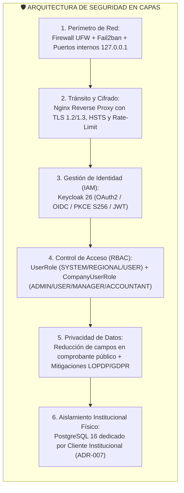

# Manual Técnico de Seguridad, Identidad y Gobernanza de Datos
## Módulo 04 · Suite Estandarizada de Manuales INATrace (Alcance Regional y Global)
### Proyecto GIZ · Fortalecimiento y Escalamiento de INATrace (ELKE / Sinergia SVNA – Iniciativa SASI)

---

```text
┌──────────────────────────────────────────────────────────────────────────────┐
│ 🧭 FICHA DE EXPERIENCIA DE USUARIO (UX CARD · NAVEGACIÓN RÁPIDA)             │
├──────────────────────┬───────────────────────────────────────────────────────┤
│ ⏱️ Tiempo Ejecución  │ 25 minutos (Configuración Realm, Roles y Hardening)   │
│ 👤 Arquetipo (Rol)   │ Persona 2 y 3: Admin Keycloak / CISO / Oficial Datos  │
│ 🛠️ Nivel Técnico     │ Intermedio – Avanzado (OIDC, OAuth2, PostgreSQL, UFW) │
│ 📦 Prerrequisitos    │ Acceso a Consola Admin Keycloak (`/auth`) y BD        │
│ 🎬 Video Vinculado   │ Cápsulas 03 (Keycloak IAM) y 05 (LOPDP / TRACES-NT)   │
└──────────────────────┴───────────────────────────────────────────────────────┘
```

---

## 1. Introducción y Principios de Seguridad

La trazabilidad agroalimentaria maneja información altamente sensible: identidades de productores familiares campesinos, coordenadas de predios, volúmenes de cosecha y liquidaciones financieras de compraventa.

La arquitectura de seguridad de **INATrace** se rige por el principio de **Defensa en Profundidad (*Defense in Depth*)** y **Privacidad desde el Diseño (*Privacy by Design*)**, articulando la gestión centralizada de identidades con **Keycloak 26**, el control estricto de accesos basado en roles (**RBAC**), el cifrado de comunicaciones en tránsito (TLS 1.2/1.3) y el cumplimiento armónico de normativas de protección de datos como la **LOPDP** de Ecuador y el **GDPR** de la Unión Europea.



---

## 2. Gestión de Identidad con Keycloak 26

> [!CAUTION]
> **Keycloak es el único mecanismo de autenticación efectivo.** El backend define un solo
> `SecurityFilterChain`, configurado como `oauth2ResourceServer`. Existe además un endpoint
> heredado `POST /api/user/login` que responde `200` y fija cookies
> `inatrace-accessToken` / `inatrace-refreshToken`, pero **ningún filtro las lee**: con esas
> cookies, `/api/user/profile`, `/api/company/list` y `/api/user/admin/list` devuelven
> **401**. Es código vestigial de la época anterior a Keycloak. No lo use como prueba de
> acceso ni lo exponga a los usuarios como vía de entrada.
>
> **Doble registro obligatorio de cada persona.** `KeycloakJwtAuthenticationConverter` toma
> el claim `email` (o `preferred_username`) del token y busca ese valor en la tabla `"User"`.
> Un usuario que exista sólo en Keycloak obtiene un token válido y recibe **401** con
> *«Keycloak user X has a valid token but is not registered in INATrace»*. Todo usuario
> necesita, con **el mismo correo**: una cuenta en el realm y una fila en `"User"`.

INATrace delega la autenticación, federación y gestión de sesiones de usuario en **Keycloak 26**, desacoplando la lógica de contraseñas del código fuente de la aplicación.

### 2.1 Modelo de Reinos (*Realms*) por Cliente Institucional

Siguiendo el principio de aislamiento institucional (ADR-007):
- **Master Realm (`master`):** Reservado exclusivamente para la administración técnica de la infraestructura Keycloak.
- **Tenant Realm (ej. `fortaleza`, `unocace`, `dufer` o el de su organización):** Cada cliente institucional dispone de su propio reino donde residen sus usuarios, políticas de contraseñas, proveedores de identidad y clientes OIDC.

### 2.2 Configuración de Clientes OIDC en Keycloak

Para cada organización se aprovisionan dos clientes principales (los comandos `curl` automatizados se encuentran en el **Módulo 01 §9.1**):

1. **Cliente Público Frontend (`inatrace-frontend`):**
   - **Tipo de Acceso:** Público (`publicClient: true`).
   - **Flujo de Autorización:** Código de Autorización Estándar (`standardFlowEnabled: true`) con **PKCE (`pkce.code.challenge.method: S256`)** activado obligatoriamente.
   - **Direct Access Grants:** Deshabilitado (`false`).
   - **URIs de Redirección Válidas:** `https://trazabilidad.mi-cooperativa.org/*`
   - **Orígenes Web (*Web Origins*):** `https://trazabilidad.mi-cooperativa.org`

2. **Cliente Confidencial Backend (`inatrace-backend`):**
   - **Tipo de Acceso:** Confidencial (`publicClient: false`).
   - **Autenticación del Cliente:** Secreto de cliente compartido entre `KEYCLOAK_CLIENT_SECRET` e `INATRACE_KEYCLOAK_ADMIN_CLIENT_SECRET` en `docker-compose.yml` (sin este último, `KeycloakAdminConfig` intenta autenticarse con el secreto por defecto y falla al sincronizar altas nuevas).
   - **Service Accounts Roles:** Habilitado (`serviceAccountsEnabled: true`) con el rol compuesto `manage-users` del cliente `realm-management`, necesario para que `POST /api/user/register` cree y gestione usuarios automáticamente en Keycloak.

### 2.3 Plantilla Visual Institucional (`loginTheme: inatrace`), Flujo `inatrace-browser-flow` y Protección `redirect_uri`

Para sustituir la interfaz genérica gris de Keycloak y evitar bloqueos al usar la plataforma en producción:

1. **Montaje del Tema Oficial:** Copie [`verificado/keycloak-theme/inatrace/`](./verificado/keycloak-theme/inatrace/login/theme.properties) en `/opt/inatrace/keycloak-theme/inatrace` y móntelo en solo lectura (`:ro`) dentro de `/opt/keycloak/themes/inatrace` en `inatrace-keycloak`. En el realm seleccione `loginTheme: inatrace` (Módulo 01 §5.2 y §9.1).
2. **Flujo `inatrace-browser-flow`:** Keycloak 26 incluye en su flujo `browser` estándar un paso inicial *Organization Identity-First* que interfiere con el acceso directo sin organizaciones configuradas en Keycloak. Clone `browser` como `inatrace-browser-flow`, deshabilite ese subflujo de organizaciones y fíjelo como flujo por defecto (`browserFlow: inatrace-browser-flow`).
3. **Redirección Canónica en Nginx para Proteger `redirect_uri`:** El frontend Angular calcula `APP_BASE_HREF` dinámicamente por idioma (`/` -> `/es/`), por lo que solicita el inicio de sesión enviando `redirect_uri=https://<host-del-navegador>/es/`. Si un usuario accede por la dirección IP del servidor o un subdominio alterno mientras Keycloak solo autoriza `https://trazabilidad.mi-cooperativa.org/*`, Keycloak rechazará la sesión con `Invalid parameter: redirect_uri`. Configure en Nginx la redirección previa `if ($host != $server_name) { return 301 https://$server_name$request_uri; }` (Módulo 01 §7.4).

---

## 3. Matriz de Control de Acceso Basado en Roles (RBAC)

El acceso a las funcionalidades y endpoints de la API REST de INATrace está restringido mediante roles asignados a los usuarios en `"User"` y `companyuser`:

| Rol | Enum de Origen | Alcance | Notas de Seguridad |
|---|---|---|---|
| **`SYSTEM_ADMIN`** | `UserRole` (global) | Administración de toda la instancia: creación de organizaciones, catálogos globales y cadenas. | Reservado a personal técnico. Exija autenticación multifactor (MFA) en Keycloak. |
| **`REGIONAL_ADMIN`** | `UserRole` (global) | Administración de un ámbito regional de organizaciones. | Permisos delegados entre empresas asignadas. |
| **`USER`** | `UserRole` (global) | Rol global por defecto de cualquier cuenta. No concede permisos de empresa por sí solo. | Es el valor inicial al crear una fila en `"User"`. |
| **`COMPANY_ADMIN`** | `CompanyUserRole` (por empresa) | Administración completa de su organización: parcelas, socios, precios y configuración. | Es el rol mínimo que exige la API de compras (`PUT /api/chain/stock-order`). |
| **`COMPANY_USER`** | `CompanyUserRole` (por empresa) | Operación diaria dentro de la organización: pesajes en báscula, comprobantes y consultas. | Perfil estándar para operadores de acopio y técnicos de campo. |
| **`MANAGER`** | `CompanyUserRole` (por empresa) | Gestión operativa y supervisión de procesos dentro de la organización. | — |
| **`ACCOUNTANT`** | `CompanyUserRole` (por empresa) | Perfil contable, liquidaciones y conciliación financiera. | — |

> [!IMPORTANT]
> **Estos siete son los únicos roles reales en el código fuente.** Se definen en
> `types/UserRole.java` (ámbito global) y `types/CompanyUserRole.java` (ámbito por
> empresa). No existen `SUPER_ADMIN`, `BASCULA_OPERATOR`, `FIELD_AGENT` ni `AUDITOR`:
> si intenta insertarlos por SQL, las restricciones `CHECK` (`"User_role_check"` y
> `companyuser_role_check`) rechazarán la sentencia, o el backend no los reconocerá. Para
> operadores de báscula utilice `COMPANY_USER`; para un rol de auditoría estrictamente de
> solo lectura a nivel SQL use el rol `inatrace_mcp_ro` (§5).

---

## 4. Cuentas Técnicas de Servicio e Interoperabilidad ERP

Para permitir la sincronización desatendida entre básculas electrónicas, software contable (ERP institucional) e INATrace, se utilizan **Cuentas Técnicas de Servicio** (*Client Credentials* o cuenta de servicio dedicada).

### 4.1 La Regla Crítica de Vinculación de Cuentas Técnicas

> [!WARNING]
> **Error Común `401 Unauthorized`:**
> El interceptor `KeycloakJwtAuthenticationConverter` valida la firma del JWT emitido por
> Keycloak. Sin embargo, para autorizar operaciones en la API de compras
> (`PUT /api/chain/stock-order`), el backend **exige que el usuario técnico exista en la
> tabla `"User"` de PostgreSQL y tenga rol `COMPANY_ADMIN` en `companyuser`**. Si la
> cuenta solo existe en Keycloak pero falta en PostgreSQL, todas las llamadas fallarán con
> `401 Unauthorized` o `403 Forbidden`.

### 4.2 Script de Aprovisionamiento Técnico en Base de Datos

Omita explícitamente la columna `id` en los `INSERT` para que las secuencias `IDENTITY` de PostgreSQL (`"User_id_seq"` y `companyuser_id_seq`) asignen valores correlativos sin causar colisiones futuras:

```sql
-- Columnas reales de "User": id (IDENTITY autogenerado), email (único), name, surname,
-- status, role, language, password, entityversion, creationtimestamp.
INSERT INTO "User" (
    entityversion, email, name, surname,
    status, role, language, password, creationtimestamp
) VALUES (
    0,
    'erp-service@mi-cooperativa.org',   -- el identificador único es el EMAIL
    'Servicio',
    'ERP Contable',
    'ACTIVE',
    'USER',
    'ES',
    '!',                                -- sin login interactivo: autentica vía Keycloak
    NOW()
) ON CONFLICT (email) DO NOTHING;

-- Asignar rol COMPANY_ADMIN sobre la empresa correspondiente (ajuste company_id si no es 1)
INSERT INTO companyuser (entityversion, user_id, company_id, role)
SELECT 0, u.id, 1, 'COMPANY_ADMIN'
FROM "User" u
WHERE u.email = 'erp-service@mi-cooperativa.org'
  AND NOT EXISTS (
    SELECT 1 FROM companyuser cu
    WHERE cu.user_id = u.id AND cu.company_id = 1
  );

-- Comprobación
SELECT u.id, u.email, u.name, u.surname, u.status, cu.role, c.name AS empresa
FROM "User" u
JOIN companyuser cu ON cu.user_id = u.id
JOIN company c ON c.id = cu.company_id
WHERE u.email = 'erp-service@mi-cooperativa.org';
```

> [!WARNING]
> El claim `email` (o `preferred_username`) del JWT emitido por Keycloak para la cuenta de
> servicio debe coincidir exactamente con `'erp-service@mi-cooperativa.org'`. No existe
> ninguna columna `username` en `"User"`.

---

## 5. Gobernanza de Datos: Privacidad B2C vs. B2B (LOPDP & GDPR)

En cumplimiento de la **Ley Orgánica de Protección de Datos Personales (LOPDP de Ecuador)** y el **Reglamento General de Protección de Datos (GDPR de la UE)**, INATrace estructura el acceso en **Cuatro Tiers de Gobernanza**:

```text
┌─────────────────────────────────────────────────────────────────────────────┐
│                    MATRIZ DE RIESGO Y TIERS DE GOBERNANZA                   │
├────────┬──────────────────┬─────────────────┬───────────────────────────────┤
│ Tier   │ Audiencia / Tipo │ Nivel de Acceso │ Política de Datos Sensibles   │
├────────┼──────────────────┼─────────────────┼───────────────────────────────┤
│ Tier 1 │ Público B2C      │ QR sin login    │ Reducción de campos en API    │
│        │ (Consumidor/Socio│ (permitAll() en │ (sin cédula, teléfono, correo,│
│        │ en comprobante)  │ SpringSecurity) │ cuenta bancaria ni precios).  │
├────────┼──────────────────┼─────────────────┼───────────────────────────────┤
│ Tier 2 │ Aduana / Control │ Token OIDC /    │ Trazabilidad técnica completa.│
│        │ (TRACES-NT / UE) │ Conector DDS    │ Polígonos WGS84, DDS JSON-LD. │
├────────┼──────────────────┼─────────────────┼───────────────────────────────┤
│ Tier 3 │ ERP / Báscula    │ Client Secret   │ Transaccional de acopio.      │
│        │ Institucional    │ Machine-to-Mach │ Pesajes, claves SRI y pagos.  │
├────────┼──────────────────┼─────────────────┼───────────────────────────────┤
│ Tier 4 │ Soporte Técnico  │ Solo Lectura    │ Diagnóstico forense y salud.  │
│        │ Especializado    │ (inatrace_mcp_ro│ Prohibida edición en caliente.│
└────────┴──────────────────┴─────────────────┴───────────────────────────────┘
```

### 5.1 Qué Expone Realmente el Endpoint Público (Verificado en Ejecución)

Al consultar `GET /api/public/delivery-receipt/:id` **sin autenticación**, el backend aplica `StockOrderService.restrictToPublicReceiptFields()`. Ese método es la **única barrera de privacidad** del endpoint: todo campo que no se anule ahí queda expuesto.

**Se elimina del payload:** `createdBy`, `updatedBy`, `creatorId`, `representativeOfProducerUserCustomer`, `productionLocation`, `activityProofs`, evidencias, `finalProduct`, `productOrder`, `processingOrder`, `payments`, `preferredWayOfPayment`, `quoteFacility`, `quoteCompany`, `consumerCompanyCustomer`, `qrCodeTag`, `womenShare`, `sacNumber`, `pricePerUnit`, `cost`, `pricePerUnitForEndCustomer`, `comments` (donde viaja la clave fiscal SRI) y la configuración completa de la empresa. Del agricultor sólo se construye un objeto reducido con `name` y `surname` (sin teléfono, correo, cédula ni cuenta bancaria).

**Comportamiento real de los campos clave en el payload público:**

| Campo | Estado en el Código Actual | Observación Operativa |
|---|---|---|
| `producerUserCustomer.name` + `.surname` | **Presente (completo)** | **Nombre y apellidos completos.** El backend no enmascara ni recorta a inicial. |
| `pricePerUnit` y `cost` | **Anulados (`null`)** | Corregido en el código fuente actual (`restrictToPublicReceiptFields()`); imágenes antiguas pre-parche sí los devolvían. |
| `paid` y `balance` | **Presentes** | Monto abonado y saldo pendiente de liquidación (cuando no aplica `priceDeterminedLater`); no exponen precio unitario ni costo total de la transacción. |
| `parcelLot` | **Presente** | Nombre de la parcela de origen. |
| `totalQuantity` / `totalGrossQuantity` | **Presentes** | Pesos neto y bruto de la entrega. |
| `deliveryReceipt` / `identifier` | **Presentes** | Identificadores secuenciales del comprobante. |
| `productionLocation` | **Anulado (`null`)** | La vista pública del comprobante **no** expone las coordenadas ni el polígono GPS de la finca. |

> [!IMPORTANT]
> **Verifique su imagen compilada antes de activar `enablePublicDeliveryReceipt`:**
> Si utiliza una imagen precompilada anterior al parche de privacidad, `pricePerUnit` y
> `cost` podrían devolverse al público. Compruébelo sobre un comprobante real con `curl`:
> ```bash
> curl -s "https://<su-dominio>/api/public/delivery-receipt/<id>" \
>   | python3 -c 'import sys,json; d=json.load(sys.stdin)["data"]; \
>      print("pricePerUnit:", d.get("pricePerUnit"), "| cost:", d.get("cost"))'
> ```
> Debe imprimir exactamente `pricePerUnit: None | cost: None`. Si imprime importes
> numéricos, actualice el backend desde el repositorio oficial y recompile la imagen antes
> de abrir el QR público.

> [!NOTE]
> **Transparencia sobre el nombre completo:** `name` y `surname` del socio se envían
> completos en el comprobante público por diseño actual del recibo para que el productor
> reconozca su ticket. Si su organización o marco regulatorio exige abreviar el apellido,
> requiere un ajuste adicional en `restrictToPublicReceiptFields()`.

```text
┌──────────────────────────────────────────────────────────────────────────────┐
│ 🎨 [WIREFRAME IL-10 PARA DISEÑADOR] DOBLE CAPA DE PRIVACIDAD (LOPDP vs EUDR) │
├──────────────────────────────────────┬───────────────────────────────────────┤
│   📱 CAPA PÚBLICA B2C (COMPROBANTE)  │   🇪🇺 CAPA REGULATORIA B2B (ADUANA)    │
│   Acceso: QR sin login (permitAll)   │   Acceso: Autenticado / TRACES-NT     │
├──────────────────────────────────────┼───────────────────────────────────────┤
│  • Socio:    Nombre y apellidos      │  • Operador: RUC 0991234567001        │
│              completos               │  • Polígono: Anillo cerrado WGS84     │
│  • Cédula / Teléfono / Correo:       │  • DPA INEC: "130150" (6 dígitos)     │
│              [Omitidos del payload]  │  • EUDR:     Sin deforestación >2020  │
│  • Precios y Costos: [Anulados=null] │  • SRI:      Clave Acceso 49 dígitos  │
│  • Polígono GPS:     [Anulado=null]  │  • Traza:    Grafo DAG completo       │
└──────────────────────────────────────┴───────────────────────────────────────┘
```

---

### 5.2 Superficie de Ataque del Comprobante Público y Mitigaciones

El endpoint `GET /api/public/delivery-receipt/:id` no solicita autenticación cuando la empresa tiene `enablePublicDeliveryReceipt: true`. Conviene conocer cuatro vectores de exposición asociados a esta URL:

| # | Vector / Riesgo | Estado y Detalle |
|---|---|---|
| 1 | **Identificadores enteros secuenciales** | El parámetro `:id` corresponde al `StockOrder.id` autoincremental (`1..N`). Sin limitación de tasa, un extractor automatizado puede recorrer identificadores correlativos. |
| 2 | **Ausencia de limitación de peticiones por defecto** | Nginx sin `limit_req_zone` permite miles de peticiones por minuto contra `/api/public/`. |
| 3 | **Los comprobantes anulados siguen respondiendo `200`** | `getPublicDeliveryReceipt` no filtra por `status`: una entrega anulada (`status = 'CANCELED'`) conserva sus datos visibles si alguien consulta ese `:id`. |
| 4 | **Nombre completo (y precios en imágenes antiguas)** | `name`/`surname` viajan completos; en imágenes anteriores al parche de privacidad también viajaban `pricePerUnit` y `cost` (verifique siempre con el comando `curl` de §5.1). |

> [!CAUTION]
> **No active `enablePublicDeliveryReceipt` sin configurar la Mitigación 1 y verificar la
> prueba `curl` de §5.1.** Es la barrera práctica que impide el raspado masivo (*scraping*)
> del historial de entregas de la cooperativa.

**Mitigación 1 — Limitar peticiones en Nginx (obligatoria en producción, aplicada en Módulo 01 §7.3 y §7.4):**
Asegúrese de mantener activo `/etc/nginx/conf.d/inatrace-ratelimit.conf`:

```nginx
limit_req_zone $binary_remote_addr zone=inatrace_public:10m rate=20r/m;
```

Y el bloque `location /api/public/` **por delante** de `location /api/` en `/etc/nginx/sites-available/inatrace.conf`:

```nginx
location /api/public/ {
    limit_req zone=inatrace_public burst=10 nodelay;
    limit_req_status 429;
    proxy_pass http://127.0.0.1:8083/api/public/;
    proxy_set_header Host $host;
    proxy_set_header X-Real-IP $remote_addr;
    proxy_set_header X-Forwarded-For $proxy_add_x_forwarded_for;
    proxy_set_header X-Forwarded-Proto https;
}
```

Veinte consultas por minuto por dirección IP bastan para usuarios reales que escanean tickets con el teléfono y bloquean con `HTTP 429` cualquier barrido automatizado.

**Mitigación 2 (evolución de código) — Consultar por `qrCodeTag` (UUID v4) en lugar de `id`:**
El modelo posee `stockorder.qrcodetag` (UUID v4 no enumerable) y el endpoint `GET /api/public/stock-order/{qrTag}`. Actualmente la migración `V14` asigna `qrcodetag` sólo a lotes de producto final, por lo que extenderlo a comprobantes de báscula requiere un cambio de código en la creación del `StockOrder` y en la URL generada por el QR.

**Mitigación 3 (evolución de código) — Excluir entregas anuladas:**
Filtrar `status != 'CANCELED'` (respondiendo `404`) dentro de `getPublicDeliveryReceipt` impide que tickets anulados por error de pesaje permanezcan consultables.

---

## 6. Fortalecimiento del Servidor (*Hardening* y Buenas Prácticas)

### 6.1 Protección contra Fuerza Bruta con Fail2ban

Instale y configure Fail2ban para proteger el acceso SSH y mitigar intentos repetidos de intrusión:

```bash
sudo apt install -y fail2ban
sudo cp /etc/fail2ban/jail.conf /etc/fail2ban/jail.local

sudo tee -a /etc/fail2ban/jail.local << 'EOF'
[sshd]
enabled = true
port = 22
maxretry = 4
findtime = 600
bantime = 3600
EOF

sudo systemctl enable --now fail2ban
sudo fail2ban-client status sshd
```

### 6.2 Gestión y Rotación de Secretos

1. **Protección del Archivo `.env`:** El archivo `/opt/inatrace/.env` almacena las contraseñas de PostgreSQL, administrador de Keycloak y secreto de cliente; debe mantenerse con permisos de lectura exclusivos para el propietario:
   ```bash
   sudo chmod 600 /opt/inatrace/.env
   sudo chown "$USER":docker /opt/inatrace/.env
   ```
2. **Prohibición de Secretos en Control de Versiones:** Nunca incluya archivos `.env`, llaves privadas TLS ni tokens en repositorios Git públicos o privados.
3. **Rotación Semestral:** Actualice periódicamente las contraseñas de PostgreSQL y los *Client Secrets* de Keycloak cada 6 meses, recreando los servicios afectados con `docker compose up -d --force-recreate`.

---

## 7. Lista de Verificación de Seguridad (UX Quality Gate)

Antes de cerrar la puesta en marcha de seguridad, confirme estos 6 controles:

- [ ] **Acceso Exclusivo vía Keycloak:** Los usuarios finales inician sesión únicamente mediante OIDC/PKCE (`inatrace-frontend`); no se usa el endpoint heredado `/api/user/login`.
- [ ] **Roles RBAC Válidos:** Todos los usuarios en `"User"` y `companyuser` emplean exclusivamente los 7 roles reales definidos en el backend (§3).
- [ ] **Cuentas de Servicio Sincronizadas:** Toda cuenta técnica ERP existe con idéntico correo en Keycloak y en `"User"` + `companyuser` (`COMPANY_ADMIN`), insertada sin colisionar secuencias (§4.2).
- [ ] **Verificación de Precios en Endpoint Público:** El comando `curl` de §5.1 devuelve `pricePerUnit: None | cost: None` antes de activar `enablePublicDeliveryReceipt`.
- [ ] **Rate-Limiting Activo en `/api/public/`:** Nginx cuenta con `/etc/nginx/conf.d/inatrace-ratelimit.conf` y responde `HTTP 429` ante ráfagas excesivas.
- [ ] **Hardening del Host:** `fail2ban` activo sobre SSH y `/opt/inatrace/.env` protegido con `chmod 600`.
