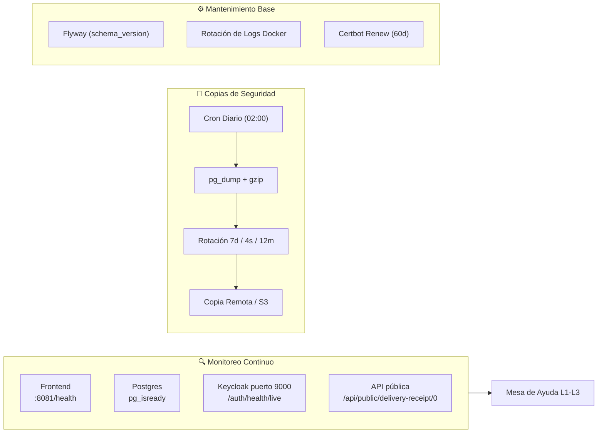
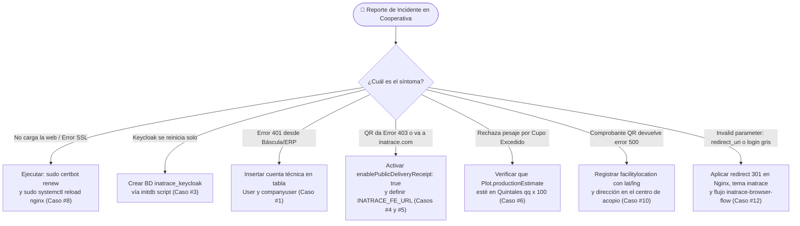

# Manual Técnico de Mantenimiento Preventivo, Migraciones y Resolución de Problemas
## Módulo 05 · Suite Estandarizada de Manuales INATrace (Alcance Regional y Global)
### Proyecto GIZ · Fortalecimiento y Escalamiento de INATrace (ELKE / Sinergia SVNA – Iniciativa SASI)

---

```text
┌──────────────────────────────────────────────────────────────────────────────┐
│ 🧭 FICHA DE EXPERIENCIA DE USUARIO (UX CARD · NAVEGACIÓN RÁPIDA)             │
├──────────────────────┬───────────────────────────────────────────────────────┤
│ ⏱️ Tiempo Respuesta  │ Diagnóstico < 5 min / Restauración Total < 30 min     │
│ 👤 Arquetipo (Rol)   │ Persona 2: Soporte Técnico L1/L2/L3 (Bolsa 60h GIZ)   │
│ 🛠️ Nivel Técnico     │ Intermedio – Avanzado (PostgreSQL, Flyway, Docker)    │
│ 📦 Prerrequisitos    │ Acceso SSH / Consola PostgreSQL y Carpeta de Backups  │
│ 🎬 Video Vinculado   │ Cápsula 05 (Respaldos Automatizados y Mesa de Ayuda)  │
└──────────────────────┴───────────────────────────────────────────────────────┘
```

---

## 1. Introducción y Gobernanza Operativa

La continuidad operativa de **INATrace** en los centros de acopio campesinos, plantas de beneficio y oficinas de exportación depende de una disciplina rigurosa de mantenimiento preventivo, respaldos verificables y capacidad de respuesta técnica ante contingencias.

Este manual consolida los protocolos para la gestión de copias de seguridad automatizadas, el ciclo de vida de migraciones de base de datos con **Flyway**, la recuperación ante desastres (*Disaster Recovery*) y una **matriz de resolución de problemas (*Troubleshooting*)** con los **12 incidentes más críticos** registrados en operaciones reales de campo.



---

## 2. Estrategia de Copias de Seguridad Automatizadas (*Backups*)

La pérdida de información de pesajes o polígonos satelitales EUDR puede paralizar una exportación y generar severas pérdidas económicas a una cooperativa. Para mitigar este riesgo se implementa un script de respaldo automatizado.

### 2.1 Script Canónico de Respaldo (`/opt/inatrace/scripts/backup-inatrace.sh`)

Cree el archivo y otorgue permisos de ejecución:

```bash
sudo mkdir -p /opt/inatrace/scripts /opt/inatrace/backups/daily /opt/inatrace/backups/weekly /opt/inatrace/backups/monthly

cat << 'EOF' > /opt/inatrace/scripts/backup-inatrace.sh
#!/bin/bash
# ==============================================================================
# Script de Respaldo Automatizado de INATrace (PostgreSQL 16 + Keycloak + Archivos)
# ==============================================================================
set -euo pipefail

BACKUP_DIR="/opt/inatrace/backups"
TIMESTAMP=$(date +"%Y%m%d_%H%M%S")
DATE_DAY=$(date +"%u") # 1 = Lunes, 7 = Domingo
DATE_DAY_OF_MONTH=$(date +"%d")
ENV_FILE="/opt/inatrace/.env"

# Cargar variables de entorno de forma segura (soporta espacios y caracteres especiales)
if [ -f "$ENV_FILE" ]; then
    set -a
    # shellcheck disable=SC1090
    . "$ENV_FILE"
    set +a
else
    echo "ERROR: Archivo .env no encontrado en /opt/inatrace/.env"
    exit 1
fi

echo "====================================================================="
echo "Iniciando respaldo de INATrace: $(date)"
echo "Base de datos principal: $POSTGRES_DB | Keycloak: $KC_DB_NAME"
echo "====================================================================="

# 1. Respaldo de Bases de Datos PostgreSQL (en caliente sin bloqueo)
BACKUP_SQL_CORE="$BACKUP_DIR/daily/inatrace_core_${TIMESTAMP}.sql.gz"
BACKUP_SQL_KC="$BACKUP_DIR/daily/inatrace_keycloak_${TIMESTAMP}.sql.gz"

echo ">> Exportando $POSTGRES_DB..."
docker exec inatrace-postgres pg_dump -U "$POSTGRES_USER" -d "$POSTGRES_DB" --no-owner --clean --if-exists | gzip > "$BACKUP_SQL_CORE"

echo ">> Exportando $KC_DB_NAME..."
docker exec inatrace-postgres pg_dump -U "$POSTGRES_USER" -d "$KC_DB_NAME" --no-owner --clean --if-exists | gzip > "$BACKUP_SQL_KC"

# 2. Respaldo de Documentos y Archivos Físicos Adjuntos
BACKUP_FILES="$BACKUP_DIR/daily/inatrace_files_${TIMESTAMP}.tar.gz"
echo ">> Comprimiendo archivos adjuntos y documentos..."
tar -czf "$BACKUP_FILES" -C /opt/inatrace file_storage documents

# 3. Políticas de Rotación (incluyendo núcleo, Keycloak y archivos)
# Copia semanal los domingos (Día 7)
if [ "$DATE_DAY" -eq 7 ]; then
    echo ">> Generando copia semanal..."
    cp "$BACKUP_SQL_CORE" "$BACKUP_DIR/weekly/"
    cp "$BACKUP_SQL_KC"   "$BACKUP_DIR/weekly/"
    cp "$BACKUP_FILES"    "$BACKUP_DIR/weekly/"
fi

# Copia mensual el primer día del mes (Día 01)
if [ "$DATE_DAY_OF_MONTH" -eq 1 ]; then
    echo ">> Generando copia mensual..."
    cp "$BACKUP_SQL_CORE" "$BACKUP_DIR/monthly/"
    cp "$BACKUP_SQL_KC"   "$BACKUP_DIR/monthly/"
    cp "$BACKUP_FILES"    "$BACKUP_DIR/monthly/"
fi

# 4. Limpieza de respaldos antiguos
# Conservar 7 días de diarios, 4 semanas de semanales y 12 meses de mensuales
find "$BACKUP_DIR/daily"   -type f -mtime +7   -delete
find "$BACKUP_DIR/weekly"  -type f -mtime +30  -delete
find "$BACKUP_DIR/monthly" -type f -mtime +365 -delete

echo ">> Respaldo completado con éxito: $(date)"
echo "Tamaño de respaldos generados:"
ls -lh "$BACKUP_DIR/daily"/*"${TIMESTAMP}"*
EOF

sudo chmod +x /opt/inatrace/scripts/backup-inatrace.sh
```

> [!NOTE]
> **Script verificado en ejecución**, literal y con `exit 0`, sobre PostgreSQL 16: genera
> los tres artefactos (`inatrace_core_*.sql.gz`, `inatrace_keycloak_*.sql.gz`,
> `inatrace_files_*.tar.gz`). La restauración en una base limpia dio **0 errores** y
> conteos idénticos al original (empresas, socios, parcelas, coordenadas, entregas y
> migraciones). Se recomienda copiar periódicamente `/opt/inatrace/backups/` hacia un
> almacenamiento externo (*off-site* / S3 / NAS remoto).

### 2.2 Programación en el Programador de Tareas (Cron)

Configure la ejecución desatendida todos los días a las 02:00 AM:

```bash
sudo tee /etc/cron.d/inatrace-backup << 'EOF'
0 2 * * * root /opt/inatrace/scripts/backup-inatrace.sh >> /var/log/inatrace-backup.log 2>&1
EOF
```

---

## 3. Plan de Recuperación ante Desastres (*Disaster Recovery*)

Ante una pérdida total del servidor host, se deben cumplir los siguientes objetivos de recuperación:
- **RPO (Punto Objetivo de Recuperación):** Menor a 24 horas (o 1 hora si se replican los WAL de PostgreSQL).
- **RTO (Tiempo Objetivo de Recuperación):** Menor a 30 minutos sobre un servidor limpio.

### 3.1 Procedimiento de Restauración Paso a Paso

1. **Aprovisionar el nuevo servidor** instalando Docker, Docker Compose, el script `initdb` y configurando Nginx según el [**Módulo 01**](./01-manual-instalacion-despliegue.md).
2. **Transferir los respaldos** hacia `/opt/inatrace/backups/daily/` en el nuevo servidor.
3. **Iniciar exclusivamente el contenedor de PostgreSQL** (esperar a que esté `healthy` y que `initdb/01-create-keycloak-db.sh` haya creado `inatrace_keycloak`):
   ```bash
   cd /opt/inatrace && set -a && . ./.env && set +a
   docker compose up -d inatrace-postgres
   docker compose ps inatrace-postgres
   ```
4. **Seleccionar explícitamente el respaldo más reciente y restaurar ambas bases de datos** (evite usar comodines `*.sql.gz` que concatenan varios días):
   ```bash
   LATEST_CORE=$(ls -t /opt/inatrace/backups/daily/inatrace_core_*.sql.gz | head -n 1)
   LATEST_KC=$(ls -t /opt/inatrace/backups/daily/inatrace_keycloak_*.sql.gz | head -n 1)
   LATEST_FILES=$(ls -t /opt/inatrace/backups/daily/inatrace_files_*.tar.gz | head -n 1)

   echo "Restaurando: $LATEST_CORE | $LATEST_KC | $LATEST_FILES"

   # Verificar que existe la base de Keycloak antes de restaurar
   docker exec inatrace-postgres psql -U "$POSTGRES_USER" -d "$POSTGRES_DB" \
     -tc "SELECT 1 FROM pg_database WHERE datname = '$KC_DB_NAME'" | grep -q 1 \
     || docker exec inatrace-postgres psql -U "$POSTGRES_USER" -d "$POSTGRES_DB" -c "CREATE DATABASE $KC_DB_NAME;"

   # Restaurar base de datos principal de INATrace
   gunzip -c "$LATEST_CORE" | \
     docker exec -i inatrace-postgres psql -v ON_ERROR_STOP=1 -U "$POSTGRES_USER" -d "$POSTGRES_DB"

   # Restaurar base de datos de Keycloak
   gunzip -c "$LATEST_KC" | \
     docker exec -i inatrace-postgres psql -v ON_ERROR_STOP=1 -U "$POSTGRES_USER" -d "$KC_DB_NAME"
   ```
5. **Restaurar los archivos y documentos:**
   ```bash
   tar -xzf "$LATEST_FILES" -C /opt/inatrace/
   ```
6. **Arrancar el resto del ecosistema:**
   ```bash
   docker compose up -d
   ```
7. **Verificar el servicio:** Comprobar los logs del backend, abrir el dominio en el navegador y verificar que los usuarios puedan autenticarse vía Keycloak y que los históricos de pesaje estén íntegros.

---

## 4. Gestión de Migraciones de Base de Datos con Flyway

INATrace gestiona su evolución relacional combinando **Hibernate** (validación) y **Flyway** (ejecución):

1. **Hibernate NO modifica el esquema.** El backend arranca con `spring.jpa.hibernate.ddl-auto = validate`: Hibernate **comprueba** que las entidades Java coincidan con las tablas y aborta el arranque si hay discrepancias, pero no crea ni altera columnas. Esto es un invariante arquitectónico (**ADR-008, Gobierno Exclusivo por Flyway**).
2. **Flyway** es el único mecanismo autorizado de cambio de esquema:
   - **Tabla de Control:** `schema_version` (no el `flyway_schema_history` por defecto de Flyway; se fija con `spring.flyway.table`). Vive en el esquema `public`.
   - **Opciones activas:** `baseline-on-migrate = true`, `baseline-version = 1`, `out-of-order = false`, `validate-on-migrate = true`.

**Secuencia actual de versiones en el repositorio (`Atijaguar-ec/backend`):**

A fecha de esta edición, tanto `main` como `staging` (commit `a0d1951`) incluyen **15 migraciones (`V1`–`V15`)**. Como las ramas pueden volver a divergir en futuros ciclos de desarrollo, el criterio de verificación **siempre** consiste en comparar la versión aplicada en `schema_version` con los archivos reales de la rama compilada:

```bash
# 1. Contar archivos de migración en la copia de código compilada
ls -1 /opt/src/backend/src/main/resources/db/migration/V*__*.sql | wc -l

# 2. Consultar versión efectiva aplicada en PostgreSQL
docker exec inatrace-postgres psql -U inatrace -d inatrace_core \
  -c 'SELECT max(version::int) AS version, count(*) AS aplicadas FROM schema_version;'
```

**Catálogo de migraciones (`V1`–`V15`):**

| Versión | Fichero | Contenido |
|---|---|---|
| `V1` | `V1__baseline_canonical.sql` | Esquema canónico completo (99 tablas) |
| `V2` | `V2__envers_audit_tables.sql` | Tablas de auditoría Envers (`*_aud`) |
| `V3` | `V3__add_fk_indexes.sql` | Índices sobre claves ajenas |
| `V4` | `V4__add_delivery_receipt_and_unocace_config.sql` | Comprobante de entrega y configuración UNOCACE |
| `V5` | `V5__enable_delivery_receipt_for_all_unocace_orgs.sql` | Comprobante en todas las organizaciones UNOCACE |
| `V6` | `V6__add_display_quota_balance.sql` | `displayquotabalance` en centros de acopio |
| `V7` | `V7__add_sortorder_to_processingactionpef.sql` | `sortorder` en `processingactionpef` |
| `V8` | `V8__configure_unocace_quota_alert_threshold.sql` | Umbral de alerta de cupo UNOCACE |
| `V9` | `V9__add_stockorder_cancellation.sql` | Anulación de lotes (`cancellationreason`, `cancellationtimestamp`) |
| `V10` | `V10__add_public_delivery_receipt_config.sql` | QR público (`enablePublicDeliveryReceipt`) |
| `V11` | `V11__align_fv_tenant_configuration.sql` | Alinea la matriz de configuración de Fortaleza del Valle |
| `V12` | `V12__disable_quota_balance_for_fv.sql` | Desactiva cupos en FV y restituye `parcelLotFreeText = true` |
| `V13` | `V13__grant_mcp_ro_bi_schema.sql` | Permisos del rol de solo lectura sobre el esquema `bi` |
| `V14` | `V14__backfill_final_product_qrcodetag.sql` | Backfill de `qrcodetag` (UUID v4) en lotes de producto final |
| `V15` | `V15__add_usercustomer_timestamps.sql` | `creationtimestamp` y `updatetimestamp` en `usercustomer` (+ `usercustomer_aud`) e índices para sincronización incremental |

> [!WARNING]
> **Imágenes precompiladas antiguas pueden ir por detrás del código fuente.** Una imagen
> antigua como `backend-inatrace:latest` sólo aplicaba hasta `V11`, dejando sin aplicar
> `V12`–`V15`. Construya siempre su imagen propia desde su *fork* (Módulo 01 §4) y
> compruebe la versión efectiva con `SELECT max(version::int) FROM schema_version;`.

### 4.1 Resolución de Inconsistencias de Checksum en Flyway

> [!WARNING]
> Si alguien edita un archivo de migración que ya fue ejecutado en producción (por ejemplo
> `V9__add_stockorder_cancellation.sql`), Spring Boot abortará el arranque con
> `FlywayException: Validate failed: Migration checksum mismatch for migration version 9`.

**Procedimiento de Reparación:**
```bash
# Conectarse a PostgreSQL en el contenedor
docker exec -it inatrace-postgres psql -U inatrace -d inatrace_core

-- Verificar el estado de la migración en discordancia
SELECT version, description, checksum, success FROM schema_version ORDER BY installed_rank DESC;

-- Opción A: Actualizar el checksum calculado en la tabla de control
-- (Sólo si el cambio fue inocuo, como agregar un comentario SQL o formato)
UPDATE schema_version
SET checksum = <nuevo_checksum_reportado_en_log>
WHERE version = '9';

-- Opción B: Eliminar el registro fallido para permitir que Flyway lo reaplique limpiamente
DELETE FROM schema_version WHERE version = '9' AND success = false;
```

---

## 5. Matriz de Resolución de Problemas (*Troubleshooting*)

> [!TIP]
> **🎨 [BRIEF PARA EL DISEÑADOR EDITORIAL — LÁMINA IL-12]:**
> Diagramar el siguiente árbol de decisión como un **flujograma de emergencia de página completa** con rutas coloreadas por tipo de síntoma (Rojo: Caída Web/Login, Ámbar: Bloqueo de Báscula, Azul: Error de Código QR), para que el personal de soporte de Nivel 1 resuelva el incidente en menos de 60 segundos.



A continuación se sistematizan los **12 problemas más recurrentes** observados en operaciones reales y su resolución inmediata:

### 1. Error `401 Unauthorized` en interoperabilidad desde software contable o báscula
- **Causa Raíz:** La cuenta técnica (`erp-service@mi-cooperativa.org`) existe en Keycloak pero falta en la tabla `"User"` o no tiene rol `COMPANY_ADMIN` en `companyuser`.
- **Solución:** Ejecutar el script SQL de aprovisionamiento detallado en el [**Módulo 04 §4.2**](./04-manual-seguridad-identidad-cumplimiento.md#42-script-de-aprovisionamiento-técnico-en-base-de-datos).

### 2. `UnexpectedRollbackException` en consultas de listado o conteo de lotes
- **Causa Raíz:** Un método de Spring Data / Torpedo ejecuta un `count(*)` conservando la cláusula `ORDER BY` sobre proyecciones complejas en PostgreSQL 16.
- **Solución:** Aplicar `PaginationTools.clearOrderBy(proxy)` sobre el proxy de consulta antes de despachar el conteo (el método recibe el proxy de Torpedo, no una cadena SQL).

### 3. Keycloak entra en bucle de reinicio continuo (*CrashLoopBackOff*) en instalación limpia
- **Causa Raíz:** El contenedor oficial de PostgreSQL sólo crea la base de datos definida en `POSTGRES_DB`. Keycloak no encuentra `inatrace_keycloak` y se cierra.
- **Solución:** Colocar el script `01-create-keycloak-db.sh` en `./initdb` antes del primer arranque con volumen vacío (Módulo 01 §5.1), o crearla manualmente vía `CREATE DATABASE inatrace_keycloak;`.

### 4. El código QR del comprobante apunta a `https://inatrace.com` en lugar del dominio local
- **Causa Raíz:** La variable de entorno `INATRACE_FE_URL` no fue definida en `.env` y el perfil `prod` tomó el valor por defecto del repositorio upstream.
- **Solución:** Declarar `INATRACE_FE_URL=https://trazabilidad.mi-cooperativa.org` en `/opt/inatrace/.env` y recrear el contenedor con `docker compose up -d inatrace-backend`.

### 5. Error `403 Forbidden` al escanear el QR desde el teléfono sin login
- **Causa Raíz:** Falta la directiva `"enablePublicDeliveryReceipt": true` en el campo `company.configuration`.
- **Solución:** Ejecutar en PostgreSQL mezclando con `jsonb_set`:
  ```sql
  UPDATE company
  SET configuration = jsonb_set(COALESCE(configuration, '{}'::jsonb), '{enablePublicDeliveryReceipt}', 'true')
  WHERE id = <ID_EMPRESA>;
  ```

### 6. Entrega bloqueada en báscula: «Validación de Cupo Excedido»
- **Causa Raíz:** El productor alcanzó el `100%` de su límite anual, o la parcela fue registrada con estimación en kilogramos en vez de quintales (`qq`).
- **Solución:** Verificar que **`Plot.productionEstimate`** (`plot.productionestimate`) esté expresado en quintales `qq` ($1\text{ qq} = 100\text{ lb}$). Si el rendimiento real de la finca aumentó, el administrador debe actualizar la estimación agronómica en el módulo de parcelas.

### 7. Agotamiento de conexiones a la base de datos (`HikariPool - Connection is not available`)
- **Causa Raíz:** Reportes de BI concurrentes o consultas lentas retienen conexiones sin cerrarlas (el valor por defecto en `application.properties` es `maximumPoolSize=10`).
- **Solución:** Incrementar el pool mediante variables de entorno en `docker-compose.yml` (o en `application.properties`):
  ```yaml
  SPRING_DATASOURCE_HIKARI_MAXIMUMPOOLSIZE: 25
  SPRING_DATASOURCE_HIKARI_IDLETIMEOUT: 30000
  SPRING_DATASOURCE_HIKARI_LEAKDETECTIONTHRESHOLD: 60000
  ```

### 8. Certificado SSL vencido en Nginx y advertencia de sitio no seguro
- **Causa Raíz:** El temporizador/cron de renovación automática de Certbot falló (por ejemplo por bloqueo temporal del puerto 80).
- **Solución:** Renovar y recargar Nginx:
  ```bash
  sudo certbot renew --force-renewal
  sudo systemctl reload nginx
  ```

### 9. Disco del servidor saturado por archivos de log de Docker
- **Causa Raíz:** Docker acumula registros JSON sin rotación en `/var/lib/docker/containers/*/*.log`.
- **Solución:** Configurar rotación global de logs en `/etc/docker/daemon.json`:
  ```json
  {
    "log-driver": "json-file",
    "log-opts": {
      "max-size": "50m",
      "max-file": "3"
    }
  }
  ```
  Reiniciar el demonio con `sudo systemctl restart docker`.

### 10. El comprobante público responde `500` en lugar del ticket
- **Causa Raíz:** El centro de acopio (`facility`) asociado a la entrega no tiene `facilitylocation` registrada. `FacilityMapper` desreferencia `getFacilityLocation()` sin comprobación de nulo y lanza `NullPointerException`.
- **Diagnóstico:**
  ```sql
  SELECT f.id, f.name, fl.latitude, fl.longitude, fl.address_address
  FROM facility f
  LEFT JOIN facilitylocation fl ON fl.id = f.facilitylocation_id;
  ```
- **Solución:** Registrar la ubicación del centro (latitud, longitud y dirección completa) desde la interfaz web. Afecta a todas las entregas de ese centro, incluidas las anteriores.

### 11. Bloqueo de concurrencia al anular un lote (`400 Bad Request`)
- **Causa Raíz:** El operador intenta anular una compra cuyo lote ya ingresó a fermentación o secado (`availableQuantity != fulfilledQuantity`).
- **Solución:** Por invariante de inventario, no es posible anular un lote ya transformado. Si se requiere corrección, el jefe de planta debe revertir o ajustar primero la orden de procesamiento asociada.

### 12. Error `"Invalid parameter: redirect_uri"` o pantalla gris genérica en Keycloak al iniciar sesión
- **Causa Raíz:** El operador abre la aplicación usando la dirección IP del servidor u otro nombre distinto al configurado en Keycloak (Angular calcula `APP_BASE_HREF` como `/es/` sobre el host activo y envía `redirect_uri=https://<ip>/es/`, que no coincide con los `redirectUris` del cliente `inatrace-frontend`). Si la pantalla de login aparece en gris genérico, falta montar la carpeta `/opt/inatrace/keycloak-theme/inatrace` o activar `loginTheme: inatrace` y el flujo `inatrace-browser-flow`.
- **Solución:**
  1. Confirme en el bloque HTTPS de Nginx la redirección canónica `if ($host != $server_name) { return 301 https://$server_name$request_uri; }` (**Módulo 01 §7.4**).
  2. Verifique el montaje del tema `/opt/inatrace/keycloak-theme/inatrace:/opt/keycloak/themes/inatrace:ro` (**Módulo 01 §5.2 y §6.2**).
  3. Verifique en Keycloak que el realm tenga asignado `"loginTheme": "inatrace"`, `"browserFlow": "inatrace-browser-flow"` y que `inatrace-frontend` incluya `https://<DOMAIN_NAME>/*` en `redirectUris` y `https://<DOMAIN_NAME>` en `webOrigins` (**Módulo 01 §9.1**).

---

## 6. Lista de Verificación de Mantenimiento y Continuidad (UX Quality Gate)

Antes de dar por cerrada la puesta en marcha operativa y el paso a soporte continuo:

- [ ] **Respaldo Programado y Probado:** `/opt/inatrace/scripts/backup-inatrace.sh` se ejecutó manualmente con `exit 0` y está registrado en `/etc/cron.d/inatrace-backup`.
- [ ] **Prueba de Restauración en Limpio:** Se verificó la restauración de los respaldos de núcleo (`inatrace_core`), Keycloak (`inatrace_keycloak`) y archivos (`inatrace_files`) sin errores SQL.
- [ ] **Rotación de Logs Docker Activa:** `/etc/docker/daemon.json` limita `max-size` y `max-file` para impedir saturación de disco.
- [ ] **Renovación TLS Automática:** `sudo certbot renew --dry-run` finaliza sin errores.
- [ ] **Esquema Flyway Sincronizado:** `schema_version` coincide exactamente con los scripts de migración de la rama compilada en producción.
