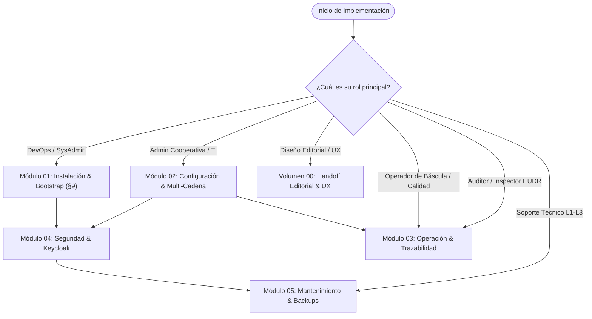

# Paquete de Manuales Técnicos Estandarizados INATrace
## Sistematización de la Experiencia Ecuador con Enfoque Regional y Global
### Proyecto GIZ · Fortalecimiento y Escalamiento de INATrace (ELKE / Sinergia SVNA – Iniciativa SASI)

---

## 🌍 Presentación y Propósito

Este paquete documental consolida la arquitectura técnica, guías de despliegue y protocolos operativos de la plataforma de trazabilidad **INATrace**, con base en las implementaciones en cadenas de valor de cacao fino de aroma (UNOCACE, Fortaleza del Valle) y acuicultura (Empacadora Dufer) en Ecuador.

El objetivo es proveer a cooperativas, instituciones públicas y equipos de desarrollo en América Latina y el Caribe manuales técnicos de nivel productivo, didácticos e ilustrados, orientados a la instalación autónoma, configuración multi-tenant, operación y mantenimiento de la plataforma **INATrace** de forma independiente del proveedor de nube y del rubro productivo.

Cada organización participante cuenta con una instancia dedicada e independiente bajo el principio de aislamiento institucional (ADR-007), articulando el núcleo monolítico para cadenas agrícolas (Cacao y Café) con extensiones desacopladas para cadenas especializadas como acuicultura (ADR-016).

```text
┌──────────────────────────────────────────────────────────────────────────────┐
│                    SUITE DE MANUALES TÉCNICOS INATRACE                       │
├──────────────┬──────────────────┬──────────────┬──────────────┬──────────────┤
│  Módulo 01   │    Módulo 02     │  Módulo 03   │  Módulo 04   │  Módulo 05   │
│ Instalación  │  Configuración   │  Operación   │  Seguridad   │Mantenimiento │
│ y Despliegue │  Multi-Cadena    │  y Procesos  │ e Identidad  │ y Resolución │
│ (Docker/Net) │ (Parametrizada)  │(Campo/Puerto)│(Keycloak/RB) │(Backups/Diag)│
└──────────────┴──────────────────┴──────────────┴──────────────┴──────────────┘
```

> [!NOTE]
> La suite técnica operativa se complementa con la guía marco [**`00-aprobacion-ux-ui-design-thinking-handoff-disenador.md`**](./00-aprobacion-ux-ui-design-thinking-handoff-disenador.md) (brief de diseño editorial y UX/UI con 13 láminas vectoriales) y la serie multimedia en [**`docs/audiovisual/`**](../audiovisual/README.md) (Cápsulas 01 a 05).

---

## 📚 Estructura Modular de los Manuales

La colección está conformada por cinco (5) manuales técnicos de implementación y operación, precedidos por un documento marco (00) de handoff editorial y diseño UX/UI:

| Volumen | Documento | Alcance y Contenido Central | Audiencia Destinataria |
|---|---|---|---|
| **00 (Marco)** | [`00-aprobacion-ux-ui-design-thinking-handoff-disenador.md`](./00-aprobacion-ux-ui-design-thinking-handoff-disenador.md) | **Dictamen UX/UI, Design Thinking y Guía de Handoff Editorial**: Arquetipos de usuario (*Personas*), paleta HEX/CMYK (WCAG AA/AAA e identidad Keycloak `inatrace`), sistema tipográfico, retícula A4, catálogo de 13 láminas vectoriales (`IL-01` a `IL-13`) y dirección de arte de video. | Diseñador Gráfico Editorial, Productor Multimedia, Especialista UX/UI y Coordinación GIZ. |
| **01** | [`01-manual-instalacion-despliegue.md`](./01-manual-instalacion-despliegue.md) | **Instalación y Despliegue de Infraestructura**: Requisitos de cómputo (ejecución y compilación `x86_64`), preparación OS/Docker/UFW, construcción desde rama `main`, Docker Compose, PostgreSQL 16, Keycloak 26 (tema visual `inatrace`, `inatrace-browser-flow` y `manage-users`), Spring Boot 3.3, Angular 19 (monorepo Nx), Nginx con TLS/redirección canónica y *bootstrap* inicial. | Administradores de Sistemas, Ingenieros DevOps, Desarrolladores de Infraestructura. |
| **02** | [`02-manual-configuracion-multitenant-multicadena.md`](./02-manual-configuracion-multitenant-multicadena.md) | **Configuración y Parametrización Multi-Tenant**: Aislamiento institucional (ADR-007), alta y activación de organizaciones, banderas `company.configuration`, adaptación a cadenas (Cacao en Baba/Seco, Café; alcance separado de Camarón bajo ADR-016), catálogos territoriales DPA/ISO, cupos anuales y unidades de medida (`PESOLIBRA`, quintales `qq`, `kg`). | Administradores de Plataforma, Líderes Técnicos de Cooperativas, Consultores de Implementación. |
| **03** | [`03-manual-operacion-trazabilidad.md`](./03-manual-operacion-trazabilidad.md) | **Operación Funcional y Trazabilidad**: Acopio en báscula física y API, control de cupos, protocolo de contingencia sin red, balance de masas en beneficio, impresión térmica POS (72 mm), trazabilidad pública QR y debida diligencia EUDR / TRACES-NT. | Operadores de Báscula, Jefes de Planta/Acopio, Oficiales de Trazabilidad y Certificación. |
| **04** | [`04-manual-seguridad-identidad-cumplimiento.md`](./04-manual-seguridad-identidad-cumplimiento.md) | **Seguridad, Identidad y Gobernanza de Datos**: Keycloak 26 OIDC/PKCE, matriz RBAC de los 7 roles reales, cuentas técnicas ERP, alcance real de privacidad en comprobante público, mitigación *rate-limit* en Nginx y hardening del servidor. | Oficiales de Seguridad de la Información (CISO), Administradores de Keycloak, Auditores. |
| **05** | [`05-manual-mantenimiento-migraciones-troubleshooting.md`](./05-manual-mantenimiento-migraciones-troubleshooting.md) | **Mantenimiento, Migraciones y Resolución de Problemas**: Respaldos automatizados de PostgreSQL y archivos, recuperación ante desastres (Disaster Recovery), ciclo Flyway en `schema_version` (`ddl-auto = validate`) y matriz de 12 incidentes reales con solución verificada. | Equipos de Soporte Técnico (Mesa de Ayuda L1/L2/L3), Administradores de Base de Datos. |

---

## 🧪 Artefactos Verificados en Vivo (`verificado/`) y Evidencia de Despliegue

Todos los manifiestos y recursos validados en instancia limpia Ubuntu 24.04 (`main`) se agrupan en [`docs/manuales/verificado/`](./verificado/README.md):

- **Orquestación y Proxy Inverso:** [`docker-compose.verificado.yml`](./verificado/docker-compose.verificado.yml), [`nginx-inatrace.verificado.conf`](./verificado/nginx-inatrace.verificado.conf) (con redirección canónica `$host != $server_name`) y [`nginx-http-limit_req_zone.conf`](./verificado/nginx-http-limit_req_zone.conf).
- **Bootstrap y Tema Visual OIDC:** [`primer-admin.sql`](./verificado/primer-admin.sql) y la plantilla oficial de Keycloak 26 [`keycloak-theme/inatrace/`](./verificado/keycloak-theme/inatrace/login/theme.properties).
- **Evidencia Empírica de Despliegue:** [`informe-prueba-gcp-vm-limpia-2026-11-16.md`](../informe-prueba-gcp-vm-limpia-2026-11-16.md).

---

## 🎯 Principios Pedagógicos y Metodológicos

1. **Independencia de Infraestructura y Estándares Abiertos:**
   La guía prioriza el uso de formatos y estándares abiertos ([OGC GeoJSON](https://geojson.org/), [JSON-LD](https://json-ld.org/), especificaciones de [AgStack / Linux Foundation](https://agstack.org/) y licencia MPL-2.0), articulados con contratos de dominio estructurados (*Open Knowledge Format* - OKF). La solución no requiere servicios propietarios de proveedores de nube específicos.

2. **Diagramación y Apoyo Visual:**
   Cada manual incorpora diagramas en lenguaje `mermaid`, esquemas de arquitectura en bloques de texto, tablas paramétricas comparativas y capturas conceptuales del flujo de trabajo, facilitando la comprensión tanto a perfiles informáticos como a personal agroindustrial.

3. **Parámetros Derivados de Operación en Campo:**
   Las configuraciones y flujos documentados se basan en especificaciones y reglas operativas observadas en campo en Ecuador (consecutivos de báscula física, tickets térmicos en rollos de 72 mm sin drivers privativos, polígonos satelitales WGS84 para exportación a la Unión Europea y parametrización fiscal SRI).

4. **Pertinencia Territorial y Enfoque Inclusivo:**
   En cumplimiento de los estándares de la Cooperación Alemana (GIZ), la documentación fomenta el uso de un lenguaje técnico respetuoso, inclusivo y accesible para personal técnico de diversas procedencias culturales, e incorpora perfiles de operadoras de báscula, productoras y administradoras de centros de acopio en los casos de uso.

---

## 🧭 Mapa de Navegación según el Rol Operativo



---

## 🌐 Glosario Internacional de Siglas y Estándares

Para facilitar la adopción fuera de Ecuador, la siguiente tabla resume los acrónimos institucionales, normativos y técnicos empleados en esta suite:

| Sigla / Término | Significado y Equivalencia Regional / Global |
|---|---|
| **GIZ / ELKE / SVNA / SASI** | Cooperación Técnica Alemana (*Deutsche Gesellschaft für Internationale Zusammenarbeit*), proyecto **ELKE**, programa global **SVNA** (*Sustainability and Value Added in Agricultural Supply Chains*) e iniciativa regional **SASI** (*Smart Agri-Food Supply Chains Initiative* en América Latina y el Caribe). |
| **AgStack** | Proyecto de infraestructura agrícola abierta alojado en la **Linux Foundation**, impulsor original de INATrace y del registro de identificadores geográficos (`GeoID`). |
| **MPL-2.0** | *Mozilla Public License 2.0*: licencia de código abierto oficial de los repositorios `Atijaguar-ec/backend` y `Atijaguar-ec/fe`. Permite uso comercial, despliegue autónomo y derivación, exigiendo mantener publicados bajo la misma licencia los cambios sobre los archivos fuente cubiertos. |
| **OKF** | *Open Knowledge Format*: especificación interna de contratos de datos y balance de masas diseñada en el ecosistema para cadenas especializadas como acuicultura (camarón). |
| **EUDR** | *European Union Deforestation Regulation* (Reglamento UE 2023/1115): normativa europea que prohíbe importar materias primas (cacao, café, entre otras) procedentes de tierras deforestadas después del **31 de diciembre de 2020**. |
| **TRACES-NT / DDS** | *Trade Control and Expert System – New Technology* de la Dirección General de Salud y Seguridad Alimentaria (DG SANTE) de la Comisión Europea, donde los operadores presentan la Declaración de Debida Diligencia (**DDS**) en formato **JSON-LD** / GeoJSON WGS84. |
| **OIDC / PKCE** | *OpenID Connect* con *Proof Key for Code Exchange* (RFC 7636): estándar de autenticación delegada utilizado entre el cliente Angular y Keycloak 26 sin exponer secretos en el navegador. |
| **DPA INEC / ISO 3166-2** | División Político-Administrativa de 6 dígitos del Instituto Nacional de Estadística y Censos de Ecuador (ej. `130150`). En despliegues fuera de Ecuador se sustituye por el catálogo territorial equivalente del país y los códigos internacionales **ISO 3166-2** (ej. `HN-FM`). |
| **SRI / Agrocalidad GUIA** | Servicio de Rentas Internas (autoridad tributaria y facturación electrónica de Ecuador) y sistema GUIA de la Agencia de Regulación y Control Fito y Zoosanitario. En otros países equivalen a la autoridad fiscal nacional y a la autoridad sanitaria/fitosanitaria de exportación. |
| **LOPDP / GDPR** | Ley Orgánica de Protección de Datos Personales de Ecuador y Reglamento General de Protección de Datos de la Unión Europea. |

---

## ⚠️ Convenciones y Alertas Didácticas Utilizadas

A lo largo de los manuales se utilizan bloques de alerta estándar de GitHub Flavored Markdown para guiar al implementador:

> [!NOTE]
> Contexto técnico, explicaciones de diseño o detalles de arquitectura necesarios para comprender el funcionamiento interno.

> [!TIP]
> Consejos de optimización de rendimiento, atajos de configuración, buenas prácticas operativas y ahorro de recursos computacionales.

> [!IMPORTANT]
> Requisitos indispensables, pasos críticos de ejecución o contratos normativos obligatorios (como el Reglamento EUDR 2023/1115 o claves fiscales SRI).

> [!WARNING]
> Puntos de atención donde una mala configuración puede generar inconsistencias de datos, bloqueos de inventario o fallos de arranque en los contenedores.

> [!CAUTION]
> Acciones de alto impacto sobre la base de datos o el sistema operativo que conllevan riesgo potencial de pérdida irreversible de datos si no se cuenta con respaldo previo.
